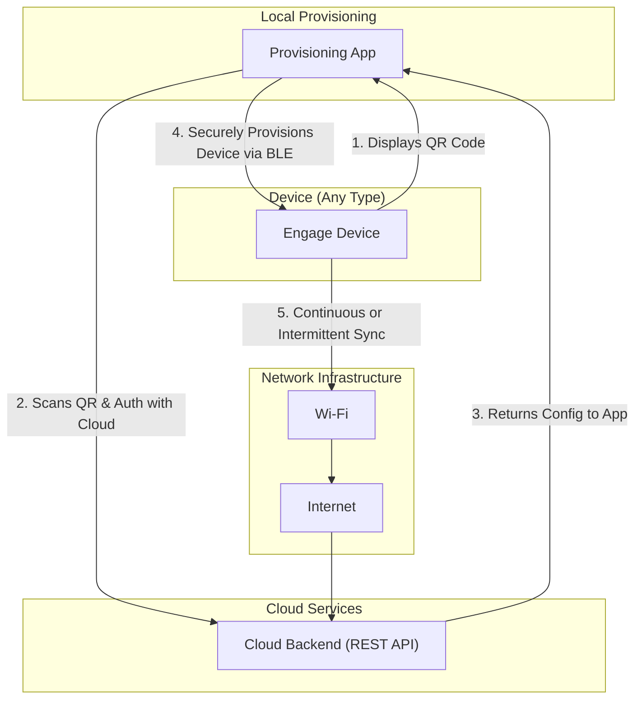
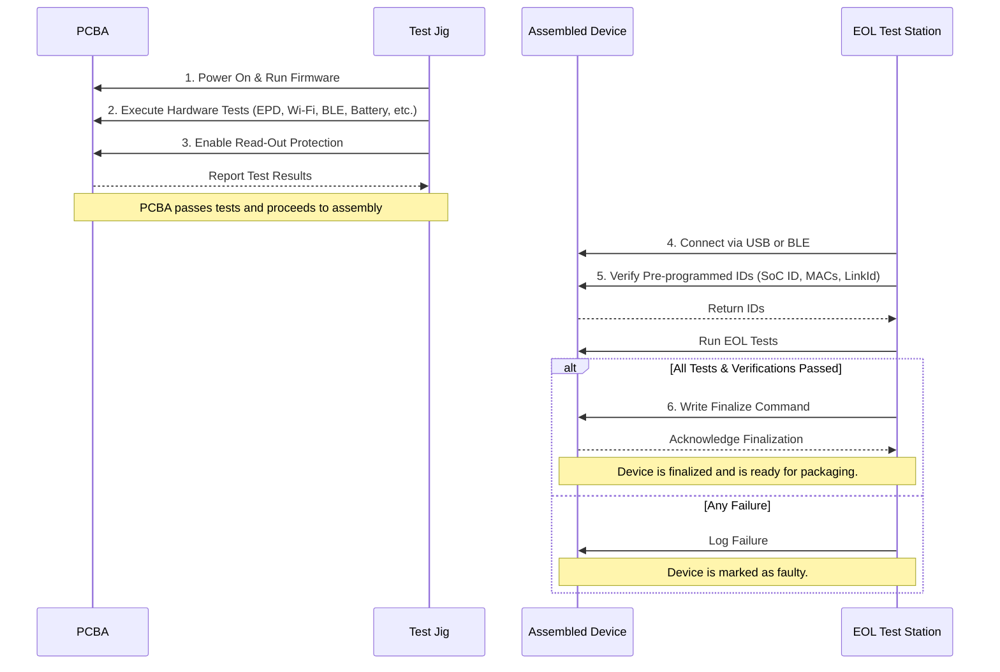
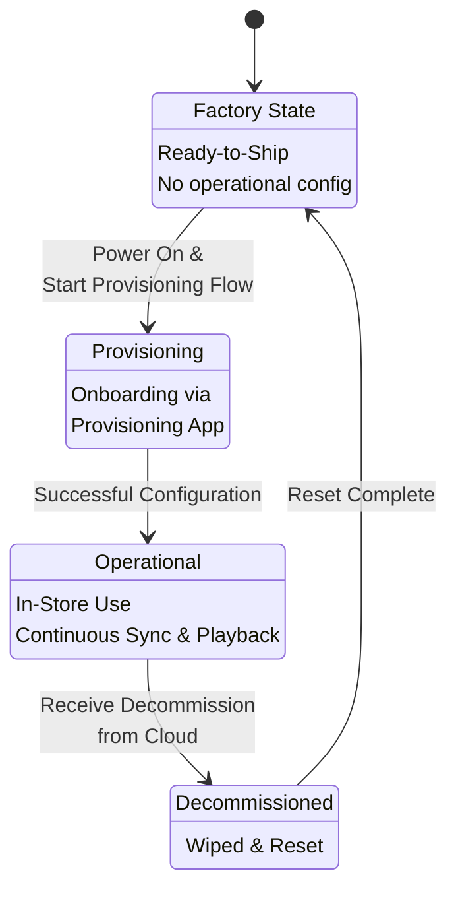
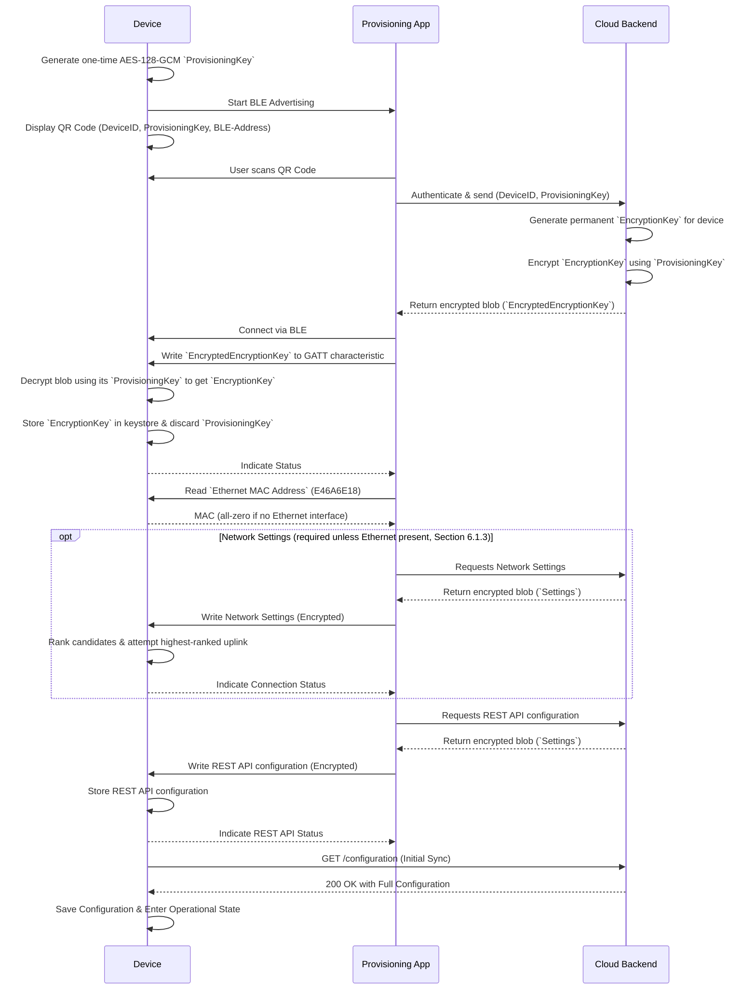
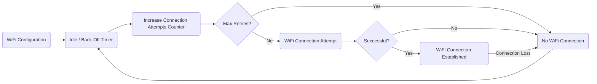
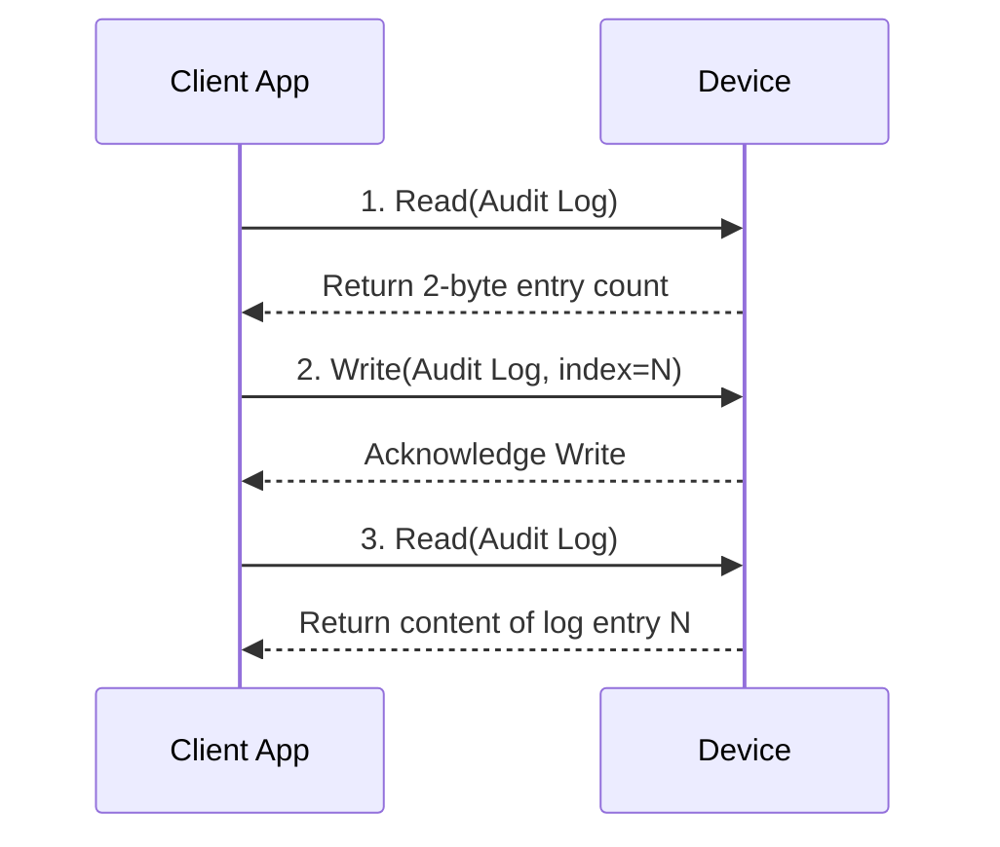
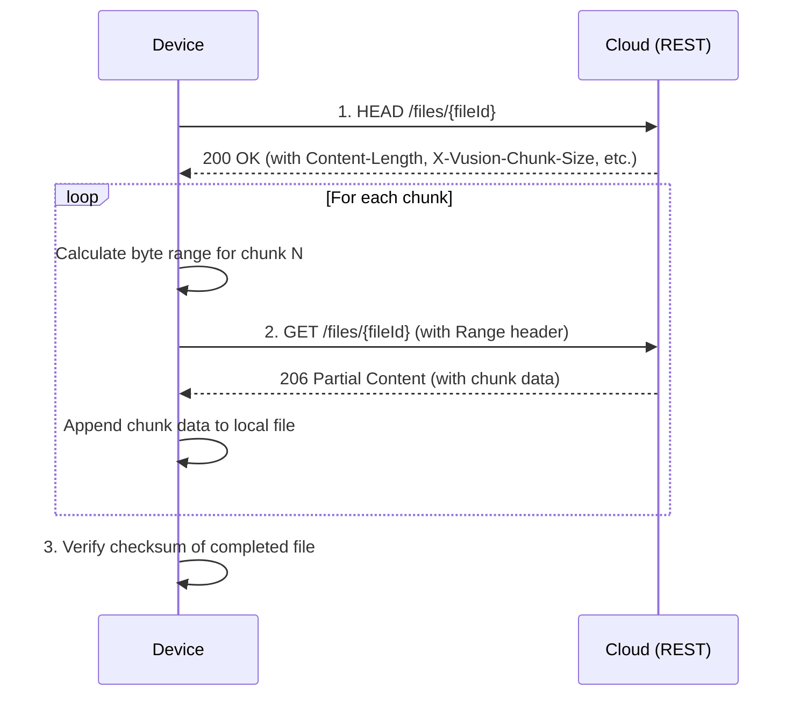
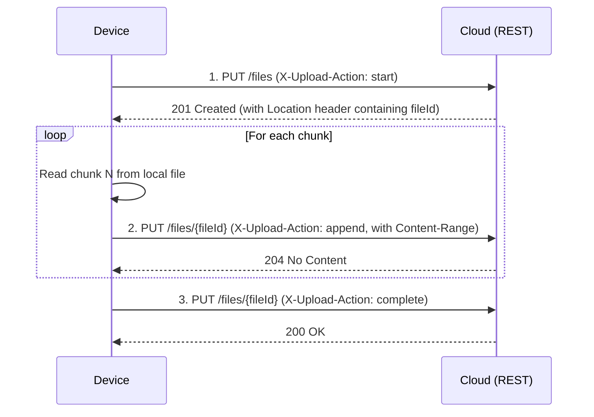
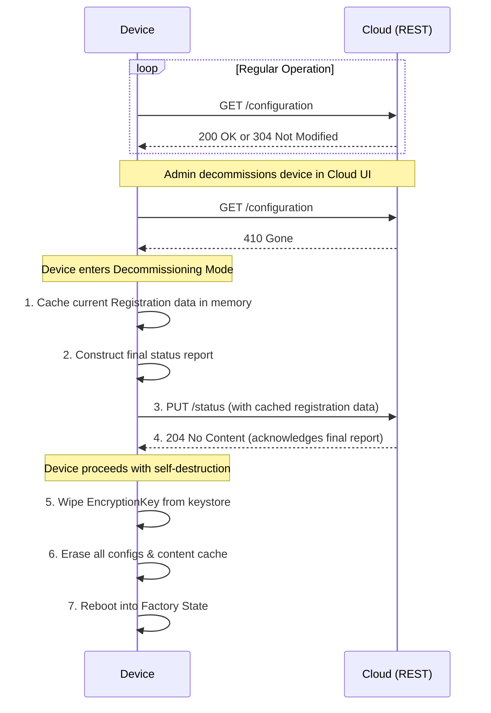
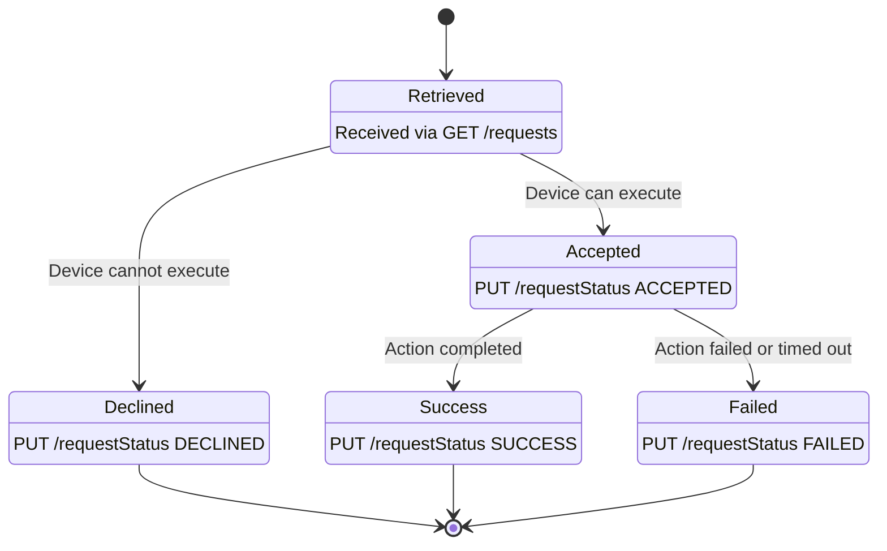

# Engage Device Requirements and Specification

**Version:** 1.15 <br> **Status:** Approved <br> **Date:** 2026-08-04

### Change Log

- **Version 1.15 (2026-08-04)**:

  - **Service Mode content playback suspension** (Section 9.3.2). A `live` device now **MUST** fully stop content playback (release the media pipeline, not pause) on entering Service Mode, resume from the beginning of the schedule loop on exit (Section 9.3.3), and emit `PlaybackStopped`/`PlaybackStarted` audit events. The asset interrupted by Service Mode **MUST NOT** produce a Proof-of-Play record and Service Mode time **MUST NOT** count as playback (Section 8.11.1). Entering Service Mode also **MUST** leave any active power-saving state, overriding the `PowerSaving.panelControl` schedule so the Service Mode display is visible (Section 9.3.2).
  - **Replaced the `WiFi` module with a `Network` module** (Section 7.2.2.3). Configuration now carries a ranked list of candidate connections (`networks[]`) spanning Ethernet and one or more Wi-Fi networks — expressing Ethernet only, Wi-Fi only, Ethernet + Wi-Fi, or multiple Wi-Fi — for both `live` and `eco` devices, configurable via cloud and via BLE. The old fixed `preferred`/`fallback` pair is superseded.
  - **Rewrote uplink selection** (Section 8.4.1) as automatic ranking over the candidate set: Ethernet before Wi-Fi, then Wi-Fi by configured array order, with signal strength only as a same-position tie-break. The former separate Wi-Fi logic (old Section 8.4.2) is folded in.
  - Renamed the BLE **WiFi Service** to **Network Service** (Section 6.3.2.2, UUIDs retained), widening its `Settings` payload to the `networks` list while still accepting a single legacy Wi-Fi object.
  - **Ethernet-based provisioning** (new Section 6.1.3). A `live` device with an RJ45 port **MAY** be provisioned entirely over Ethernet: it acquires DHCP during the provisioning phase and performs the initial cloud sync over the wired uplink, with the **Network Service** write carrying an Ethernet-only list or skipped (Section 6.1.1, step 9). Section 8.4.1's DHCP/reachability logic is reused during provisioning.
  - **Added network reporting for mobile apps** (issue #328): the `/status` `network` object now reports `ipAddress`, `macAddress`, and `ssid` (Section 7.3.3); the BLE **Device Information Service** exposes disambiguated `Wi-Fi MAC Address` / `Ethernet MAC Address` and a new `IP Address` characteristic (Section 6.3.3.1).
  - **Added `application/vusion.telemetry.network`** (Section 7.5.3.7): a consolidated, outage-surviving history of interface state, buffered locally and uploaded on reconnect so network outages — invisible to real-time `/status` — become observable after the fact.
  - Clarified that the `REBOOT_DEVICE` device request (Section 7.7.4) is the mechanism for operator-initiated remote reboot of hard-to-reach devices, noting the reboot latency is bounded by `heartbeatInterval`.
  - **Introduced the display-less Engage DS Player (FluxPlayer)** as a `live`-class device (Sections 2.1, 2.4). Added HDMI output requirements (new Section 2.4.2): 16:9 mode ladder up to 4Kp60 (`2160p`/`1080p`/`720p`), EDID-based negotiation of the highest mutually-supported mode with hotplug re-negotiation, and a `1080p60` safe-baseline fallback — addressing the blank screen on sub-4K displays (issue #330).
  - Added a carve-out to the no-scaling rule (Section 7.2.2.5): a display-less device **MUST** scale the composited frame to its negotiated HDMI resolution (aspect-preserving, as all modes are 16:9). Integrated-panel devices are unchanged.
  - Defined display-less **power saving** (issue #329): `dimmingLevel 0` disables the HDMI output (signal and video decoding stopped), `≥ 1` re-enables it (Sections 7.2.2.7, 8.3). Generalized Proof-of-Play so that **no** record is generated while the display output is off due to power saving, on any `live` device (Section 8.11.1).
  - Clarified that **audio is not supported**: any audio track in a video asset **MUST** be ignored — not decoded, not emitted on any output (speaker or HDMI) — on all `live` devices (Section 8.2.1).
  - Required a connected, powered, supported display for provisioning and Service Mode on display-less devices (new Section 2.4.3, cross-referenced from 6.1.1 and 9.7), with HDMI connection state reported in `/status` (`display` object, Section 7.3.3) and as telemetry events (Section 7.5.3.2).
  - Made Wi-Fi optionality during Ethernet provisioning determinable by the app (Section 6.1.3): the Provisioning App reads the `Ethernet MAC Address` characteristic (all-zero = no Ethernet, so Wi-Fi is required; non-zero = the app may offer to skip Wi-Fi), added as an explicit step in the provisioning sequence diagram (Section 6.1.1).
  - Added `dimmingLevel` to Proof-of-Play records and specified that a change in the effective dimming level splits an asset's play into separate records, each reflecting a single level (Sections 8.11.1, 7.5.3.6); bumped the `proofofplay` schema version from `"1.0"` to `"1.1"`.
  - Made the `Content-Type` header **mandatory** on `/configuration`, `/status`, `/requests` and `/requestStatus` requests and responses that carry a body, documented as a header table in the **Payload Encryption** section (Section 7.1.3); the value **MUST** be `application/vusion.device.encrypted+cbor`.
  - Added a `Link Id Hex` characteristic (`E46A6E20`) to the BLE **Device Information Service** (Section 6.3.3.1), exposing the optional hexadecimal (binary) form of the manufacturing `LinkId` (Section 4.1.1) alongside the existing string-form `Link Id`.
  - Added **GATT Compatibility Across Specification Versions** (new Section 6.2.3): UUIDs are append-only and immutable; clients must discover characteristics and degrade gracefully when an expected one is absent (older device), ignore unrecognised ones (newer device), and distinguish an absent characteristic from one present with a sentinel (all-zero / empty) value.
  - Bumped the `Configuration` payload schema version from `"2.6"` to `"2.7"` (new `Network` module) and the `Status` payload schema version from `"2.2"` to `"2.3"` (network `ipAddress`/`macAddress`/`ssid`, and the display-less `display` object).

- **Version 1.14 (2026-07-21)**:

  - Corrected the content of the large QR code in the split-screen **Provisioning & Service Display** (Section 9.7). In Service Mode it now encodes the device's `LinkId`; it previously specified the `labelId` of "the content currently shown", which cannot be produced on a `live` device — the split-screen suspends playback, the on-screen `background` is identified by `asset.id` rather than a `labelId`, and one QR code cannot carry the per-label-per-panel mapping of Section 9.3.2.
  - Scoped the `labelId` QR code content of Section 9.3.2 explicitly to `eco` (EPD) devices, resolving the conflict with Section 9.7.
  - Defined the **Provisioning QR Payload Format** (Section 6.1.1). The three fields were previously listed without any encoding, leaving device and Provisioning App unable to interoperate. The format is now specified as `<DeviceID>;<BLE-Address>;<ProvisioningKey>`, documenting the encoding already shipped in the Engage LCD firmware.

- **Version 1.13 (2026-07-20)**:

  - **Removed the push notification mechanism.** The persistent WebSocket connection, the `push` object of the `Sync` module `live` object, and the entire **Push Notification Protocol** are deleted. Devices are now exclusively poll-driven.
  - Introduced the **Device Requests API** (Section 7.7): `GET /requests` delivers a queue of cloud-originated requests, polled as part of every sync cycle, replacing the push channel. `REBOOT_DEVICE` is the only defined request type; the `SYNC_CONFIGURATION`, `UPLOAD_STATUS`, and `UPLOAD_LOGS` push actions are **withdrawn without replacement**, removing the ability to trigger an out-of-band status report or log upload from the cloud.
  - Added an `enforced` flag to the `REBOOT_DEVICE` request. A non-enforced reboot **MAY** be declined by the device when rebooting would be disruptive; an enforced reboot **MUST** be accepted and executed regardless of local state.
  - Introduced `PUT /requestStatus` for two-phase request reporting: an acknowledgement (`ACCEPTED`/`DECLINED`) followed by an outcome (`SUCCESS`/`FAILED`), giving the Device Hub end-to-end traceability that the push channel could not provide.
  - Bumped the `Sync` module schema version from `"2.1"` to `"2.2"` (removal of the `push` object) and the `Configuration` payload schema version from `"2.5"` to `"2.6"`.
  - Added the `Requests` and `RequestStatus` payload schema version `"1.0"` and made `X-Schema-Version` mandatory on `/requests` and `/requestStatus` requests.

- **Version 1.12 (2026-07-14)**:

  - Removed the `mirrorAxis` field from the `Content` module. Secondary-panel mirroring for double-sided products is a fixed **product assembly profile** determined at manufacturing (Section 2.4.1); firmware applies it automatically and it is not configurable via the Device Hub.
  - Bumped the `Content` module schema version from `"2.0"` to `"2.1"`.
  - Redefined `BatteryHealth.warningIcon` `position` and `rotation` to be relative to the effective viewport produced by the active `Display.orientation`, not the panel's native orientation.
  - Bumped the `BatteryHealth` module schema version from `"1.0"` to `"1.1"`.
  - Bumped the `Configuration` payload schema version from `"2.4"` to `"2.5"`.

- **Version 1.11 (2026-06-29)**:

  - Extended **Beacon-Triggered Service Mode Activation** (Section 9.3.4) with **Common LinkIds** for broadcast targeting of device groups (`Y01Z-0002`/`0xF003F00002` all types, `Y01Z-0003`/`0xF003F00003` `live`, `Y01Z-0004`/`0xF003F00004` `eco`), matched additively with the device's own short `LinkId` under the existing 5-minute duration. Extended background beacon scanning to `eco` devices that support it.
  - Clarified that the manufacturing `LinkId` (Section 4.1.1) string form is mandatory and the hexadecimal form is an optional extension; at runtime the hex form is preferred and the string-to-short-LinkId conversion is used only as a fallback.
  - Added a fixed **five (5) minute overall timeout** to the initial provisioning workflow (Section 6.1.1); on expiry the device aborts, discards the in-memory `ProvisioningKey` and partial configuration, and returns to the Factory State.

- **Version 1.10 (2026-06-12)**:

  - Added device display orientation support (`0`/`90`/`180`/`270` degrees relative to the device's defined mounting position), configurable at provisioning and in service mode via BLE (new **Display Service**) and via the Device Hub (new `Display` configuration module), with the active orientation reported in the device status.
  - Added an audited remote reboot capability for Linux/Android (`live`) devices, triggered from the Device Hub via the `REBOOT_DEVICE` push action and recorded in the audit log.
  - Defined a split-screen provisioning/service display for `live` devices, combining a large QR code, a live log/state window, and a mounting/orientation attention banner.
  - Added automatic Ethernet networking with DHCP for onboarded `live` devices that have an RJ45 port, preferring Ethernet when the internet is reachable and falling back to Wi-Fi otherwise.
  - Bumped the `Configuration` payload schema version from `"2.3"` to `"2.4"` (new `Display` module) and the `Status` payload schema version from `"2.1"` to `"2.2"` (the `Display` module status now reports the active orientation in `configurationStatus`).

- **Version 1.9 (2026-06-12)**:

  - Changed the `X-Schema-Version` header from optional to **mandatory** on `/configuration` and `/status` requests. The device **MUST** declare the supported `Configuration` schema version (currently `"2.3"`) on `/configuration` and the `Status` schema version (currently `"2.1"`) on `/status`.
  - Bumped the `Configuration` payload schema version from `"2.2"` to `"2.3"`.
  - Bumped the `Sync` module schema version from `"2.0"` to `"2.1"` and renamed its `eco` fields `interval` → `intervalMin` and `randomizationWindow` → `randomizationWindowMin` to match the documented behavior and examples.
  - Documented the top-level `configurationId` field in the `/status` `configurationStatus` object and split the per-module `Status` object into its own schema definition.
  - Consistency and correction fixes: corrected the `Location` module `schemaVersion` to `"2.0"` and the `Status` payload examples to `schemaVersion "2.1"`; fixed the `live` mode heartbeat unit in the sequence diagram (minutes, not seconds); fixed the `recurrenceRule` spelling; clarified the `mirrorAxis` "Required" column.

- **Version 1.8 (2026-05-27)**:

  - Added a `mirrorAxis` field to the `Content` module to support content mirroring according the device's physical orientation.
  - Added a LED status pattern for the decommissioning process to provide visual feedback during factory reset.

- **Version 1.7 (2026-04-28)**:

  - Added optional `X-Schema-Version` header to REST API requirements.
  - Added alternative interaction mode using Simple Beacons for devices without an Activity Button.

- **Version 1.6 (2026-04-15)**:

  - Added generic fields (`utcOffset`, `dstOffset`, `dstStart`, `dstEnd`) to the `Location` module for local timezone definition, allowing embedded devices to function without a full locale database.

- **Version 1.5 (2025-12-09)**:

  - Fix heartbeatInterval description to reflect minutes instead of seconds

- **Version 1.4 (2025-11-11)**:

  - Enhanced status reporting for `Content` and `Firmware` modules to support structured `details` field for improved diagnostics.
  - Added Proof-of-Play (PoP) logic for both `live` and `eco` mode devices.
  - Added Battery Health module for `eco` mode devices.
  - Added Emergency Battery Level Warning feature.
  - Clarified Device ID derivation algorithm with corrected examples.

- **Version 1.3 (2025-10-28)**:

  - Updated EOL testing workflow for improved clarity and efficiency.
  - Added NFC interface requirements for data sharing.

- **Version 1.2 (2025-08-05)**:

  - Added TLS section and updated references.
  - Introduced Wi-Fi module configuration and connection logic.
  - Added BLE Simple Beacon support.
  - Incorporated Android-specific adoptions, including Secure Key Storage requirements.
  - General rewording and styling updates.

- **Version 1.1 (2025-07-11)**:

  - Initial release of the unified technical specification for Engage devices.

---

## 1. Introduction

This document establishes the technical specification for all VusionGroup **Engage** devices. It outlines the functional requirements and implementation guidelines necessary for software development, cloud integration and software quality assurance.

### 1.1 Purpose & Scope

This document covers the specification for the software and system development of all Engage devices:

- Mains-powered **LCD** devices
- Battery-powered **Electronic Paper Display (EPD)** devices
- **Android-based** systems

The document aims to provide one definitive truth with regard to technical and functional requirements, ensuring interoperability, security, and reliability in all current and future products.

The key objective of this specification is to abstract device-specific behaviors into configurable modules, allowing the cloud backend to manage a diverse fleet of hardware through a consistent and unified API. Adherence to this specification is mandatory.

### 1.2 System Architecture Overview

The Engage ecosystem is designed for robust, secure, and flexible operation for all device types. The provisioning process will be facilitated through the **Provisioning App**, that securely connects a device to the cloud backend.



### 1.3 Target Audience

This document is intended for the following technical audiences:

- **Embedded Software Engineers:** Responsible for developing, testing, and maintaining the device's operating system (Yocto, Android, RTOS) and application layer.
- **Cloud Developers:** Responsible for developing the backend services that interact with all device types.
- **Quality Assurance (QA) Engineers:** Responsible for creating test plans and verifying conformance across the product family.
- **System Architects:** Responsible for understanding the device's role within the broader system.

### 1.4 Definitions and Acronyms

| Term      | Definition                                                                                        |
| :-------- | :------------------------------------------------------------------------------------------------ |
| **AES**   | Advanced Encryption Standard; a symmetric block cipher standard. [FIPS PUB 197]                   |
| **APNG**  | Animated Portable Network Graphics.                                                               |
| **BLE**   | Bluetooth Low Energy; a wireless personal area network technology.                                |
| **CBOR**  | Concise Binary Object Representation; a binary data format.                                       |
| **FIPS**  | Federal Information Processing Standards.                                                         |
| **GATT**  | Generic Attribute Profile; defines the structure of services and characteristics over a BLE link. |
| **GCM**   | Galois/Counter Mode; a mode of operation for authenticated encryption. [NIST SP 800-38D]          |
| **HLS**   | HTTP Live Streaming; an adaptive bitrate streaming protocol. [RFC 8216]                           |
| **HTTPS** | Hypertext Transfer Protocol Secure.                                                               |
| **IETF**  | Internet Engineering Task Force.                                                                  |
| **JSON**  | JavaScript Object Notation.                                                                       |
| **LCD**   | Liquid Crystal Display.                                                                           |
| **MAC**   | Medium Access Control.                                                                            |
| **NIST**  | National Institute of Standards and Technology.                                                   |
| **OS**    | Operating System.                                                                                 |
| **PSK**   | Pre-Shared Key.                                                                                   |
| **RFC**   | Request for Comments.                                                                             |
| **SHA**   | Secure Hash Algorithm. [FIPS PUB 180-4]                                                           |
| **SoC**   | System-on-Chip.                                                                                   |
| **SSID**  | Service Set Identifier (for a Wi-Fi network).                                                     |
| **TEE**   | Trusted Execution Environment.                                                                    |
| **TLS**   | Transport Layer Security; a cryptographic protocol for secure communication. [RFC 8446]           |
| **TPM**   | Trusted Platform Module.                                                                          |
| **UUID**  | Universally Unique Identifier. [RFC 9562]                                                         |
| **UTC**   | Coordinated Universal Time.                                                                       |


## 2. Baseline Hardware and Software Architecture

This chapter defines the architectural baselines for the VusionGroup Engage device family. To accommodate a diverse range of products, this specification defines two primary architectural classes: **`live` mode devices** and **`eco` mode devices**. The hardware and software stack of any Engage device **MUST** conform to the requirements of its designated class.

### 2.1 Architectural Class Definitions

| Class                  | Intended `Sync` Mode | Typical Device Types                         | Core Principle                                                                             |
| :--------------------- | :------------------- | :------------------------------------------- | :----------------------------------------------------------------------------------------- |
| **`live` mode device** | `live`               | Engage LCD, Engage Android, Engage DS Player | Performance and real-time responsiveness are prioritized. Assumes a constant power source. |
| **`eco` mode device**  | `eco`                | Engage EPD                                   | Power conservation and long battery life are the primary design drivers.                   |

- **Display-less devices:** The **Engage DS Player** (product name "FluxPlayer") is a `live`-class device that has **no integrated display**. Instead of an on-board panel it drives an external screen through an **HDMI output** (see **Section 2.4.2**). Except where this specification calls out display-less behavior explicitly, the DS Player follows all `live` mode requirements.

### 2.2 System-on-Chip (SoC)

- **Requirement:** The SoC **MUST** provide the necessary performance, security features, and I/O capabilities for its architectural class. A hardware-backed keystore (e.g., TEE, TrustZone, Secure Element) **MUST** be present on all classes.

| Class                  | SoC Type Requirement                                                                                                                       |
| :--------------------- | :----------------------------------------------------------------------------------------------------------------------------------------- |
| **`live` mode device** | Multi-core ARM Cortex-A series application processor with hardware-accelerated graphics (OpenGL ES 3.1+) and video decoding (H.264/H.265). |
| **`eco` mode device**  | Ultra-low-power MCU with efficient deep sleep modes and a minimal active power draw.                                                       |

### 2.3 Operating System (OS)

- **Requirement:** The OS **MUST** be appropriate for the device's hardware capabilities and intended function.

| Class                  | OS Requirement                                                                                                                                                                                               |
| :--------------------- | :----------------------------------------------------------------------------------------------------------------------------------------------------------------------------------------------------------- |
| **`live` mode device** | A full-featured operating system with a modern networking and multimedia stack:                                                                                                                              |
|                        | - **Linux-based OS:** The OS **MUST** be based on Yocto Project distribution, with support for systemd and a modern kernel (5.10+).                                                                          |
|                        | - **Android-based OS:** The OS **MUST** be based on Android 14 or later, with support for Google Play Services and **SHALL** achieve **Google EDLA (Enterprise Devices Licensing Agreement) certification**. |
| **`eco` mode device**  | A lightweight Real-Time Operating System (RTOS) optimized for low-power operation and fast wake-up times (e.g., Zephyr, FreeRTOS).                                                                           |

### 2.4 Display Technology

- **Requirement:** The display technology **MUST** align with the device's power source and primary use case.

| Class                  | Display Technology Requirement                                                                                                |
| :--------------------- | :---------------------------------------------------------------------------------------------------------------------------- |
| **`live` mode device** | Active-Matrix Liquid Crystal Display (AMLCD) with LED backlight, capable of 60Hz refresh rates for dynamic and video content. |
| **`eco` mode device**  | Bi-stable Electronic Paper Display (EPD) optimized for static content and zero power consumption when idle.                   |

- **Display-less `live` devices** (Engage DS Player) have no integrated panel and instead present content on an external screen via an **HDMI output**, as specified in **Section 2.4.2**. The requirements in this section that refer to an integrated panel or backlight do not apply to them.

#### 2.4.1 Product Assembly Profile (Multi-Panel Devices)

- **Requirement:** Double-sided Engage products are assembled as a fixed physical stack: rear panel, frame, mainboard, and front panel, bonded in a defined factory layout. The relative orientation of each display panel to the mainboard is therefore **determined at manufacturing**, not at installation or via cloud configuration.
- **Firmware Responsibility:** Device firmware **MUST** know the finished product's assembly profile (e.g., from the device-type prefix programmed during EOL, factory-programmed product data, and/or detected panel topology). For double-sided products operating in `Content` mirror mode (**Section 7.2.2.5**), firmware **MUST** automatically apply the product-defined assembly transform to every secondary panel (`panelId` other than `0`) on the final composited frame before the global `Display.orientation` transform is applied.
- **Single-Panel Products:** Devices with only one display panel **MUST NOT** apply any assembly transform.
- **Not Cloud-Configurable:** The assembly transform axis (e.g., vertical flip, horizontal flip, or both) is a firmware-internal constant tied to the product SKU. It **MUST NOT** be exposed as a field in any cloud configuration module.

#### 2.4.2 HDMI Output (Display-less Devices)

Display-less `live` devices (Engage DS Player) present all content — operational playback, and the provisioning/Service Mode UI — on an external screen connected to their **HDMI output**.

- **Supported Output Modes:** The device **MUST** support **16:9** output modes up to **4Kp60**. The supported mode ladder is, from highest to lowest:

  | Mode    | Resolution  | Refresh rates |
  | :------ | :---------- | :------------ |
  | `2160p` | 3840 × 2160 | 60 / 50 Hz    |
  | `1080p` | 1920 × 1080 | 60 / 50 Hz    |
  | `720p`  | 1280 × 720  | 60 / 50 Hz    |

- **EDID Negotiation:** On boot, and on every **hotplug (HPD)** event, the device **MUST** read the connected sink's **EDID** and select the **highest mode from the ladder above that the sink also supports**. The device **MUST NOT** assume a fixed mode (e.g. 2160p); doing so leaves lower-resolution sinks with a blank screen.

- **No Common Mode:** If the sink advertises no supported 16:9 mode from the ladder, the device **MUST** fall back to **1080p60** as a safe baseline, and report the condition as a display fault (**Section 2.4.3**).

- **Content Scaling (carve-out from Section 7.2.2.5):** Because the negotiated output resolution depends on the attached sink and is not known at authoring time, a display-less device **MUST** scale rendered content to the active output resolution. As every supported mode is 16:9, this scaling preserves aspect ratio and introduces no distortion. This is the sole exception to the no-scaling rule of **Section 7.2.2.5**, which continues to apply unchanged to integrated-panel devices.

- **Audio:** Audio is **not supported**. The HDMI output **MUST NOT** emit an audio stream, and any audio track present in a video asset **MUST** be ignored, as defined generally in **Section 8.2.1**.

#### 2.4.3 Display Connection Requirements (Display-less Devices)

- **Setup Requires a Display:** **Provisioning** (**Chapter 6**) and **Service Mode** (**Section 9.3**) present on-screen UI (QR code, split-screen service display) that a display-less device can only show over HDMI. A display-less device therefore **MUST** have a **connected, powered, and supported** display for these workflows; without one, the installer cannot complete provisioning or read the Service Mode display.

- **Reporting:** Display connection problems — no sink connected, sink powered off (HPD low), or a sink with no supported 16:9 mode — **MUST** be reported both in the device status (`display` object, **Section 7.3.3**) and as telemetry events (**Section 7.5.3.2**), so that a device that cannot present its UI is still observable from the cloud.

### 2.5 Local Storage

- **Requirement:** The device **MUST** include sufficient non-volatile storage for its OS, application, and content caching needs. All devices **MUST** support encryption for sensitive configuration data stored locally.

| Class                  | Storage Requirement                                           |
| :--------------------- | :------------------------------------------------------------ |
| **`live` mode device** | High-speed eMMC or UFS. Minimum capacity: **8 GB**.           |
| **`eco` mode device**  | On-chip or external flash memory. Minimum capacity: **4 MB**. |

### 2.6 Communication

- **Requirement:** All devices **MUST** support robust and secure wireless communication.

| Interface     | Requirement                                                                                                                                                                                                                           |
| :------------ | :------------------------------------------------------------------------------------------------------------------------------------------------------------------------------------------------------------------------------------ |
| **Wi-Fi**     | Dual-Band (2.4/5 GHz) Wi-Fi 5 (802.11ac) or later **MUST** be supported on all devices.                                                                                                                                               |
| **Bluetooth** | **Bluetooth Low Energy (BLE) 5.0** or later **MUST** be supported on all devices for provisioning and service mode interaction.                                                                                                       |
| **Ethernet**  | An RJ45 Ethernet port **MAY** be included for `live` mode devices. It **MUST NOT** be included for `eco` mode devices. When present, it is used as the preferred uplink with automatic Wi-Fi fallback, as defined in **Section 8.4**. |

### 2.7 Power Subsystem

- **Requirement:** The power source and management strategy **MUST** align with the device's operational mode.

| Class                  | Power Subsystem Requirement                                                                                                                                                                                                                                                                                              |
| :--------------------- | :----------------------------------------------------------------------------------------------------------------------------------------------------------------------------------------------------------------------------------------------------------------------------------------------------------------------- |
| **`live` mode device** | **Mains-powered**, typically via a USB-C connector supporting Power Delivery (PD). The firmware **MUST** implement thermal management logic to handle heat dissipation from continuous operation.                                                                                                                        |
| **`eco` mode device**  | **Battery-powered**, using long-life primary cells or a rechargeable battery system. The firmware **MUST** implement aggressive power management with deep sleep states to maximize battery life. The final design **SHALL** achieve a minimum operational lifetime of **5 years** based on the following usage profile: |
|                        | - One (1) cloud synchronization (`GET /configuration` and `PUT /status`) every 24 hours.                                                                                                                                                                                                                                 |
|                        | - One (1) full-screen EPD update every 72 hours.                                                                                                                                                                                                                                                                         |

### 2.8 Compliance & Regulatory Requirements

- **Requirement:** All devices **MUST** be certified to comply with all relevant standards for the regions in which it will be sold. The supplier is responsible for obtaining and maintaining these certificates. This includes, but is not limited to:

| Region  | Certification | Standard / Directive                 |
| :------ | :------------ | :----------------------------------- |
| **USA** | **FCC**       | **FCC Part 15, Subpart B & C**.      |
| **EU**  | **CE**        | **Radio Equipment Directive (RED)**. |

### 2.9 Environmental and Physical Specifications

All Engage devices **MUST** be designed to operate reliably within the environmental conditions specified in this section. The engineering partner **SHALL** provide test reports confirming compliance with these requirements.

#### 2.9.1 Ingress Protection

- **Requirement:** All devices **MUST** achieve a minimum of **IP53** rating as defined in the IEC 60529 standard.

#### 2.9.2 Operating and Storage Conditions

- **Requirement:** The device **MUST** operate and be stored safely within the following environmental conditions:

| Class / Condition      | Parameter             | Value          | Unit |
| :--------------------- | :-------------------- | :------------- | :--- |
| **`eco` mode device**  | Operating Temperature | +5 to +35      | °C   |
|                        | Storage Temperature   | -25 to +60     | °C   |
|                        | Operating Humidity    | Non-condensing | %    |
|                        | Storage Humidity      | Non-condensing | %    |
| **`live` mode device** | Operating Temperature | 0 to +40       | °C   |
|                        | Storage Temperature   | -20 to +60     | °C   |
|                        | Operating Humidity    | Non-condensing | %    |
|                        | Storage Humidity      | Non-condensing | %    |


## 3. Device Identity & Security

This chapter details the core security principles of the device. It covers how the device establishes a unique and trusted identity, the cryptographic mechanisms used to protect data, and the requirements for protecting all secrets by a hardware-backed keystore.

### 3.1 Device ID Derivation Algorithm

**Requirement:** The device **MUST** autonomously generate and permanently store a globally unique, deterministic identifier when entering EOL mode. The generation process itself **MUST NOT** require network connectivity, and the Device ID **MUST** be generated on the device, not pre-programmed as a whole.

**Specification:** The Device ID **SHALL** be derived on the device using a combination of unique hardware identifiers and cryptographic hashing.

#### **Algorithm**

The Device ID **SHALL** be generated using the following steps:

1. **Prefix:** A device-type specific prefix **SHALL** be used (e.g., `"en-1ds65os-"`).

2. **Data Collection:** The device's startup scripts **SHALL** gather the following identifiers, which are guaranteed to be present on the device after it leaves the factory EOL process:

   - **SoC ID:** A unique serial number programmed into a secure, non-volatile memory location during manufacturing. The value is treated as the $soc\_id$.
   - **BLE MAC Address:** The 6-byte MAC address of the Bluetooth LE controller.

3. **Data Preparation:**

   - The SoC Unique ID string **SHALL** be converted into a byte array using UTF-8 encoding ($soc\_id\\_{bytes}$).
   - The 6-byte BLE MAC address **SHALL** be converted into a 6-byte array ($ble\_mac\\_{bytes}$).

4. **Concatenation:** A new byte array, $input\\_{combined}$, **SHALL** be created by concatenating $soc\_id\\_{bytes}$ and $ble\_mac\\_{bytes}$ in that specific order.

   - $input\\_{combined} = soc\_id\\_{bytes} + ble\_mac\\_{bytes}$

5. **Hashing:**

   - The **SHA-256** hash of $input\\_{combined}$ **SHALL** be calculated.
   - The first **16 bytes** (128 bits) of the resulting 32-byte hash **SHALL** be taken. This 16-byte value is denoted as $U\\_{base}$.

6. **UUIDv4 Formatting:** To ensure compliance with **RFC 9562**, specific bits of $U\\_{base}$ **SHALL** be set to fixed value.

   - **Byte 6 (Version):** The 4 most significant bits of byte 6 (0-indexed) **SHALL** be set to `0100` (binary for version 4).
     - $U\\_{base}[6] = (U\\_{base}[6] \\land \\mathrm{0x0F}) \\lor \\mathrm{0x40}$
   - **Byte 8 (Variant):** The 2 most significant bits of byte 8 (0-indexed) **SHALL** be set to `10` (binary for the RFC 9562 variant).
     - $U\\_{base}[8] = (U\\_{base}[8] \\land \\mathrm{0x3F}) \\lor \\mathrm{0x80}$

7. **Hexadecimal Representation:** The resulting 16-byte value **SHALL** be converted to a 32-character lowercase hexadecimal string, with hyphens inserted in the custom format: `xxxxxxxxxxxx4xxx-yxxxxxxxxxxxxxxx`.

8. **Final Concatenation:** The final Device ID **SHALL** be formed by concatenating the prefix and the formatted UUID string.

   - $device\_id = prefix + uuid\_string$

#### **Example**

- `prefix = "en-1ds65os-"`
- `soc_id = "0123456789abcdef"`
- `ble_mac = "80:1F:12:AB:CD:EF"`

1. **Data Preparation:**

   - $soc\_id\\_{bytes}$ (UTF-8) is a 16-byte array: `[0x30, 0x31, 0x32, ..., 0x66]`
   - $ble\_mac\\_{bytes}$ is a 6-byte array: `[0x80, 0x1F, 0x12, 0xAB, 0xCD, 0xEF]`

2. **Concatenation:** The two byte arrays are combined into a single 22-byte array.

3. **Hashing:**

   - The SHA-256 hash of the 22-byte array is calculated: `9b6c7dbfc7c3a0792bab1549f0aa4cc9ede2b3541885c0a53f76e42db71be020`
   - The first 16 bytes are taken for $U\\_{base}$: `9b6c7dbfc7c3a0792bab1549f0aa4cc9`

4. **UUIDv4 Formatting:**

   - **Byte 6 (Version):** The original byte at index 6 is `0xA0` (binary `10100000`). The version bits (most significant 4) must be set to `0100`.

     - $(U\\_{base}[6] \\land \\mathrm{0x0F}) \\lor \\mathrm{0x40}$ -> $(\\mathrm{0xA0} \\land \\mathrm{0x0F}) \\lor \\mathrm{0x40}$ -> $\\mathrm{0x00} \\lor \\mathrm{0x40}$ -> $\\mathrm{0x40}$
     - The new byte 6 is **`0x40`**.

   - **Byte 8 (Variant):** The original byte at index 8 is `0x2B` (binary `00101011`). The variant bits (most significant 2) must be set to `10`.

     - $(U\\_{base}[8] \\land \\mathrm{0x3F}) \\lor \\mathrm{0x80}$ -> $(\\mathrm{0x2B} \\land \\mathrm{0x3F}) \\lor \\mathrm{0x80}$ -> $\\mathrm{0x2B} \\lor \\mathrm{0x80}$ -> $\\mathrm{0xAB}$
     - The new byte 8 is **`0xAB`**, which now conforms to the variant rule after this transformation.

   - The formatted 16-byte value becomes: `9b6c7dbfc7c34079abab1549f0aa4cc9`

5. **Hexadecimal Representation:** The custom hyphen format is applied to create the final UUID string:

   - `9b6c7dbfc7c34079-abab1549f0aa4cc9`

6. **Final Concatenation:**

   - `device_id = "en-1ds65os-9b6c7dbfc7c34079-abab1549f0aa4cc9"`

#### **Example Implementation**

```python
def generate_device_id(prefix: str, soc_id: str, ble_mac: str) -> str:
    """
    Calculates a deterministic, unique Device ID based on hardware identifiers.

    Args:
        prefix: The device-type specific prefix (e.g., "en-1ds65os-").
        soc_id: The unique SoC serial number as a string.
        ble_mac: The BLE MAC address as a string in "XX:XX:XX:XX:XX:XX" format.

    Returns:
        The final, formatted Device ID string.
    """
    soc_id_bytes = soc_id.encode('utf-8')
    ble_mac_bytes = bytes.fromhex(ble_mac.replace(':', ''))
    input_combined = soc_id_bytes + ble_mac_bytes
    sha256_hash = hashlib.sha256(input_combined).digest()
    u_base = bytearray(sha256_hash[:16])
    u_base[6] = (u_base[6] & 0x0F) | 0x40
    u_base[8] = (u_base[8] & 0x3F) | 0x80
    hex_string = u_base.hex()
    uuid_string = f"{hex_string[:16]}-{hex_string[16:]}"
    device_id = prefix + uuid_string
    return device_id
```

#### **Rationale**

- **Self-Contained:** After leaving the factory, the device can generate its ID using only locally available information without requiring network access.
- **Uniqueness:** The combination of a unique SoC ID and a unique BLE MAC address provides a strong foundation for a globally unique ID. The use of SHA-256 ensures that this uniqueness is preserved in the final identifier, making collisions extremely unlikely.
- **UUIDv4 Compatibility:** The generated ID (without the prefix) is a valid UUIDv4, a widely used standard that ensures compatibility with many platforms and tools.
- **Deterministic:** Given the same SoC ID and BLE MAC address, the same Device ID will always be generated.

### 3.2 BLE Advertisement Name

- **Requirement:** During BLE advertising (in both Provisioning and Service modes), the device **MUST** advertise a short, locally-unique name to allow for easy identification by the **Provisioning App**.

- **Constraint:** The advertisement name **MUST NOT** exceed a total length of 8 characters.

- **Derivation Algorithm:** The name **SHALL** be constructed as follows:

  1. **Prefix:** A static, 2-character prefix: `"VG"`.
  2. **Identifier:** The last 6 characters (3 bytes) of the device's unique BLE MAC address, formatted as an uppercase hexadecimal string.
  3. **Concatenation:** The final name is the concatenation of the prefix and the identifier.

- **Example:** For a device with BLE MAC Address `80:1F:12:AB:CD:EF`, the resulting advertisement name **MUST** be `VGABCDEF`.

### 3.3 Secure Key Storage and Encryption

**Requirement:** All sensitive configuration data **MUST** be encrypted at rest. The device **MUST** have a hardware-backed method for storing the master encryption key.

**Specification:** The device **SHALL** use the SoC's **Trusted Execution Environment (TEE)** to store a master 128-bit key for **AES-128-GCM** authenticated encryption. This key **SHALL** be provisioned once via the secure BLE process and **MUST** be inaccessible to the main OS. All subsequent cryptographic operations using this key **SHALL** be handled by a trusted application running within the TEE.

This provisioned `EncryptionKey` is mandatory for encrypting all operational configuration data received from the cloud. All factory-programmed data (e.g., the `soc_id` or `LinkId`) **MUST** also be encrypted at rest. This encryption **MUST** be performed using either the device's intrinsic Hardware Unique Key (HUK) or a dedicated factory key programmed during the EOL process. This factory key **MUST NOT** be used for operational data.

**OS-Specific Implementation:**

- **Linux-based OS:** The `EncryptionKey` **MUST** be stored in a hardware-backed keystore via the SoC's TEE. If a hardware-backed keystore is not available, the key **MUST** be stored in an obfuscated format on the filesystem, with access restricted to the `root` user. All configuration data stored on the device **MUST** be encrypted using this key.
- **Android-based OS:** The `EncryptionKey` **MUST** be stored in the **Android Keystore**. The key **MUST** be hardware-backed and marked as non-exportable. All configuration data stored on the device **MUST** be encrypted using this key.

### 3.4 Firmware Signing and Secure Boot

**Requirement:** The device **MUST** be protected against unauthorized firmware installation.

**Specification:** The device **SHALL** implement a secure boot chain. The bootloader **MUST** be configured to cryptographically verify the signature of the OS kernel and root filesystem before execution. If verification fails, the bootloader **MUST NOT** execute the application and **SHALL** automatically revert to the last known-good firmware version in an A/B partition scheme.

### 3.5 Physical Tamper Detection (Optional)

- **Requirement:** Physical tamper detection is not a mandatory design requirement. However, if the selected SoC or platform provides a hardware-based tamper detection mechanism, the firmware **SHOULD** monitor it. Upon a tamper event, the device **MUST** create a detailed entry in its audit log, and this event **SHOULD** be uploaded to the cloud at the next opportunity.


## 4. Manufacturing and EOL Testing

This chapter describes the processes a device undergoes at the factory to verify its functionality before being finalized for shipping.

### 4.1 Pre-EOL Requirements

Before entering the End-of-Line (EOL) testing phase at the factory, the device **MUST** meet all requirements specified in this section.

#### 4.1.1 Unique Identifier Programming

**Requirement:** The device supplier **MUST** program the following unique identifiers into a secure, non-volatile memory location _before_ the device enters the EOL testing phase:

- **Wi-Fi MAC Address**
- **Bluetooth LE MAC Address**
- **SoC ID (Serial Number)**
- **LinkId** — **MUST** be programmed in its **string form**. A **hexadecimal (binary) form** **MAY** additionally be written as an optional extension; if present, the firmware uses it as the preferred source at runtime per **Section 9.3.4**.

**Rationale:** This is a mandatory prerequisite for the following reasons:

1. The BLE MAC address and SoC ID are the critical inputs used by the firmware to generate the device's unique, self-derived Device ID.
2. The Wi-Fi MAC address is required for the network connectivity tests performed during the EOL workflow.
3. The LinkId is a critical identifier used by the VusionGroup services to uniquely identify the device and for beacon-triggered Service Mode targeting (see **Section 9.3.4**).

#### 4.1.2 Read-Out Protection

**Requirement:** The device supplier **MUST** enable all available read-out protection mechanisms on the SoC to prevent unauthorized access to the programmed identifiers and any factory keys.
**Rationale:** This is essential to ensure the integrity and confidentiality of the device's unique identifiers and any factory keys, which are critical for secure operation.

### 4.2 EOL Testing Workflow

The End-of-Line (EOL) testing workflow is optimized for speed, with a target round-trip time of under two minutes per device. It relies on a test jig for most hardware verification before final assembly.

**Rationale:** Released firmware is considered pre-validated. The EOL tests **SHALL** focus exclusively on verifying the device's functional integrity. After all EOL tests are successfully completed, the device **MUST** be finalized to ensure the device enters **Factory State** on its next boot:

- Erase any test configurations.
- Erase any assets or logs created during testing.
- Set a **finalized** flag to prevent re-entry into EOL mode.
- Exit EOL mode and power down.




## 5. Device Lifecycle

This chapter defines the distinct operational states of an Engage device, from its initial factory state to its end-of-life decommissioning. The device firmware **MUST** adhere to this state model to ensure predictable and secure behavior throughout its lifecycle.

### 5.1 Lifecycle State Diagram



### 5.2 Lifecycle Stages

This section describes each lifecycle stage of a device after it has left the factory.

#### Stage 1: Factory State (Ready-to-Ship)

- **Description:** This is the state of the device immediately after it has passed all End-of-Line (EOL) tests and has been finalized.
- **Requirements:**
  - The device **MUST NOT** contain any operational configuration (e.g., Wi-Fi credentials, API endpoints).
  - The device **MUST NOT** contain a permanent `EncryptionKey`. The secure key storage for this key must be empty.
- **Device Action:**
  - On receiving a trigger of the **Activity Button**, the device **MUST** automatically enter the **Provisioning** stage, see **Section 9.2**.

#### Stage 2: Onboarding (Provisioning)

- **Description:** The stage for securely delivering the device's permanent `EncryptionKey` and operational configuration.
- **Requirements:**
  - The device **MUST** follow the complete provisioning workflow as defined in **Chapter 6**.
- **Device Action:**
  - Upon successful receipt and secure storage of the `EncryptionKey` and operational configuration, the device **MUST** immediately transition to the **Operational** stage.

#### Stage 3: Operational State

- **Description:** This is the normal, in-store state where the device performs its primary function of displaying content.
- **Requirements:**
  - The device **MUST** follow the main operational logic as defined in **Chapter 8**.
- **Device Action:**
  - The device **MUST** continuously synchronize with the cloud backend according to its configured `Sync` mode.

#### Stage 4: Decommissioning and Re-Onboarding

- **Description:** This stage defines the process for securely removing a device from service so it can be safely reset and redeployed.
- **Requirements:**
  - The device **MUST** be at in the **Operational** stage.
  - The trigger for this stage **MUST** be the device receiving an **HTTP `410 Gone`** status code in response to a `GET /configuration` request.
- **Device Action:**
  - Upon receiving the `410 Gone` signal, the device **MUST** immediately and irrevocably begin the decommissioning workflow as detailed in **Section 7.6**.

    > [!NOTE] Decommissioning Workflow Summary
    >
    > 1. **Send Final Report:** The device sends one final `/status` report to the cloud, confirming it has received the decommission command.
    > 2. **Wipe Secrets:** The device securely wipes the `EncryptionKey` from its hardware-backed keystore.
    > 3. **Erase Data:** The device erases all configuration, content, and log entries from its local storage.
    > 4. **Reboot:** The device reboots, returning to the Factory State.

  - After the factory reset process is complete, the device **MUST** reboot into the **Factory State**.


## 6. Device Provisioning via BLE

This chapter specifies the Bluetooth LE (BLE) communication protocol used for manufacturing tests, initial "out-of-box" setup, and subsequent in-field configuration updates. The device **MUST** act as a GATT server and expose services and characteristics precisely as defined in this chapter.

### 6.1 Provisioning and Configuration Workflows

The device **MUST** support two distinct configuration workflows based on its lifecycle state.

#### 6.1.1 Initial Provisioning (Provisiong State)

- **Description:** This is a high-security, one-time workflow used to deliver the device's permanent `EncryptionKey`. This workflow is only available when the device is in the **Factory State**.
- **Display Requirement (display-less devices):** A display-less device (Engage DS Player) renders the provisioning QR code and prompt over its HDMI output and therefore **MUST** have a connected, powered, and supported display to be provisioned, as required by **Section 2.4.3**.
- **Initial Provisioning Workflow Diagram:**



- **Workflow Requirements:**

  01. The device **MUST** generate a cryptographically random, single-use 128-bit AES key, hereafter referred to as the `ProvisioningKey`.
  02. The device **MUST** display a QR code on its primary panel containing its `DeviceID`, the BLE-Address and the hex-encoded `ProvisioningKey`, encoded as defined in **Provisioning QR Payload Format** below, and it **SHALL** display a message prompting the user to scan the QR code for provisioning. Part of this message, the device **MAY** include additional context for the user (e.g. `DeviceID`). The device **MUST** also advertise its presence via BLE using the advertisement name format defined in **Section 3.2**. For `live` mode devices, this QR code and prompt **MUST** be presented using the split-screen **Provisioning & Service Display** defined in **Section 9.7**.
  03. The **Provisioning App** retrieves these values and sends them to the cloud backend.
  04. The cloud backend generates a permanent 128-bit `EncryptionKey` for the device and encrypts it using the `ProvisioningKey`.
  05. The **Provisioning App** receives this encrypted blob and writes it to the appropriate GATT characteristic on the device.
  06. The device **MUST** decrypt the blob using its in-memory `ProvisioningKey` to retrieve the `EncryptionKey`.
  07. The device **MUST** securely store the `EncryptionKey` in its keystore and immediately discard the `ProvisioningKey` from memory.
  08. The device **MUST** acknowledge successful storage of the `EncryptionKey` to the **Provisioning App**.
  09. The **Provisioning App** **MUST** then requests the device's operational configuration (REST API settings, and Wi-Fi credentials where applicable) from the cloud and writes into the appropriate GATT characteristics, encrypting all data using the newly provisioned `EncryptionKey`. Wi-Fi entries in the `networks` list are **OPTIONAL** for `live` mode devices provisioned over Ethernet, as described in **Section 6.1.3**; on such a device the **Network Service** write **MAY** carry an Ethernet-only list or be skipped entirely, and the initial cloud sync is performed over the wired uplink.
  10. As part of this early provisioning step, the installer **MUST** set the device's physical mounting orientation by writing to the **Display Service** (**Section 6.3.2.4**). The device **MUST** apply the orientation immediately so that the remainder of the on-screen provisioning UI is rendered correctly for the chosen portrait/landscape placement.
  11. The device **MUST** store this configuration securely and acknowledge successful receipt to the **Provisioning App**.
  12. Upon successful completion of all steps, the device **MUST** transition to the **Operational State**.
  13. **Overall Timeout:** The entire provisioning workflow **MUST** be bounded by a fixed **five (5) minute** timeout, starting when the device begins BLE advertising and displays the QR code. If the workflow has not successfully completed (i.e., the device has not transitioned to the **Operational State**) within this period, the device **MUST** abort provisioning, securely discard any in-memory `ProvisioningKey` and any partially written configuration from memory, cease BLE advertising, and return to the **Factory State**. The timeout **MUST NOT** abort an in-progress cloud synchronization (`GET /configuration`) that has already been initiated.

- **Provisioning QR Payload Format:** The data encoded in the provisioning QR code **MUST** be a single-line string consisting of exactly three fields joined by a semicolon (`;`) separator, in the following order and with no surrounding whitespace:

  `<DeviceID>;<BLE-Address>;<ProvisioningKey>`

  | Field             | Format                                                                                                                          |
  | :---------------- | :------------------------------------------------------------------------------------------------------------------------------ |
  | `DeviceID`        | The device's full Device ID as derived in **Section 3.1**, verbatim. Treated as an opaque, case-sensitive string.               |
  | `BLE-Address`     | The BLE controller MAC address as an **uppercase**, colon-separated string (e.g. `80:1F:12:AB:CD:EF`).                          |
  | `ProvisioningKey` | The 128-bit single-use `ProvisioningKey`, hex-encoded in **lowercase** as 32 characters, without any `0x` prefix or separators. |

  **Example:**

  ```text
  en-1ds65os-9b6c7dbfc7c34079-abab1549f0aa4cc9;80:1F:12:AB:CD:EF;3f8a2b1c9d4e5f60718293a4b5c6d7e8
  ```

  The **Provisioning App** **MUST** split the scanned string on the first and second `;` characters only, and **MUST NOT** assume the `DeviceID` is free of other punctuation. No field may itself contain a `;`.

#### 6.1.2 In-Field Re-configuration (Operational State)

- **Description:** This workflow allows a technician to update specific settings (e.g., Wi-Fi) on a device that is already provisioned and operational.
- **Workflow Requirements:**
  1. The device **MUST** be in the **Operational** state.
  2. The device **MUST NOT** expose the initial **Encryption Key Delivery Service**.
  3. The device **MUST** expose the services for in-field updates (e.g., **Network Service**, **Section 6.3.2.2**). For `eco` mode devices, this **MUST** be triggered by a medium press (5-10 seconds) of the Activity Button.
  4. All data written to these services **MUST** be encrypted using the device's permanent `EncryptionKey` as specified in the relevant sections below.

#### 6.1.3 Ethernet-Based Provisioning (`live` mode)

- **Description:** A `live` mode device that includes an RJ45 Ethernet port (**Section 2.6**) **MAY** be provisioned entirely over Ethernet, with no Wi-Fi credentials configured at any point. This supports deployments where a wired uplink is available at install time and Wi-Fi is not to be used.

- **Applicability:** This workflow applies only to `live` mode devices with a physical Ethernet port. `eco` mode devices have no Ethernet port and **MUST** be provisioned over Wi-Fi as described in **Section 6.1.1**.

- **Networking During Provisioning:** The **Factory State** and the **Provisioning** workflow are network-bearing states for a wired device. When an Ethernet link is physically present, the device **MUST**:

  1. Bring up the Ethernet interface and attempt to obtain an IPv4 configuration automatically via **DHCP**, exactly as defined for the operational state in **Section 8.4.1**.
  2. Use Ethernet as the uplink for the initial cloud sync (`GET /configuration`) performed at the end of the provisioning workflow (**Section 6.1.1**), after the REST API configuration has been written.

- **Detecting Ethernet Availability:** Before deciding whether Wi-Fi is required, the **Provisioning App** **SHOULD** read the device's `Ethernet MAC Address` characteristic (`E46A6E18`, **Section 6.3.3.1**). A device with **no Ethernet interface MUST** return an all-zero MAC (per **Section 6.3.3.1**), in which case a Wi-Fi network is **required** and the Network Settings step **MUST NOT** be skipped. A **non-zero** MAC indicates a wired-capable device, on which the app **MAY** offer the installer the choice to skip Wi-Fi (for example, prompting whether to also configure a Wi-Fi fallback). The exact prompt is an app concern; see the **Companion App Integration Guide**.

- **Wi-Fi Is Optional:** On an Ethernet-provisioned device, the **Network Service** write (**Section 6.1.1**, step 9) **MAY** carry an Ethernet-only `networks` list (no Wi-Fi entry), or be skipped entirely. The device **MUST** complete provisioning and transition to the **Operational State** without any Wi-Fi configuration; the absence of Wi-Fi credentials **MUST NOT** be treated as an error.

- **Reachability and Feedback:** The device **MUST** report the outcome of the Ethernet-based initial sync via the **REST API Configuration Service** `Connection Details` characteristic (**Section 6.3.2.3**), using the same status enumeration and back-off retry logic as for a Wi-Fi uplink. If the Ethernet link is absent, DHCP fails, or the cloud is unreachable over Ethernet, the connection attempt **MUST** be reported as failed; the installer **MAY** then add one or more Wi-Fi entries to the `networks` list via the **Network Service** as a fallback.

- **Relationship to Operational Uplink Selection:** Once operational, an Ethernet-provisioned device follows the standard uplink logic in **Section 8.4**. A device provisioned without Wi-Fi credentials has no Wi-Fi fallback available until credentials are later supplied via in-field re-configuration (**Section 6.1.2**); until then it operates on Ethernet only.

### 6.2 Common Concepts

This section defines common patterns and protocols used across multiple GATT services to ensure consistency and security.

#### 6.2.1 Encrypted Characteristics

This section defines the standard method for securely transferring data to the device for in-field reconfiguration after the `EncryptionKey` has been provisioned.

- **Requirement:** Any characteristic marked as `[encrypted]` **MUST** adhere to the following specification.
- **Algorithm:** **AES-128-GCM**. This provides both confidentiality and authenticity.
- **Key:** The device's permanent 128-bit **`EncryptionKey`**.
- **Payload Format:** The data written to the characteristic **MUST** be a direct concatenation of the cryptographic components:
  **Structure:** `| Nonce (12 bytes) | Ciphertext (variable) | Authentication Tag (16 bytes) |`
  - **Nonce:** A 12-byte cryptographically random nonce generated by the client. A new, unique nonce **MUST** be generated for every single write operation to prevent reuse attacks.
  - **Ciphertext:** The result of encrypting the CBOR-serialized plaintext with AES-128-GCM.
  - **Authentication Tag:** The 16-byte GCM authentication tag used to verify the integrity of the ciphertext.
- **Device Action:** Upon receiving a write to an encrypted characteristic, the device **MUST** use its `EncryptionKey` to decrypt and authenticate the payload. If authentication fails, the write operation **MUST** be rejected, and an error **MUST** be sent via the corresponding indication characteristic.

#### 6.2.2 Characteristic Indications

This section defines the standard protocol for providing acknowledged notifications from the device to the client.

- **Requirement:** Any characteristic with the `Indicate` property **MUST** adhere to this protocol.
- **Mechanism:** When a client is subscribed to indications for a characteristic, the device **MUST** send an indication packet whenever the value of that characteristic is updated by the device firmware. The payload of this indication packet **MUST** be the new, raw value of the characteristic, identical to the value a client would receive if it performed a `Read` operation at that same moment. BLE Indications require an explicit acknowledgment from the client, ensuring reliable delivery of the value change notification.

#### 6.2.3 GATT Compatibility Across Specification Versions

The set of GATT services and characteristics defined by this specification grows over time. A device implements the set defined by the specification version it was built against, so at any moment the field contains devices of different versions and apps of different versions. A device built to an **earlier** version will not expose characteristics added by a **later** version (for example, the `Ethernet MAC Address`, `IP Address`, and `Link Id Hex` characteristics of **Section 6.3.3.1** were introduced in later revisions and are absent on older devices). Conversely, an **older** app will encounter characteristics it does not recognise on a **newer** device. Both directions **MUST** interoperate, governed by the following rules.

- **UUID Stability (specification guarantee):** Characteristic and service UUIDs are **append-only and immutable**. Once assigned, a UUID keeps its meaning, format, and units across all versions of this specification. A new capability **MUST** be given a **new** UUID; an existing UUID **MUST NOT** be repurposed, and the UUID of a withdrawn capability **MUST NOT** be reused for a different purpose. This is what lets a client of any version rely on a UUID it recognises.

- **Backwards Compatibility (newer client, older device):** A client **MUST** perform GATT service discovery and **MUST NOT** assume a characteristic is present merely because its parent service is present. If a characteristic the client expects is **absent** from the device's attribute table, the client **MUST** treat that capability as **not supported by this device** and degrade gracefully — proceeding without it rather than failing the whole interaction. For example, an app that cannot find the `Ethernet MAC Address` characteristic **MUST** treat the device as one whose Ethernet capability is unknown and fall back to requiring Wi-Fi (see **Section 6.1.3**).

- **Forwards Compatibility (older client, newer device):** A client **MUST** ignore any service or characteristic it does not recognise, and its presence **MUST NOT** disrupt the client's operation. A device **MAY** therefore expose characteristics beyond those defined in the version a given client implements. Reading or subscribing to a characteristic **MUST** remain optional for the client; a device **MUST NOT** require a client to interact with a characteristic in order to complete provisioning or service workflows defined by an earlier version.

- **Absent vs. Not-Applicable:** A client **MUST** distinguish two cases. A characteristic that is **absent** from the attribute table means the device does not implement it (an older version). A characteristic that is **present but carries a sentinel value** — an all-zero byte array (e.g. `Ethernet MAC Address`, `Link Id Hex`) or an empty string (e.g. `IP Address`) — means the device implements the characteristic but the value is **not applicable** to it (e.g. no Ethernet interface, or no hexadecimal `LinkId` programmed). Each characteristic's definition states its sentinel; a client **MUST** treat both cases as "capability unavailable" for functional decisions, while distinguishing them where the difference matters (e.g. diagnostics).

- **Determining Device Capability:** A client **SHOULD** establish what a device supports from the results of service discovery (which characteristics exist) together with the `Firmware Version` characteristic (**Section 6.3.3.1**), rather than assuming a fixed attribute table.

### 6.3 GATT Service Specifications

#### 6.3.1 Manufacturing Services

These services are intended for use only during End-of-Line (EOL) testing in the factory. They MUST be disabled and made inaccessible after the device is finalized.

##### 6.3.1.1 **Test Service**

- **Description:** Provides characteristics to trigger hardware tests and read results.

- **Service UUID:** `E46A6EF0-1008-4001-1333-DF45C65AE082`

  | Characteristic Name | Property      | Length | UUID                                   | Description                                                                   |
  | :------------------ | :------------ | :----- | :------------------------------------- | :---------------------------------------------------------------------------- |
  | `Test Command`      | Write         | \*     | `E46A6EF1-1008-4001-1333-DF45C65AE082` | Write a command to start a test (e.g., `{"test":"display","pattern":"red"}`). |
  | `Test Status`       | Read / Notify | \*     | `E46A6EF2-1008-4001-1333-DF45C65AE082` | Read the result of the last test (e.g., `{"test":"wifi","status":"pass"}`).   |

  _**NOTE:** The exact command set is defined in a separate manufacturing test specification._

##### 6.3.1.2 **Finalization Service**

- **Description:** This service is used to finalize the device as the last step of EOL testing, locking it into a 'Ready-to-Ship' state.

- **Specification:** The `Finalize` characteristic **MUST** be write-once. The TestWalker application will write a 4-byte `LOCK` string value to this characteristic. Upon receiving the correct value, the device firmware **MUST** perform the finalization process (erase test data, power down) and make this characteristic permanently non-writable.

- **Service UUID:** `E46A6EA0-1008-4001-1333-DF45C65AE082`

  | Characteristic Name | Property         | Length | UUID                                   |
  | :------------------ | :--------------- | :----- | :------------------------------------- |
  | `Finalize`          | Write / Indicate | 4      | `E46A6EA1-1008-4001-1333-DF45C65AE082` |

#### 6.3.2 Provisioning Services

These services are used by a **Provisioning App** as well as during EOL testing. The services exposed by the device depend on the device's state.

##### 6.3.2.1 **Encryption Key Delivery Service**

- **Description:** Facilitates the secure, one-time delivery of the device's permanent `EncryptionKey`. This service is **ONLY** available when the device is in its `Provisioning` state and **MUST** be disabled once the device transitions to the `Operational` state.

- **Specification:** The **Provisioning App** writes the `EncryptionKey` (encrypted with the one-time `ProvisioningKey`) to the `EncryptedEncryptionKey` characteristic. The device **MUST** decrypt this value using its in-memory `ProvisioningKey`, securely store the resulting `EncryptionKey` in its keystore, and immediately discard the `ProvisioningKey` from memory. The device **MUST** then acknowledge successful storage to the app via an indication.

- **Service UUID:** `E46A6E00-1008-4001-1333-DF45C65AE082`

  | Characteristic Name      | Property         | Length | UUID                                   |
  | :----------------------- | :--------------- | :----- | :------------------------------------- |
  | `EncryptedEncryptionKey` | Write / Indicate | \*     | `E46A6E01-1008-4001-1333-DF45C65AE082` |

- **Encryption of `EncryptedEncryptionKey`:**

  - **Source:** This encrypted blob is generated by the cloud backend.
  - **Algorithm:** **AES-128-GCM**.
  - **Key:** The one-time `ProvisioningKey` (128-bit AES key) that the device generated and displayed in the QR code.
  - **Plaintext Content:** The permanent 128-bit `EncryptionKey` for the device.
  - **Payload Format:** The data written to the characteristic is a direct concatenation of the cryptographic components:
    **Structure:** `| Nonce (12 bytes) | Ciphertext (16 bytes) | Authentication Tag (16 bytes) |`
  - **Device Action:** Upon receiving a write, the device uses its in-memory `ProvisioningKey` to decrypt the payload. If the decryption and authentication tag check succeed, it extracts the `EncryptionKey`, stores it in the device's keystore, and immediately discards the `ProvisioningKey`.

##### 6.3.2.2 **Network Service**

- **Description:** Used to configure the device's network connections over BLE (formerly the **WiFi Service**; the Service and characteristic UUIDs are retained). It carries the same set of candidate connections as the cloud `Network` module (**Section 7.2.2.3**), so a technician can configure Ethernet and one or more Wi-Fi networks — or reconfigure them in Service Mode — without cloud access.

- **Specification:** A **Provisioning App** pushes a `Network` settings object to the device. After receiving it, the device **MUST** store it in its internal non-volatile secure storage, apply the automatic ranking of **Section 8.4.1**, and initiate a connection attempt on the highest-ranked available candidate. The connection status **MUST** be reported.

- **Service UUID:** `E46A6E40-1008-4001-1333-DF45C65AE082`

  | Characteristic Name  | Property                              | Length | UUID                                   |
  | :------------------- | :------------------------------------ | :----- | :------------------------------------- |
  | `Settings`           | `[encrypted]` Read / Write / Indicate | \*     | `E46A6E41-1008-4001-1333-DF45C65AE082` |
  | `Connection Details` | Read / Indicate                       | 1      | `E46A6E42-1008-4001-1333-DF45C65AE082` |

- **Settings:** An encrypted CBOR object carrying the same `networks` array as the cloud `Network` module (**Section 7.2.2.3**), for example:

  ```json
  {
    "networks": [
      { "interface": "ethernet" },
      { "interface": "wifi", "ssid": "example", "auth": 1, "psk": "XTTSkzh+" }
    ]
  }
  ```

  A single Wi-Fi object without the `networks` wrapper (`{"auth":1,"ssid":"example","psk":"XTTSkzh+"}`) **MUST** still be accepted for backward compatibility and treated as a one-entry Wi-Fi list.

- **`auth` Enum:**

  - `0`: Unspecified (the Wi-Fi configuration is treated _invalid_)
  - `1`: WPA2-PSK
  - `2`: WPA3-SAE

- **Connection Details Enum:**

  - `0`: Not-Configured
  - `1`: Waiting-For-Connect
  - `2`: Attempting-Connect
  - `3`: Connection-Successful
  - `4`: Connection-Failed

- **Connection Parameters:**

  - `back-off-delay`: `N retries * 5 seconds`
  - `max-retries`: `3`

  > [!CAUTION]
  > The device **MUST** NOT connect to access points offering **TKIP** encryption, as this is considered insecure. The device **MUST** only connect to access points using **AES** encryption in **CCM** or **GCM**.

**Connection Cycle:**



##### 6.3.2.3 **REST API Configuration Service**

- **Description:** Used to configure the URL and authentication headers for the cloud backend.

- **Specification:** The **Provisioning App** pushes the essential cloud credentials to the device. After receiving a write to the `Settings` characteristic, the device **MUST** perform the following steps:

  1. Decrypt the payload using its unique `EncryptionKey`.
  2. Parse the CBOR object to extract the `baseUrl`, `basePath`, `assignedId`, and `storeId`.
  3. Save this configuration securely to its internal non-volatile memory. These values will be used for all subsequent cloud communications.
  4. Send an indication back to the **Provisioning App** with the characteristic value to confirm the successful write.
  5. Immediately initiate an attempt to contact the cloud API at `{baseUrl}{basePath}` by sending a `GET` request to the `/configuration` endpoint. This request **MUST** use the newly provisioned `baseUrl`, `basePath` and include the `X-Device-Id`, `X-Assigned-Id`, and `X-Registered-Store-Id` header fields.
  6. The status of this connection attempt is reported via the `Connection Details` characteristic, following a back-off retry logic (`N retries * 5 seconds`, max of `3` retries).

- **Service UUID:** `E46A6E70-1008-4001-1333-DF45C65AE082`

  | Characteristic Name  | Property                       | Length | UUID                                   |
  | :------------------- | :----------------------------- | :----- | :------------------------------------- |
  | `Settings`           | `[encrypted]` Write / Indicate | \*     | `E46A6E71-1008-4001-1333-DF45C65AE082` |
  | `Connection Details` | Read / Indicate                | 1      | `E46A6E72-1008-4001-1333-DF45C65AE082` |

- **Settings:** An encrypted CBOR object with the following logical structure.

  | Field        | Type   | Description                                                                           |
  | :----------- | :----- | :------------------------------------------------------------------------------------ |
  | `baseUrl`    | String | The base URL for the REST API (e.g., `https://api.eu-devices-hub.engage.vusion.com`). |
  | `basePath`   | String | The base path for the REST API (e.g., `/v1`).                                         |
  | `assignedId` | String | The human-readable ID assigned to the device, used in the `X-Assigned-Id` header.     |
  | `storeId`    | String | The ID of the store, used in the `X-Registered-Store-Id` header.                      |

  **Example (logical structure of decrypted CBOR):**

  ```json
  {
    "baseUrl": "https://api.eu-devices-hub.engage.vusion.com",
    "basePath": "/v1",
    "assignedId": "00005",
    "storeId": "NRF2025"
  }
  ```

- **Connection Details Enum:** This characteristic reports the status of the device's attempt to make its connection to the `/configuration` endpoint after being provisioned.

  - `0`: Not-Configured
  - `1`: Waiting-For-Connect (Configuration received, about to start)
  - `2`: Attempting-Connect
  - `3`: Connection-Successful (Received a valid HTTP response, e.g., 200 or 304)
  - `4`: Connection-Failed (DNS, TCP, or HTTP error after all retries)

- **Connection Parameters:**

  - `back-off-delay`: `N retries * 5 seconds`
  - `max-retries`: `3`

##### 6.3.2.4 **Display Service**

- **Description:** Used to configure the device's physical mounting orientation so that the rendered output is correctly aligned for the installer's chosen portrait/landscape placement. This service allows the orientation to be set during the early provisioning workflow and to be re-adjusted later in **Service Mode**.

- **Specification:** A **Provisioning App** writes the desired orientation to the `Settings` characteristic. After receiving the write, the device **MUST** decrypt and validate the payload, persist the orientation to its internal non-volatile secure storage, immediately apply it to all connected display panels, and acknowledge the new value via an indication. The orientation set via this service is treated as a local override that remains in effect until a `Display` configuration module is received from the cloud (see **Section 7.2.2.10** for the source-of-truth precedence rules).

- **Service UUID:** `E46A6E80-1008-4001-1333-DF45C65AE082`

  | Characteristic Name | Property                              | Length | UUID                                   |
  | :------------------ | :------------------------------------ | :----- | :------------------------------------- |
  | `Settings`          | `[encrypted]` Read / Write / Indicate | \*     | `E46A6E81-1008-4001-1333-DF45C65AE082` |

- **Settings:** An encrypted CBOR object: `{"orientation": 0}`

- **`orientation` Enum:** The clockwise rotation, in degrees, applied to the rendered output relative to the device's defined mounting position. **MUST** be one of:

  - `0`: No rotation (default mounting position).
  - `90`: Rotated 90 degrees clockwise.
  - `180`: Rotated 180 degrees clockwise.
  - `270`: Rotated 270 degrees clockwise.

- **Device Action:** If the written value is not one of the allowed enum values, the device **MUST** reject the write and report the error via the `Settings` indication. A successful write **MUST** be reflected as the active orientation in the `Display` module status reported to the cloud (see **Section 7.3.4.3**).

#### 6.3.3 Informational Services

This service is read-only and available in all states to help identify the device.

##### 6.3.3.1 **Device Information Service**

- **Description:** Provides read-only access to device identifiers and logs.

- **Specification:** The **Provisioning App** **MUST** be able to read device-specific information, including serial number, IDs, firmware details, and audit log information, from the device. This information is crucial for device identification, management, and auditing purposes.

- **Service UUID:** `E46A6E10-1008-4001-1333-DF45C65AE082`

  | Characteristic Name    | Property   | Length | UUID                                   |
  | :--------------------- | :--------- | :----- | :------------------------------------- |
  | `Device Serial`        | Read       | \*     | `E46A6E11-1008-4001-1333-DF45C65AE082` |
  | `Device Id`            | Read       | \*     | `E46A6E12-1008-4001-1333-DF45C65AE082` |
  | `Link Id`              | Read       | \*     | `E46A6E13-1008-4001-1333-DF45C65AE082` |
  | `Firmware Version`     | Read       | \*     | `E46A6E14-1008-4001-1333-DF45C65AE082` |
  | `Firmware Signature`   | Read       | \*     | `E46A6E15-1008-4001-1333-DF45C65AE082` |
  | `Wi-Fi MAC Address`    | Read       | 6      | `E46A6E16-1008-4001-1333-DF45C65AE082` |
  | `Audit Log`            | Read/Write | 2 + \* | `E46A6E17-1008-4001-1333-DF45C65AE082` |
  | `Ethernet MAC Address` | Read       | 6      | `E46A6E18-1008-4001-1333-DF45C65AE082` |
  | `IP Address`           | Read       | \*     | `E46A6E19-1008-4001-1333-DF45C65AE082` |
  | `Link Id Hex`          | Read       | 5      | `E46A6E20-1008-4001-1333-DF45C65AE082` |

- **Detailed Characteristic Breakdown:**

  - `Device Serial`: A variable-length string representing the unique serial number of the device. (e.g., `SN1234567890`).
  - `Device Id`: A variable-length string representing the device's unique identifier within the VusionGroup cloud system (e.g., `en-1ds65os-9b6c7dbfc7c34079-abab1549f0aa4cc9`).
  - `Link Id`: A variable-length string representing the device's `LinkId`, a unique identifier used for device management and tracking.
  - `Firmware Version`: A variable-length string representing the currently installed firmware version (e.g., `1.2.3`). The format should follow the semantic versioning schema.
  - `Firmware Signature`: A variable-length byte array representing the cryptographic signature of the firmware. This allows verification of the firmware's authenticity and integrity.
  - `Wi-Fi MAC Address`: A 6-byte array representing the 48-bit MAC address of the device's **Wi-Fi** interface (e.g., `[0xAA, 0xBB, 0xCC, 0xDD, 0xEE, 0xFF]`). This is the same interface whose last three bytes form the BLE advertisement name (**Section 3.2**). (Retains the UUID formerly labelled simply `MAC Address`.)
  - `Ethernet MAC Address`: A 6-byte array representing the 48-bit MAC address of the device's **Ethernet** interface, on `live` devices that include an RJ45 port (**Section 2.6**). Devices without an Ethernet interface **MUST** return an all-zero (`[0x00, 0x00, 0x00, 0x00, 0x00, 0x00]`) value.
  - `IP Address`: A variable-length UTF-8 string giving the current IP address of the **active uplink** (IPv4 or IPv6, e.g. `10.0.12.47`). If the device currently has no network connection, this **MUST** be an empty string. This mirrors the `ipAddress` field reported to the cloud in `/status` (**Section 7.3.3**), so a technician can read it locally over BLE when the device is not reachable via the cloud.
  - `Link Id Hex`: A 5-byte array holding the **hexadecimal (binary) form** of the device's `LinkId` — the optional manufacturing extension defined in **Section 4.1.1** that is used directly as the runtime short `LinkId` (**Section 9.3.4**). It complements the string-form `Link Id` characteristic (`E46A6E13`) for devices manufactured with the hexadecimal extension. Devices manufactured **without** the hexadecimal `LinkId` **MUST** return an all-zero (`[0x00, 0x00, 0x00, 0x00, 0x00]`) value.
  - `Audit Log`: This characteristic provides information about, and access to, the device's audit logs.
    - **First 2 Bytes**: A 16-bit unsigned integer representing the number of audit log entries currently stored on the device.
    - **Subsequent Bytes (Optional - if requested)**: If a client writes a specific log entry index (16-bit unsigned integer) to this characteristic before reading, the read operation will return the content of the requested log entry. If no write precedes the read, the read operation returns only the 2-byte entry count. The maximum size of a single log entry is 448 bytes.

###### Audit Log Access Flow

The `Audit Log` characteristic uses a write-then-read flow to retrieve specific log entries.




## 7. Cloud Management via REST API

This chapter defines the RESTful API that all Engage devices **MUST** use to communicate with the VusionGroup cloud backend. Adherence to this specification is mandatory for device configuration, status reporting, file transfers, and lifecycle management.

### 7.1 Common API Specification

All API endpoints defined in this chapter **MUST** adhere to the following common principles.

#### 7.1.1 API Endpoint Construction

- **Requirement:** The full URL for any API endpoint **MUST** be constructed by concatenating the `baseUrl` and `basePath` values provided to the device during provisioning or subsequent reconfiguration.

| Component  | Example Value            | Description                                        |
| :--------- | :----------------------- | :------------------------------------------------- |
| `baseUrl`  | `https://api.vusion.com` | The base domain and protocol for the API server.   |
| `basePath` | `/v2/hub`                | The root path for all device-facing API endpoints. |

- **Resulting URL Construction:**
  - The device firmware **MUST** construct the base for all API calls by concatenating these two values: `baseUrl` + `basePath`.
  - **Example:** `https://api.vusion.com/v2/hub`
  - Specific endpoints are then appended to this path. For example, the `/status` endpoint would resolve to: `https://api.vusion.com/v2/hub/status`.

#### 7.1.2 Authentication

- **Requirement:** Every API request sent from the device to the cloud **MUST** include the following custom HTTP headers for authentication and identification.

| Header                  | Description                                                                                                                                                                                                                                                                                                                                                                                                                                      |
| :---------------------- | :----------------------------------------------------------------------------------------------------------------------------------------------------------------------------------------------------------------------------------------------------------------------------------------------------------------------------------------------------------------------------------------------------------------------------------------------- |
| `X-Device-Id`           | The unique, self-derived Device ID as defined in **Section 3.1**.                                                                                                                                                                                                                                                                                                                                                                                |
| `X-Assigned-Id`         | The human-readable ID assigned to the device during registration.                                                                                                                                                                                                                                                                                                                                                                                |
| `X-Registered-Store-Id` | The ID of the store where the device is registered.                                                                                                                                                                                                                                                                                                                                                                                              |
| `X-Schema-Version`      | **Mandatory** on `/configuration` (Section 7.2), `/status` (Section 7.3), `/requests` and `/requestStatus` (Section 7.7) requests. Declares the schema version that the device firmware supports for the corresponding payload, allowing the cloud to negotiate or reject incompatible versions. The value **MUST** match the schema version that the device is prepared to consume in the response or that it has produced in the request body: |
|                         | - On `GET /configuration`: the supported `Configuration` schema version (currently `"2.7"`, see Section 7.2.1).                                                                                                                                                                                                                                                                                                                                  |
|                         | - On `PUT /status`: the `Status` schema version of the encoded payload (currently `"2.3"`, see Section 7.3.2).                                                                                                                                                                                                                                                                                                                                   |
|                         | - On `GET /requests`: the supported `Requests` schema version (currently `"1.0"`, see Section 7.7.2).                                                                                                                                                                                                                                                                                                                                            |
|                         | - On `PUT /requestStatus`: the `RequestStatus` schema version of the encoded payload (currently `"1.0"`, see Section 7.7.3).                                                                                                                                                                                                                                                                                                                     |
|                         | The header is not required on `/files/...` requests (Section 7.4), as those resources do not carry a versioned CBOR payload schema.                                                                                                                                                                                                                                                                                                              |

#### 7.1.3 Payload Encryption

- **Requirement:** To ensure end-to-end confidentiality and integrity, the body of all `/configuration`, `/status`, `/requests` and `/requestStatus` requests and responses **MUST** be encrypted.
- **Algorithm:** **AES-128-GCM**.
- **Key:** The device's permanent 128-bit **`EncryptionKey`**.
- **Serialization:** The plaintext payload **MUST** be serialized into a **CBOR** object before encryption.
- **Content Type:** Every request and response carrying an encrypted CBOR body **MUST** declare it with the following standard HTTP header.

| Header         | Description                                                                                                                                                                                                                                                                                                                                                                                                                                                                                                                                                                                  |
| :------------- | :------------------------------------------------------------------------------------------------------------------------------------------------------------------------------------------------------------------------------------------------------------------------------------------------------------------------------------------------------------------------------------------------------------------------------------------------------------------------------------------------------------------------------------------------------------------------------------------- |
| `Content-Type` | **Mandatory** on `/configuration` (Section 7.2), `/status` (Section 7.3), `/requests` and `/requestStatus` (Section 7.7) requests and responses, whenever a body is present. The value **MUST** be `application/vusion.device.encrypted+cbor`. The device **MUST** set it on every request body it sends and **MUST** reject a response body that does not declare it. Responses with no body (e.g. `204 No Content`, `304 Not Modified`) do not carry this header. It does not apply to `/files/...` requests (Section 7.4), which use the content types defined in Sections 7.4.1 and 7.5. |

#### 7.1.4 Transport Layer Security

- **Requirement:** All communication between an Engage device and the cloud backend **MUST** be secured using **TLS 1.2** or a later version. The use of **TLS 1.3** is **STRONGLY RECOMMENDED**.
- **Reference:** The device's TLS client implementation **MUST** conform to the best practices outlined in **RFC 9325**, "Recommendations for Secure Use of Transport Layer Security (TLS) and Datagram Transport Layer Security (DTLS)".
- **Protocol Versions:**
  - Implementations **MUST** support TLS 1.2.
  - Implementations **SHOULD** support TLS 1.3 and **MUST** prefer to negotiate it over TLS 1.2 if available.
  - Support for TLS 1.1, TLS 1.0, and all versions of SSL **MUST** be disabled.
- **Cipher Suites for TLS 1.3:** If TLS 1.3 is negotiated, the client **MUST** support and prefer the following cipher suites:
  - `TLS_AES_128_GCM_SHA256`
  - `TLS_AES_256_GCM_SHA384`
- **Cipher Suites for TLS 1.2:** If falling back to TLS 1.2, the client **MUST** prefer Authenticated Encryption with Associated Data (AEAD) cipher suites that provide Perfect Forward Secrecy (PFS). The following are **REQUIRED**, all other cipher suites **MUST** be disabled:
  - `TLS_ECDHE_RSA_WITH_AES_128_GCM_SHA256`
  - `TLS_ECDHE_RSA_WITH_AES_256_GCM_SHA384`
- **Certificate Validation:** The device's TLS client **MUST** perform full certificate path validation against a trusted root Certificate Authority (CA) store provisioned in its firmware. The client **MUST** also perform server identity verification. This **MUST** be done by comparing the `dNSName` identifiers within the `subjectAltName` (SAN) extension of the server's certificate against the hostname from the `baseUrl`, as per **RFC 9525**.
- **Note on Memory Optimization:** While the TLS Maximum Fragment Length Negotiation extension ([RFC 8449](https://www.rfc-editor.org/info/rfc8449)) is beneficial for memory-constrained devices, it is not currently supported by the cloud API endpoint. Device firmware **SHOULD** be designed to function without this extension.

### 7.2 Configuration API

**Endpoint:** `/configuration` (GET)

This endpoint is the primary mechanism for the device to retrieve its operational configuration from the cloud.

#### 7.2.1 API Endpoint Definition

- **Requirement:** The device **MUST** periodically poll this endpoint to check for updates. The polling frequency is determined by the device's `Sync` mode configuration.
- **Request:** The device **MUST** include an `X-Configuration-UUID` header containing the `configurationId` of the last successfully applied configuration. If the device has no configuration, this header should be omitted.
- **Response Codes:** The device **MUST** correctly handle the following HTTP status codes.

| HTTP Status Code   | Description                                                                                                                                                                                                    |
| :----------------- | :------------------------------------------------------------------------------------------------------------------------------------------------------------------------------------------------------------- |
| `200 OK`           | The configuration has changed. The response body contains the new, full, encrypted configuration payload.                                                                                                      |
| `304 Not Modified` | The configuration has not changed since the last check (based on the `X-Configuration-UUID` header). The response body is empty.                                                                               |
| `410 Gone`         | **Decommission signal.** The device's registration has been revoked by the cloud. The device **MUST** immediately begin the decommissioning process as defined in **Section 7.6**. The response body is empty. |

- **Data Model:** The decrypted configuration payload **MUST** be a CBOR object conforming to the following structure. The device **MUST** parse this structure and apply the settings from each module.

- **Current Schema Version:** `"2.7"`

  | Field             | Type          | Required | Description                                                    |
  | :---------------- | :------------ | :------- | :------------------------------------------------------------- |
  | `schemaVersion`   | String        | Yes      | The version of the configuration payload schema.               |
  | `configurationId` | String (UUID) | Yes      | The master UUID for this entire configuration set.             |
  | `modules`         | Object        | Yes      | An object containing all the individual configuration modules. |

- **Usage Examples:**

  **Example 1: Initial Configuration Fetch (No UUID)**

  ```http
  GET /configuration HTTP/1.1
  Host: api.eu-devices-hub.engage.vusion.com
  X-Device-Id: en-1ds65os-9b6c7dbfc7c34079-abab1549f0aa4cc9
  X-Assigned-Id: 00005
  X-Registered-Store-Id: NRF2025
  X-Schema-Version: 2.7
  ```

  ```http
  HTTP/1.1 200 OK
  Content-Type: application/vusion.device.encrypted+cbor
  Content-Length: 512

  [... 512 bytes of encrypted CBOR payload ...]
  ```

  **Example 2: Configuration Check (No Update Available)**

  ```http
  GET /configuration HTTP/1.1
  Host: api.eu-devices-hub.engage.vusion.com
  X-Device-Id: en-1ds65os-9b6c7dbfc7c34079-abab1549f0aa4cc9
  X-Assigned-Id: 00005
  X-Registered-Store-Id: NRF2025
  X-Schema-Version: 2.7
  X-Configuration-UUID: f4d8a1b2-c3e4-4f5a-b6c7-d8e9f0a1b2c3
  ```

  ```http
  HTTP/1.1 304 Not Modified
  ```

  **Example 2: Configuration Check (Decommissioning)**

  ```http
  GET /configuration HTTP/1.1
  Host: api.eu-devices-hub.engage.vusion.com
  X-Device-Id: en-1ds65os-9b6c7dbfc7c34079-abab1549f0aa4cc9
  X-Assigned-Id: 00005
  X-Registered-Store-Id: NRF2025
  X-Schema-Version: 2.7
  X-Configuration-UUID: f4d8a1b2-c3e4-4f5a-b6c7-d8e9f0a1b2c3
  ```

  ```http
  HTTP/1.1 410 Gone
  ```

#### 7.2.2 Configuration Modules

The decrypted configuration payload **MUST** be a CBOR object containing a `modules` object. The following sections define the required structure and fields for each module. Each module **MUST** contain its own `schemaVersion` to allow for independent evolution.

###### **Module Versioning Policy**

To ensure long-term maintainability and backward compatibility, each configuration module **MUST** contain its own `schemaVersion` field. This allows the schema for each module to evolve independently.

- **Baseline:** The original Engage EPD specification is considered `v1.0` for all its modules.
- **Major Version Change (e.g., `1.x` -> `2.0`):** Indicates a **breaking change**. The structure of the module has been altered in a way that an older device firmware would not be able to parse it correctly (e.g., fields removed, renamed, or fundamentally restructured).
- **Minor Version Change (e.g., `2.0` -> `2.1`):** Indicates a **non-breaking, backward-compatible change**. New, optional fields have been added. An older device running firmware that expects `v2.0` can safely ignore the new fields in a `v2.1` payload.

#### 7.2.2.1 **`Registration` Module**

- **Purpose:** Assigns a human-readable identity to the device.
- **Current Schema Version:** `"1.0"`
- **Valid since `Configuration` Schema Version:** `"2.0"`

| Field             | Type          | Required | Description                                                                            |
| :---------------- | :------------ | :------- | :------------------------------------------------------------------------------------- |
| `schemaVersion`   | String        | Yes      | **MUST** be `"1.0"`.                                                                   |
| `configurationId` | String (UUID) | Yes      | The unique UUID for this version of the Registration configuration.                    |
| `assignedId`      | String        | Yes      | The human-readable ID for the device (e.g., "NYC-01").                                 |
| `storeId`         | String        | Yes      | The ID of the store or location where the device is registered (e.g., "STORE-NYC-01"). |

- **Example:**

  ```json
  "Registration": {
    "schemaVersion": "1.0",
    "configurationId": "b1c2d3e4-f5a6-4b7c-8d9e-0f1a2b3c4d5e",
    "assignedId": "NYC-01",
    "storeId": "STORE-NYC-01"
  }
  ```

#### 7.2.2.2 **`Location` Module**

- **Purpose:** Defines the geographical and time context of the device. This is critical for interpreting all local time-based schedules.
- **Current Schema Version:** `"2.0"`
- **Valid since `Configuration` Schema Version:** `"2.2"`

| Field             | Type          | Required | Description                                                                                                    |
| :---------------- | :------------ | :------- | :------------------------------------------------------------------------------------------------------------- |
| `schemaVersion`   | String        | Yes      | **MUST** be `"2.0"`.                                                                                           |
| `configurationId` | String (UUID) | Yes      | The unique UUID for this version of the Location configuration.                                                |
| `timezone`        | String        | Yes      | The **IANA Time Zone Database name** (e.g., `America/New_York`, `Europe/Paris`).                               |
| `countryCode`     | String        | No       | The two-letter ISO 3166-1 alpha-2 country code (e.g., "US", "DE").                                             |
| `utcOffset`       | Integer       | No       | Base UTC offset in minutes. Provides a generic timezone definition for devices lacking a full locale database. |
| `dstOffset`       | Integer       | No       | Additional daylight saving time offset in minutes (e.g., 60).                                                  |
| `dstStart`        | String        | No       | ISO-8601 timestamp indicating when the daylight saving time period begins.                                     |
| `dstEnd`          | String        | No       | ISO-8601 timestamp indicating when the daylight saving time period ends.                                       |

- **Example:**

  ```json
  "Location": {
    "schemaVersion": "2.0",
    "configurationId": "f0a1b2c3-d4e5-4f6a-b7c8-d9e0f1a2b3c4",
    "timezone": "Europe/Berlin",
    "countryCode": "DE",
    "utcOffset": 60,
    "dstOffset": 60,
    "dstStart": "2026-03-29T02:00:00Z",
    "dstEnd": "2026-10-25T03:00:00Z"
  }
  ```

#### 7.2.2.3 **`Network` Module**

- **Purpose:** Defines the set of network connections the device may use, across both wired (Ethernet) and wireless (Wi-Fi) interfaces. The device is given a list of candidate connections and **automatically ranks and selects** among those currently available, with Ethernet always preferred over Wi-Fi (see **Section 8.4**). This module supports any combination — Ethernet only, Wi-Fi only, Ethernet plus one or more Wi-Fi networks, or multiple Wi-Fi networks — and applies to both `live` and `eco` mode devices.

- **Current Schema Version:** `"1.0"`

- **Valid since `Configuration` Schema Version:** `"2.7"`

  > [!NOTE] Supersedes the `WiFi` Module
  > The `Network` module replaces the former `WiFi` module (which carried a fixed `preferred`/`fallback` pair and could not express Ethernet or more than two networks). A device receiving a `Network` module **MUST** apply it and ignore any legacy `WiFi` module in the same payload.

| Field             | Type                    | Required | Description                                                                                                                    |
| :---------------- | :---------------------- | :------- | :----------------------------------------------------------------------------------------------------------------------------- |
| `schemaVersion`   | String                  | Yes      | **MUST** be `"1.0"`.                                                                                                           |
| `configurationId` | String (UUID)           | Yes      | The unique UUID for this version of the Network configuration.                                                                 |
| `networks`        | Array of Network Object | Yes      | The ordered list of candidate connections. **MUST** contain at least one entry. Order sets Wi-Fi preference (see **Ranking**). |

###### **The `Network` Object**

Each entry describes one candidate connection. Wi-Fi entries carry credentials; Ethernet entries carry none (the wired interface has no per-network credentials).

| Field       | Type           | Required                 | Description                                                      |
| :---------- | :------------- | :----------------------- | :--------------------------------------------------------------- |
| `interface` | String (Enum)  | Yes                      | The interface type. **MUST** be one of `"ethernet"` or `"wifi"`. |
| `ssid`      | String         | If `interface` is `wifi` | The SSID of the Wi-Fi network.                                   |
| `auth`      | Integer (Enum) | If `interface` is `wifi` | The authentication method for the network.                       |
| `psk`       | String         | If `auth` requires it    | The Pre-Shared Key (password) for the network.                   |

- **`auth` Enum (Wi-Fi):**

  - `1`: WPA2-PSK (WPA2-Personal) — requires `psk` to be set.
  - `2`: WPA3-SAE (WPA3-Personal) — requires `psk` to be set.

- **Class Constraints:**

  - `eco` mode devices have no Ethernet port (**Section 2.6**); an `ethernet` entry in their `networks` list **MUST** be ignored.
  - At most one `ethernet` entry is meaningful; if several are present, the device **MUST** use the first and ignore the rest.

- **Ranking:** The device **MUST** select its active uplink automatically from the configured candidates that are **currently available** (link present, and — for Wi-Fi — the SSID in range), using this order of precedence, as detailed in **Section 8.4.1**:

  1. **Ethernet before Wi-Fi.** Whenever the configured Ethernet connection is available and the cloud is reachable over it, the device **MUST** use Ethernet.
  2. **Wi-Fi by configured order.** Among available Wi-Fi candidates, the device **MUST** prefer the one appearing **earlier** in the `networks` array. Array order is the operator's stated preference.
  3. **Signal strength as tie-break.** Signal strength is used only to choose between Wi-Fi candidates at the *same* array position (it never overrides configured order).

- **Example `Network` Module (Ethernet + two Wi-Fi):**

  ```json
  "Network": {
    "schemaVersion": "1.0",
    "configurationId": "a0b1c2d3-e4f5-4a6b-7c8d-9e0f1a2b3c4d",
    "networks": [
      { "interface": "ethernet" },
      { "interface": "wifi", "ssid": "STORE_NXGEN", "auth": 2, "psk": "95rFSE@E" },
      { "interface": "wifi", "ssid": "STORE_WIFI",  "auth": 1, "psk": "u5ctCne!" }
    ]
  }
  ```

#### 7.2.2.4 **`Sync` Module**

- **Purpose:** Controls the device's communication strategy.
- **Current Schema Version:** `"2.2"`
- **Valid since `Configuration` Schema Version:** `"2.6"`

| Field             | Type             | Required            | Description                                                                          |
| :---------------- | :--------------- | :------------------ | :----------------------------------------------------------------------------------- |
| `schemaVersion`   | String           | Yes                 | **MUST** be `"2.2"`.                                                                 |
| `configurationId` | String (UUID)    | Yes                 | The unique UUID for this version of the Sync configuration.                          |
| `mode`            | String (Enum)    | Yes                 | The operational mode for the device. **MUST** be either **`"eco"`** or **`"live"`**. |
| `eco`             | Eco Sync Object  | If `mode` is `eco`  | Configuration object for low-power, power-saving synchronization.                    |
| `live`            | Live Sync Object | If `mode` is `live` | Configuration object for high-frequency, real-time synchronization.                  |

##### **The `eco` Synchronization Mode**

- **Purpose:** Designed for battery-powered devices or any deployment where minimizing power consumption and network traffic is the primary goal. This mode uses an infrequent, randomized check-in schedule with a configurable daily limit.

- **Data Model:**

  | Field                    | Type             | Required | Description                                                                                                                                                                  |
  | :----------------------- | :--------------- | :------- | :--------------------------------------------------------------------------------------------------------------------------------------------------------------------------- |
  | `intervalMin`            | Integer          | Yes      | The base interval in **minutes** between device check-ins.                                                                                                                   |
  | `randomizationWindowMin` | Integer          | Yes      | A window in **minutes** from which a random value is added to the base interval. This prevents network load spikes from thousands of devices syncing simultaneously.         |
  | `dailyStartTime`         | String (`HH:MM`) | No       | An optional time of day in 24-hour format. If specified, the device will perform its first sync of the day at this time, and then begin its interval-based syncs thereafter. |
  | `maxIntervalsPerDay`     | Integer          | No       | An optional daily budget. If specified, the device **MUST NOT** perform more than this number of syncs in a 24-hour period.                                                  |

- **Device Behavior:** The device firmware **MUST** implement a low-power timer and a persistent daily sync counter to manage its sleep/wake cycle based on the following logic:

  1. **Daily Sync Counter:** The device **MUST** maintain a persistent counter for the number of syncs performed within the current day (as defined by the device's local timezone). This counter **MUST** be reset to `0` at the beginning of each new day (e.g., at midnight local time).

  2. **Sync Execution:** Each sync operation **MUST** consist of a `GET /configuration` request followed by a `GET /requests` request (**Section 7.7**), so that a device that is awake only a few times per day still receives cloud-originated requests. After each successful sync operation, the device **MUST** increment its daily sync counter.

  3. **Next Sync Calculation:** Before entering a sleep state, the device **MUST** calculate its next wake-up time by evaluating its configuration in the following order of precedence:

     - **Step 1: Check Daily Limit**

       - If `maxIntervalsPerDay` is configured and the daily sync counter has reached this limit, the device **MUST** suspend all further interval-based syncs for the remainder of the day.
       - It **MUST** schedule its next wake-up for the `dailyStartTime` of the _next_ day, or midnight of the _next_ day if `dailyStartTime` is not set.

     - **Step 2: Check for Next Day's `dailyStartTime`**

       - If the daily limit has not been met, but `dailyStartTime` is configured, the device checks if the next interval-based sync would cross into the next day _before_ the next `dailyStartTime`.
       - If so, the device **MUST** schedule its next wake-up for the next day's `dailyStartTime` to ensure the time-aligned sync takes precedence.

     - **Step 3: Standard Interval Calculation**

       - If neither of the above conditions is met, the device **MUST** calculate the time for its next sync using the standard formula:
         `nextSyncDelay = (intervalMin + random(0, randomizationWindowMin)) * 60 seconds`
       - The device **MUST** then enter a low-power sleep state and schedule a wake-up event after `nextSyncDelay`.

- **Behavior Diagram:**

  ```mermaid
  %%{init: {'gantt': {'useWidth': 600, 'leftPadding': 200, 'barHeight': 20, 'barGap': 1, 'numberSectionStyles': 2}}}%%
  gantt
      title Sync Behavior in 'eco' Mode with maxIntervalsPerDay = 4
      dateFormat  HH:mm
      axisFormat %H:%M
      section Without dailyStartTime
          Sync 1 :00:00, 5m
          Sync 2 :01:05, 5m
          Sync 3 :02:08, 5m
          Sync 4 :03:11, 5m
      section With dailyStartTime = 08:00
          Sync 1 :08:00, 5m
          Sync 2 :09:02, 5m
          Sync 3 :10:07, 5m
          Sync 4 :11:05, 5m
  ```

- **Example:**

  ```json
  "Sync": {
    "schemaVersion": "2.2",
    "configurationId": "a1b2c3d4-e5f6-4a7b-8c9d-0e1f2a3b4c5d",
    "mode": "eco",
    "eco": {
      "intervalMin": 60,
      "randomizationWindowMin": 10,
      "dailyStartTime": "06:00",
      "maxIntervalsPerDay": 5
    }
  }
  ```

##### **The `live` Synchronization Mode**

- **Purpose:** Designed for mains-powered devices where responsiveness is prioritized. This mode uses a frequent polling heartbeat as its single communication mechanism. Cloud-originated commands are not pushed to the device; they are retrieved by the device from the **Device Requests API** (**Section 7.7**) on every heartbeat.

  > [!NOTE] No Persistent Connection
  > Engage devices **MUST NOT** open or maintain any persistent server-to-device channel (WebSocket, MQTT, long-poll, or vendor push service). All cloud-to-device communication is device-initiated. The responsiveness of a remote command is therefore bounded by `heartbeatInterval`, which **SHOULD** be set accordingly for fleets that rely on remote maintenance actions.

- **Data Model:**

  | Field               | Type    | Required | Description                                                                                                                      |
  | :------------------ | :------ | :------- | :------------------------------------------------------------------------------------------------------------------------------- |
  | `heartbeatInterval` | Integer | Yes      | The regular interval in **minutes** at which the device performs a full sync cycle (`GET /configuration`, then `GET /requests`). |

- **Device Behavior:** The device firmware **MUST** maintain a periodic timer that triggers a full sync cycle every `heartbeatInterval`. Each sync cycle **MUST** consist of the following steps, in order:

  1. `GET /configuration` — retrieve and apply any changed configuration, as defined in **Section 7.2**.
  2. `GET /requests` — retrieve and process any pending cloud-originated requests, as defined in **Section 7.7**.
  3. `PUT /status` — report the device's current status when a configuration was applied or a significant state change occurred, as defined in **Section 7.3**.

  A `410 Gone` response to `GET /configuration` aborts the cycle and starts the decommissioning workflow (**Section 7.6**); the device **MUST NOT** poll `/requests` after receiving a decommission signal.

- **Example:**

  ```json
  "Sync": {
    "schemaVersion": "2.2",
    "configurationId": "c7e9f0a1-b2c3-4d5e-9f60-1a2b3c4d5e6f",
    "mode": "live",
    "live": {
      "heartbeatInterval": 5
    }
  }
  ```

- **Behavior Diagram:**

  ```mermaid
  sequenceDiagram
      participant Device
      participant Cloud as Cloud (REST)

      loop Every heartbeatInterval minutes
          Device->>Cloud: 1. GET /configuration
          Cloud-->>Device: 304 Not Modified
          Device->>Cloud: 2. GET /requests
          Cloud-->>Device: 204 No Content
      end
      Note over Cloud: Admin queues a content update and a reboot request
      Device->>Cloud: 3. GET /configuration
      Cloud-->>Device: 200 OK (with new config)
      Device->>Cloud: 4. GET /requests
      Cloud-->>Device: 200 OK (REBOOT_DEVICE, enforced)
      Device->>Cloud: 5. PUT /requestStatus (ACCEPTED)
      Note over Device: Device reboots, then reports the outcome
      Device->>Cloud: 6. PUT /requestStatus (SUCCESS)
  ```

#### 7.2.2.5 **`Content` Module**

- **Purpose:** Defines the visual content to be displayed on each panel, including layering, complex scheduling, and multi-panel display strategies. The device **MUST** parse this module and render content according to the specified `mode`.

- **Current Schema Version:** `"2.1"`

- **Valid since `Configuration` Schema Version:** `"2.5"`

- **Data Model:** The `Content` module's structure is determined by a `mode` field. This field dictates whether the device should display the same content on all panels (`mirror`) or unique content on each panel (`individual`).

  | Field             | Type                   | Required                  | Description                                                                |
  | :---------------- | :--------------------- | :------------------------ | :------------------------------------------------------------------------- |
  | `schemaVersion`   | String                 | Yes                       | **MUST** be `"2.1"`.                                                       |
  | `configurationId` | String (UUID)          | Yes                       | The unique UUID for this version of the Content configuration.             |
  | `mode`            | String (Enum)          | Yes                       | The content display mode. **MUST** be either `"mirror"` or `"individual"`. |
  | `background`      | Background Object      | If `mode` is `mirror`     | The single background configuration to be applied to all panels.           |
  | `labels`          | Array of Label Objects | If `mode` is `mirror`     | A list of label overlays to be applied to all panels.                      |
  | `panels`          | Array of Panel Objects | If `mode` is `individual` | A list of individual configurations, one for each panel.                   |

- **Mode Definitions:**

###### **Mirror Mode (`mode: "mirror"`)**

- **Purpose:** To display the exact same background content and label overlays on every connected physical panel. This is ideal for double-sided displays.

- **Device Logic:** When `mode` is `"mirror"`, the device firmware **MUST** apply the single `background` configuration and the list of `labels` to every detected display panel, regardless of the number of panels connected.

- **Assembly Transform:** For double-sided products, firmware **MUST** apply the product-defined assembly transform (**Section 2.4.1**) to the final composited frame (background + label layers) for every panel except `panelId` `0` before the global `Display.orientation` transform is applied. `panelId` `0` **MUST** always receive the un-transformed, "canonical" frame. This transform **MUST NOT** modify source assets or affect the coordinate system used by `Label.layout.bounds` in the configuration.

- **Example `Content` Module in Mirror Mode:**

  ```json
  "Content": {
    "schemaVersion": "2.1",
    "configurationId": "c2d3e4f5-a6b7-4c8d-9e0f-1a2b3c4d5e6f",
    "mode": "mirror",
    "background": {
      "scheduledContent": [
        {
          "priority": 10,
          "schedule": {
            "startDate": "2025-01-01",
            "rules": [ { "startTime": "09:00", "endTime": "17:00" } ]
          },
          "content": {
            "type": "playlist",
            "playlist": {
              "id": "e6h8739-...",
              "items": [ { "asset": { "id": "f6g7h8i9-...", "type": "video/mp4" } } ]
            }
          }
        }
      ]
    },
    "labels": [
      {
        "labelId": "a3762f53-c59e-471d-8614-4e6f6a1a2b3c",
        "asset": { "id": "a1b2c3d4-e5f6-4a7b-8c9d-0e1f2a3b4c5d", "type": "image/png" }
      }
    ]
  }
  ```

###### **Individual Panel Mode (`mode: "individual"`)**

- **Purpose:** To display unique background content and unique label overlays on each specific panel. This is the standard mode for multi-zone or functionally distinct displays.

- **Device Logic:** When `mode` is `"individual"`, the device firmware **MUST** iterate through the `panels` array. For each object in the array, it **MUST** apply the specified `background` and `labels` to the physical panel corresponding to the `panelId`. If a physical panel is connected but has no corresponding entry in the `panels` array, it **MUST** display a default state (e.g., black screen).

- **Example `Content` Module in Individual Mode:**

  ```json
  "Content": {
    "schemaVersion": "2.1",
    "configurationId": "d3e4f5a6-b7c8-4d9e-0f1a-2b3c4d5e6f7g",
    "mode": "individual",
    "panels": [
      {
        "panelId": 0,
        "background": {
          "scheduledContent": [ { "priority": 5, "content": { "type": "asset", "asset": { "id": "e5f6g7h8-...", "type": "video/mp4" } } } ]
        },
        "labels": [
          {
            "labelId": "a3762f53-c59e-471d-8614-4e6f6a1a2b3c",
            "layout": { "bounds": { "x": 1520, "y": 980, "width": 400, "height": 100 } },
            "asset": { "id": "c4d5e6f7-...", "type": "image/png" }
          }
        ]
      },
      {
        "panelId": 1,
        "background": {
          "scheduledContent": [ { "priority": 5, "content": { "type": "asset", "asset": { "id": "g7h8i9j0-...", "type": "image/png" } } } ]
        },
        "labels": [
          {
            "labelId": "b8193d0a-7e4f-4c9a-8f1b-9e2d0c3b4a5e",
            "layout": { "bounds": { "x": 10, "y": 10, "width": 250, "height": 250 } }
          }
        ]
      }
    ]
  }
  ```

  - **Panel 0:** Renders the specified PNG asset inside the 400x100 pixel slot defined by the layout.
  - **Panel 1:** The `Label` has no `asset` assigned. The device **MUST** generate a QR code encoding the string "`b8193d0a-7e4f-4c9a-8f1b-9e2d0c3b4a5e`" and display it within the 250x250 pixel area at the top-left of the screen.

###### **Label Fallback Behavior (QR Code Generation)**

This is a critical feature for device setup and diagnostics.

- **Requirement:** If a `Label` object is defined in the configuration but its `asset` field is omitted or `null`, the device **MUST** perform the following actions:
  1. The device firmware **MUST** dynamically generate a QR code image.
  2. The data encoded within the QR code **MUST** be the string value of the `labelId` for that slot.
  3. The generated QR code **MUST** be rendered to fill the rectangular area defined by the `layout.bounds` of the `Label`, maintaining a small, clear margin (e.g., 10% of the smallest dimension) to ensure scannability.

###### **Device Logic for Content Rendering**

The content system is based on a layered model. The device firmware **MUST** adhere to the following principles:

- **Layering:** The `background` object represents the bottom-most, full-screen layer. Each object in the `labels` array represents a layer rendered on top of the background.
- **Asset Sizing:** All image and video assets (`video/mp4`, `image/png`, etc.) received from the cloud **MUST** be treated as pre-sized. The device **MUST NOT** perform any scaling or resizing. The `width` and `height` in the `layout.bounds` object will match the dimensions of the provided asset. **Exception:** display-less devices (Engage DS Player), whose output resolution is negotiated with the attached HDMI sink and is not known at authoring time, **MUST** scale the composited frame to the active output resolution as defined in **Section 2.4.2**; because every supported mode is 16:9, this scaling is aspect-preserving.
- **QR Code Rendering:** When generating a fallback QR code for a `Label`, the device **MUST** render it to fit within the `layout.bounds` while maintaining the QR code's natural 1:1 aspect ratio. The QR code should be centered within the bounds, and any extra space should filled with solid white color.

##### **Detailed Object Definitions**

These are the reusable building blocks for the content system.

###### **The `Panel` Object (for Individual Mode)**

| Field        | Type                   | Required | Description                                                                       |
| :----------- | :--------------------- | :------- | :-------------------------------------------------------------------------------- |
| `panelId`    | Integer                | Yes      | The zero-indexed ID of the physical panel this configuration applies to.          |
| `background` | Background Object      | No       | The primary content configuration for this specific panel.                        |
| `labels`     | Array of Label Objects | No       | A list of label overlays for this specific panel. An empty array means no labels. |

###### **The `Label` Object**

| Field     | Type          | Required | Description                                                                                                                                                    |
| :-------- | :------------ | :------- | :------------------------------------------------------------------------------------------------------------------------------------------------------------- |
| `labelId` | String (UUID) | Yes      | A unique identifier for this specific label. This ID is used for fallback QR code generation.                                                                  |
| `layout`  | Layout Object | No       | An object that defines the precise placement and dimensions of the label.                                                                                      |
| `asset`   | Asset Object  | No       | An optional object defining the image asset to be rendered. **If this field is omitted or null, the device MUST render a QR code with the `labelId` instead.** |

- **The `Layout` Object Definition:**

| Field    | Type          | Required | Description                                                               |
| :------- | :------------ | :------- | :------------------------------------------------------------------------ |
| `bounds` | Bounds Object | Yes      | An object defining the rectangular area where the label will be rendered. |

- **The `Bounds` Object Definition:**

| Field    | Type    | Required | Description                                                      |
| :------- | :------ | :------- | :--------------------------------------------------------------- |
| `x`      | Integer | Yes      | The x-coordinate of the top-left corner of the label, in pixels. |
| `y`      | Integer | Yes      | The y-coordinate of the top-left corner of the label, in pixels. |
| `width`  | Integer | Yes      | The width of the label, in pixels.                               |
| `height` | Integer | Yes      | The height of the label, in pixels.                              |

- **Device Logic for Label Rendering**

The device firmware **MUST** follow these rules when rendering a `Label`:

1. **Full-Screen Label:** If the `layout` field is **omitted or null** in the `Label` object, the asset **MUST** be rendered to cover the entire screen area of the panel.
2. **Precisely Placed Label:** If the `layout` field is present, the device **MUST** use the `x`, `y`, `width`, and `height` values from the `bounds` object to render the asset in that specific rectangular area on the panel.

###### **The `Background` Object**

| Field              | Type                              | Required | Description                                             |
| :----------------- | :-------------------------------- | :------- | :------------------------------------------------------ |
| `scheduledContent` | Array of ScheduledContent Objects | Yes      | A list of content items and their associated schedules. |

###### **The `ScheduledContent` Object**

| Field      | Type            | Required | Description                                                                                                                                          |
| :--------- | :-------------- | :------- | :--------------------------------------------------------------------------------------------------------------------------------------------------- |
| `priority` | Integer         | Yes      | A priority number to resolve conflicts. If two schedules overlap, the one with the **higher** priority number will play. `0` is the lowest priority. |
| `schedule` | Schedule Object | No       | The object defining when this content is active.                                                                                                     |
| `content`  | Content Object  | Yes      | The actual content (a single asset or a playlist) to be played when the schedule is active.                                                          |

###### **The `Schedule` Object**

| Field       | Type                  | Required | Description                                                                                                                                      |
| :---------- | :-------------------- | :------- | :----------------------------------------------------------------------------------------------------------------------------------------------- |
| `startDate` | String (ISO 8601)     | Yes      | The date (`YYYY-MM-DD`) on which this schedule can begin to be active.                                                                           |
| `endDate`   | String (ISO 8601)     | No       | The date (`YYYY-MM-DD`) on which this schedule is no longer active. If omitted, the schedule runs indefinitely.                                  |
| `rules`     | Array of Rule Objects | Yes      | A list of rules defining the specific times the content should play. The content is active if **any** rule in the list matches the current time. |

- **Time Interpretation:** All time values (`startTime`, `endTime`) **MUST** be interpreted in the local timezone defined in the **`Location` module**.

###### **The `Rule` Object**

| Field            | Type             | Required | Description                                                                                                       |
| :--------------- | :--------------- | :------- | :---------------------------------------------------------------------------------------------------------------- |
| `startTime`      | String (`HH:MM`) | Yes      | The time of day the content should start playing.                                                                 |
| `endTime`        | String (`HH:MM`) | Yes      | The time of day the content should stop playing.                                                                  |
| `recurrenceRule` | String           | No       | An **iCalendar RRULE string (RFC 5545)** defining the recurrence pattern. If omitted, the rule applies every day. |

- **`RRULE` Specification Details**

To ensure consistent and predictable scheduling behavior, the device firmware **MUST** correctly parse and evaluate `recurrenceRule` strings formatted according to the iCalendar Recurrence Rule standard, as defined in **RFC 5545**.

- **Supported `RRULE` Components**

The device firmware **MUST** support the following `RRULE` components and their values:

| Component        | Description                                                                              | Supported Values                                                         |
| :--------------- | :--------------------------------------------------------------------------------------- | :----------------------------------------------------------------------- |
| **`FREQ`**       | **(Required)** The fundamental frequency of the recurrence.                              | `YEARLY`, `MONTHLY`, `WEEKLY`, `DAILY`                                   |
| **`INTERVAL`**   | (Optional) A positive integer representing how often the `FREQ` repeats. Default is `1`. | e.g., `INTERVAL=2` with `FREQ=WEEKLY` means "every other week".          |
| **`BYDAY`**      | (Optional) Specifies a comma-separated list of days of the week.                         | `SU`, `MO`, `TU`, `WE`, `TH`, `FR`, `SA`                                 |
| **`BYMONTHDAY`** | (Optional) Specifies a comma-separated list of days of the month.                        | `1` to `31` or `-1` to `-31`. `-1` represents the last day of the month. |
| **`BYMONTH`**    | (Optional) Specifies a comma-separated list of months of the year.                       | `1` to `12`                                                              |

**Note on Unsupported Components:** While RFC 5545 defines other components (e.g., `BYSETPOS`, `BYWEEKNO`, `BYYEARDAY`, `WKST`), they are not required for initial compliance.

- **Practical `RRULE` Examples**

The following table provides examples of common scheduling scenarios.

| Plain English Description                      | `recurrenceRule` String                |
| :--------------------------------------------- | :------------------------------------- |
| Every weekday (Monday to Friday)               | `FREQ=WEEKLY;BYDAY=MO,TU,WE,TH,FR`     |
| Every weekend (Saturday and Sunday)            | `FREQ=WEEKLY;BYDAY=SA,SU`              |
| Every other Tuesday                            | `FREQ=WEEKLY;INTERVAL=2;BYDAY=TU`      |
| The 1st and 15th of every month                | `FREQ=MONTHLY;BYMONTHDAY=1,15`         |
| The last day of every month                    | `FREQ=MONTHLY;BYMONTHDAY=-1`           |
| Every day in the first quarter (Jan, Feb, Mar) | `FREQ=DAILY;BYMONTH=1,2,3`             |
| Annually on December 25th                      | `FREQ=YEARLY;BYMONTH=12;BYMONTHDAY=25` |

###### **The `Content` Object**

| Field      | Type            | Required                | Description                                             |
| :--------- | :-------------- | :---------------------- | :------------------------------------------------------ |
| `type`     | String (Enum)   | Yes                     | Defines the type of content. Enum: `asset`, `playlist`. |
| `asset`    | Asset Object    | If `type` is `asset`    | The single asset to display.                            |
| `playlist` | Playlist Object | If `type` is `playlist` | The playlist to run.                                    |

###### **The `Asset` Object**

| Field  | Type          | Required | Description                                                            |
| :----- | :------------ | :------- | :--------------------------------------------------------------------- |
| `id`   | String (UUID) | Yes      | The unique ID of the file to be downloaded from the File Transfer API. |
| `type` | String (Enum) | Yes      | The type of media. Enum: `video/mp4`, `image/png`, `image/apng`.       |

###### **The `Playlist` Object**

| Field   | Type                          | Required | Description                                                                                  |
| :------ | :---------------------------- | :------- | :------------------------------------------------------------------------------------------- |
| `id`    | String                        | Yes      | A unique identifier for this playlist instance.                                              |
| `loop`  | Boolean                       | No       | Whether the playlist should loop continuously while its schedule is active. Default: `true`. |
| `items` | Array of PlaylistItem Objects | Yes      | The sequence of assets to play.                                                              |

###### **The `PlaylistItem` Object**

| Field      | Type         | Required             | Description                                                                                            |
| :--------- | :----------- | :------------------- | :----------------------------------------------------------------------------------------------------- |
| `asset`    | Asset Object | Yes                  | The asset to be played.                                                                                |
| `duration` | Integer      | If asset is an image | The duration in seconds to display the image. Not required for videos, as their duration is intrinsic. |

#### 7.2.2.6 **`ProofOfPlay` Module**

- **Purpose:** Enables and configures the collection and reporting of content playback logs.
- **Current Schema Version:** `"1.0"`
- **Valid since `Configuration` Schema Version:** `"2.1"`

| Field             | Type          | Required        | Description                                                                                                                                                 |
| :---------------- | :------------ | :-------------- | :---------------------------------------------------------------------------------------------------------------------------------------------------------- |
| `schemaVersion`   | String        | Yes             | **MUST** be `"1.0"`.                                                                                                                                        |
| `configurationId` | String (UUID) | Yes             | The unique UUID for this version of the ProofOfPlay configuration.                                                                                          |
| `enabled`         | Boolean       | Yes             | If `true`, the device **MUST** generate and upload Proof-of-Play logs. If `false`, this feature is completely disabled.                                     |
| `uploadInterval`  | Integer       | For `live` mode | The interval in **minutes** at which a `live` mode device **MUST** batch and upload its collected PoP records. This field is ignored by `eco` mode devices. |

- **Example `ProofOfPlay` Module:**

  ```json
  "ProofOfPlay": {
    "schemaVersion": "1.0",
    "configurationId": "b8c9d0e1-f2a3-4b4c-5d6e-7f8a9b0c1d2e",
    "enabled": true,
    "uploadInterval": 60
  }
  ```

#### 7.2.2.7 **`PowerSaving` Module**

- **Purpose:** Defines rules for reducing power consumption and network activity during specific, scheduled periods (e.g., outside of business hours, on public holidays).

- **Device Logic:** The device firmware **MUST** continuously evaluate the rules within this module and override its normal panel brightness and sync behavior when a power-saving schedule is active.

- **Current Schema Version:** `"1.0"`

- **Valid since `Configuration` Schema Version:** `"2.0"`

- **Data Model**

| Field             | Type                            | Required | Description                                                                          |
| :---------------- | :------------------------------ | :------- | :----------------------------------------------------------------------------------- |
| `schemaVersion`   | String                          | Yes      | **MUST** be `"1.0"`.                                                                 |
| `configurationId` | String (UUID)                   | Yes      | The unique UUID for this version of the PowerSaving configuration.                   |
| `panelControl`    | Array of PanelPowerRule Objects | No       | A list of rules that control the dimming level or power state of the display panels. |
| `syncControl`     | Array of SyncBlackout Objects   | No       | A list of schedules during which all network synchronization **MUST** be suppressed. |

##### **`panelControl` Specification**

This feature allows for scheduled dimming of the display panels.

- **The `PanelPowerRule` Object:**

| Field      | Type               | Required | Description                                                                                                                              |
| :--------- | :----------------- | :------- | :--------------------------------------------------------------------------------------------------------------------------------------- |
| `priority` | Integer            | Yes      | A priority number to resolve conflicts. If multiple schedules are active, the rule with the **higher** priority number will be enforced. |
| `schedule` | Schedule Object    | Yes      | The schedule during which this power rule is active. This **MUST** use the same `Schedule` object definition as the `Content` module.    |
| `action`   | PanelAction Object | Yes      | The action to take when this rule is active.                                                                                             |

- **The `PanelAction` Object:**

| Field          | Type    | Required | Description                                                                                                                                                                                                                                                                                                                                                                                                                                                       |
| :------------- | :------ | :------- | :---------------------------------------------------------------------------------------------------------------------------------------------------------------------------------------------------------------------------------------------------------------------------------------------------------------------------------------------------------------------------------------------------------------------------------------------------------------- |
| `dimmingLevel` | Integer | Yes      | The desired panel brightness as a percentage from `0` to `100`. `0` **MUST** be interpreted as turning the panel's backlight completely off. `100` represents the panel's normal operating brightness. On **display-less devices** (Engage DS Player) there is no backlight to dim: `0` **MUST** disable the HDMI output entirely (see **Section 8.3**), and any value **≥ 1** **MUST** enable it — intermediate values do not partially dim an external display. |

- **`panelControl` Device Behavior:**
  1. The device firmware **MUST** continuously evaluate all rules in the `panelControl` array.
  2. At any given time, it **MUST** identify all rules whose `schedule` is currently active.
  3. If multiple rules are active, the device **MUST** select the rule with the highest `priority` value.
  4. The device **MUST** then apply the `dimmingLevel` from the winning rule's `action` to all connected display panels.
  5. If **no** `PanelPowerRule` is currently active, the device **MUST** ensure all panels are at their default operating brightness (equivalent to a `dimmingLevel` of `100`).

##### **`syncControl` Specification**

This feature allows for scheduled suppression of all network synchronization activity.

- **The `SyncBlackout` Object:**

| Field      | Type            | Required | Description                                                                                                                                   |
| :--------- | :-------------- | :------- | :-------------------------------------------------------------------------------------------------------------------------------------------- |
| `schedule` | Schedule Object | Yes      | The schedule during which all synchronization is suppressed. This **MUST** use the same `Schedule` object definition as the `Content` module. |

- **`syncControl` Device Behavior:**
  1. Before initiating **any** network synchronization operation (whether triggered by the `eco` or `live` `Sync` mode), the device **MUST** first evaluate all schedules in the `syncControl` array.
  2. If the current time falls within **any** of the active `SyncBlackout` schedules, the synchronization operation **MUST be skipped entirely**.
  3. The device should then proceed to calculate its _next_ scheduled sync time as if the skipped one never happened. This check is the first gate in all sync logic.

##### **Complete `PowerSaving` Module Example**

This example configures a device to dim its screens to 10% brightness every night, but turn them completely off and stop syncing on Christmas Day.

```json
"PowerSaving": {
  "schemaVersion": "1.0",
  "configurationId": "e8f9a0b1-c2d3-4e5f-6a7b-8c9d0e1f2a3b",
  "panelControl": [
    {
      "priority": 10,
      "schedule": {
        "startDate": "2025-01-01",
        "rules": [ { "startTime": "22:00", "endTime": "07:00" } ]
      },
      "action": { "dimmingLevel": 10 }
    },
    {
      "priority": 100,
      "schedule": {
        "startDate": "2025-01-01",
        "rules": [ { "startTime": "00:00", "endTime": "23:59", "recurrenceRule": "FREQ=YEARLY;BYMONTH=12;BYMONTHDAY=25" } ]
      },
      "action": { "dimmingLevel": 0 }
    }
  ],
  "syncControl": [
    {
      "schedule": {
        "startDate": "2025-01-01",
        "rules": [ { "startTime": "00:00", "endTime": "23:59", "recurrenceRule": "FREQ=YEARLY;BYMONTH=12;BYMONTHDAY=25" } ]
      }
    }
  ]
}
```

- **Behavior on a normal night at 23:00:** The first `PanelPowerRule` is active (`priority: 10`), so the panels are dimmed to 10%.
- **Behavior on Christmas Day at 14:00:**
  - Both `PanelPowerRule` schedules are technically active. However, the Christmas rule has a higher `priority` (100 vs 10), so it wins. The panels are turned completely off (`dimmingLevel: 0`).
  - The `SyncBlackout` schedule for Christmas is also active. Therefore, the device will skip all heartbeat syncs for the entire day.

#### 7.2.2.8 **`BatteryHealth` Module**

- **Purpose:** Defines critical battery level thresholds and corresponding actions, specifically for devices operating in `eco` mode.
- **Current Schema Version:** `"1.1"`
- **Valid since `Configuration` Schema Version:** `"2.5"`

| Field                   | Type               | Required | Description                                                                                                        |
| :---------------------- | :----------------- | :------- | :----------------------------------------------------------------------------------------------------------------- |
| `schemaVersion`         | String             | Yes      | **MUST** be `"1.1"`.                                                                                               |
| `configurationId`       | String (UUID)      | Yes      | The unique UUID for this version of the BatteryHealth configuration.                                               |
| `emergencyLevelPercent` | Integer            | Yes      | The battery percentage at which the device **MUST** enter its emergency handling state. Valid range: `0` to `100`. |
| `warningIcon`           | WarningIcon Object | No       | An optional object defining the placement of the low-battery warning icon on the display.                          |

##### **The `WarningIcon` Object**

This object defines the placement and orientation of the emergency icon.

| Field      | Type           | Required | Description                                                                                                                                                                                                            |
| :--------- | :------------- | :------- | :--------------------------------------------------------------------------------------------------------------------------------------------------------------------------------------------------------------------- |
| `position` | String (Enum)  | Yes      | The corner of the effective viewport where the icon **MUST** be rendered, as defined by the active `Display.orientation` (**Section 7.2.2.10**). Enum: `"top-left"`, `"top-right"`, `"bottom-left"`, `"bottom-right"`. |
| `rotation` | Integer (Enum) | Yes      | The rotation of the icon in degrees within that oriented viewport. Enum: `0`, `90`, `180`, `270`.                                                                                                                      |

- **Default Behavior:** If the `warningIcon` object is omitted, the device **MUST** default to rendering the icon in the **`"bottom-right"`** position with a rotation of **`0`** degrees relative to the effective viewport produced by the active `Display.orientation`.

- **Example `BatteryHealth` Module:**

  ```json
  "BatteryHealth": {
    "schemaVersion": "1.1",
    "configurationId": "a7b8c9d0-e1f2-4a3b-4c5d-6e7f8a9b0c1d",
    "emergencyLevelPercent": 5,
    "warningIcon": {
      "position": "bottom-right",
      "rotation": 0
    }
  }
  ```

#### 7.2.2.9 **`Firmware` Module**

- **Purpose:** To instruct a device to perform an Over-the-Air (OTA) firmware update. This module is designed to be flexible, supporting both full operating system updates for complex devices and simple application binary updates for lightweight devices.

- **Current Schema Version:** `"2.0"`

- **Valid since `Configuration` Schema Version:** `"2.0"`

- **Data Model:** The `Firmware` module's structure is determined by a `type` field, which dictates the nature of the update package.

| Field             | Type                     | Required                   | Description                                                                    |
| :---------------- | :----------------------- | :------------------------- | :----------------------------------------------------------------------------- |
| `schemaVersion`   | String                   | Yes                        | **MUST** be `"2.0"`.                                                           |
| `configurationId` | String (UUID)            | Yes                        | The unique UUID for this version of the Firmware configuration.                |
| `type`            | String (Enum)            | Yes                        | The type of firmware update. **MUST** be either `"system"` or `"application"`. |
| `system`          | SystemUpdate Object      | If `type` is `system`      | An object describing a full OS-level update package.                           |
| `application`     | ApplicationUpdate Object | If `type` is `application` | An object describing a single application binary update.                       |

##### **`system` Update Type**

- **Target Devices:** OS-driven devices (e.g., Engage LCD with Yocto Linux).

- **Description:** This type defines a comprehensive, signed system update package that typically includes the root filesystem, kernel, and other critical system components.

- **`SystemUpdate` Object Definition:**

| Field      | Type          | Required | Description                                                                                            |
| :--------- | :------------ | :------- | :----------------------------------------------------------------------------------------------------- |
| `id`       | String (UUID) | Yes      | The `fileId` of the update package (e.g., a `.swu` file) to be downloaded via the File Transfer API.   |
| `version`  | String        | Yes      | The semantic version string of the new firmware (e.g., "2.1.0").                                       |
| `checksum` | String        | Yes      | The **SHA-1** hash of the entire update package file. Used for a quick integrity check after download. |

- **Device Logic for `system` updates:**

  1. The device downloads the file specified by `id`.
  2. It **MUST** compute the SHA-1 hash of the downloaded file and verify that it matches the `checksum` value. If it does not match, the update is aborted, and a `Failed` status is reported.
  3. The device **MUST** then process the package using its native system update handler (e.g., the `swupdate` daemon for Yocto).
  4. The system update handler is solely responsible for verifying the internal digital signature of the package and applying the update using a robust mechanism like an A/B partition swap, as detailed in **Section 8.7**.

- **Example `Firmware` Module for a `system` update:**

  ```json
  "Firmware": {
    "schemaVersion": "2.0",
    "configurationId": "e4f5a6b7-c8d9-4e0f-1a2b-3c4d5e6f7g8h",
    "type": "system",
    "system": {
      "id": "a1b2c3d4-e5f6-4a7b-8c9d-0e1f2a3b4c5d",
      "version": "2.1.0",
      "checksum": "da39a3ee5e6b4b0d3255bfef95601890afd80709"
    }
  }
  ```

##### **`application` Update Type**

- **Target Devices:** Both, OS-driven devices (e.g., Engage LCD with Yocto Linux) and RTOS-driven devices (e.g., Engage EPD).

- **Description:** This type defines an update for a single application binary or a complete RTOS application firmware image.

- **`ApplicationUpdate` Object Definition:**

| Field       | Type          | Required    | Description                                                                                                                                                                                                |
| :---------- | :------------ | :---------- | :--------------------------------------------------------------------------------------------------------------------------------------------------------------------------------------------------------- |
| `id`        | String (UUID) | Yes         | The `fileId` of the application binary to be downloaded via the File Transfer API.                                                                                                                         |
| `version`   | String        | Yes         | The version string of the new application (e.g., "1.5.2").                                                                                                                                                 |
| `checksum`  | String        | Yes         | The **SHA-1** hash of the application binary file.                                                                                                                                                         |
| `signature` | String        | Conditional | The Base64-encoded digital signature of the application binary. This field **MUST** be present for OS-driven devices. It **MUST** be omitted for RTOS-driven devices, which rely on an embedded signature. |

- **Device Logic for `application` updates:**

  1. The device downloads the file specified by `id`.
  2. It **MUST** compute the SHA-1 hash of the downloaded file and verify that it matches the `checksum` value. If not, the update is aborted.
  3. The device then proceeds with the OS-specific workflow as defined in **Section 8.7.2**.

- **Example `Firmware` Module for an `application` update:**

  ```json
  "Firmware": {
    "schemaVersion": "2.0",
    "configurationId": "f5a6b7c8-d9e0-4f1a-2b3c-4d5e6f7g8h9i",
    "type": "application",
    "application": {
      "id": "b2c3d4e5-f6a7-4b8c-9d0e-1f2a3b4c5d6e",
      "version": "1.5.2",
      "checksum": "a9993e364706816aba3e25717850c26c9cd0d89d",
      "signature": "MIIBIjANBgkqhkiG9w0BAQEFAAOCAQ8A..."
    }
  }
  ```

#### 7.2.2.10 **`Display` Module**

- **Purpose:** Defines device-level display properties that depend on how the device is physically installed, most importantly the mounting orientation. This allows an administrator to set or correct a device's portrait/landscape orientation remotely from the Device Hub.
- **Current Schema Version:** `"1.0"`
- **Valid since `Configuration` Schema Version:** `"2.4"`

| Field             | Type           | Required | Description                                                                                                                                                           |
| :---------------- | :------------- | :------- | :-------------------------------------------------------------------------------------------------------------------------------------------------------------------- |
| `schemaVersion`   | String         | Yes      | **MUST** be `"1.0"`.                                                                                                                                                  |
| `configurationId` | String (UUID)  | Yes      | The unique UUID for this version of the Display configuration.                                                                                                        |
| `orientation`     | Integer (Enum) | Yes      | The clockwise rotation, in degrees, applied to the rendered output relative to the device's defined mounting position. **MUST** be one of `0`, `90`, `180`, or `270`. |

- **Example `Display` Module:**

  ```json
  "Display": {
    "schemaVersion": "1.0",
    "configurationId": "c9d0e1f2-a3b4-4c5d-6e7f-8a9b0c1d2e3f",
    "orientation": 90
  }
  ```

###### **Source of Truth and Precedence**

The orientation can be set both locally over BLE (via the **Display Service**, **Section 6.3.2.4**) and remotely from the cloud (via this module). To avoid ambiguity, the device firmware **MUST** apply the following precedence rules:

- When a `Display` module is present in the applied cloud configuration, its `orientation` value is **authoritative** and **MUST** override any locally set (BLE) value.
- A value set over BLE is treated as a **local override** that takes effect immediately and remains in effect only until the next cloud configuration containing a `Display` module is applied. This allows an installer to set the correct orientation during provisioning or while offline in **Service Mode**.
- If no `Display` module has ever been received and no BLE value has been set, the device **MUST** default to an `orientation` of `0`.

###### **Interaction with Other Display Features**

- **Global Transform:** The `orientation` is applied as the **final, global transform** of the fully composited frame for each panel. It is applied **after** the product assembly transform for secondary panels (**Section 2.4.1**) when rendering mirrored content.
- **Asset Sizing:** For `90` and `270` orientations, the panel's effective width and height are swapped. Because content assets are treated as pre-sized and are never scaled by the device (**Section 7.2.2.5**), the Device Hub **MUST** author and size `Content` assets to match the panel dimensions implied by the currently reported active orientation (see **Section 7.3.4.3**).
- **Warning Icon:** The `WarningIcon` `position` and `rotation` fields (**Section 7.2.2.8**) are defined relative to the effective viewport produced by the active `orientation`. The icon is placed in oriented viewport space; `orientation` is **not** applied again on top of `warningIcon.rotation`.

### 7.3 Status API

**Endpoint:** `/status` (PUT)

This endpoint is used by the device to report its current operational status to the cloud. This includes real-time hardware vitals and a confirmation of which configuration versions have been successfully applied.

#### 7.3.1 API Endpoint Definition

- **Requirement:** The device **MUST** send a status report to this endpoint after applying a new configuration or after a significant state change (e.g., a reboot, a detected fault, or a reboot performed in response to a `REBOOT_DEVICE` request).
- **Request:** The request body **MUST** contain the encrypted status payload, as defined below.
- **Response Codes:** The device **MUST** correctly handle the following HTTP status codes.

| HTTP Status Code  | Description                                                                                                 |
| :---------------- | :---------------------------------------------------------------------------------------------------------- |
| `204 No Content`  | The status report was successfully received and processed by the cloud. The response body is empty.         |
| `400 Bad Request` | The request was malformed (e.g., missing required headers). The device should log this as a critical error. |

#### 7.3.2 Status Data Model

- **Requirement:** The plaintext status payload **MUST** be a CBOR object conforming to the following structure.

- **Current Schema Version:** `"2.3"`

  | Field                 | Type   | Required | Description                                                              |
  | :-------------------- | :----- | :------- | :----------------------------------------------------------------------- |
  | `schemaVersion`       | String | Yes      | The version of the status payload schema.                                |
  | `runtimeStatus`       | Object | Yes      | An object containing real-time hardware and software vitals.             |
  | `configurationStatus` | Object | Yes      | An object reporting the application status of each configuration module. |

#### 7.3.3 Runtime Status

- **Requirement:** The `runtimeStatus` object **MUST** contain the following fields, with optional fields included based on device capabilities.

| Field            | Type    | Required                 | Description                                            |
| :--------------- | :------ | :----------------------- | :----------------------------------------------------- |
| `uptimeSec`      | Integer | Yes                      | The number of seconds since the last device boot.      |
| `network`        | Object  | Yes                      | Details about the current network connection.          |
| `cpuTemperature` | Float   | For LCD devices          | The current temperature of the SoC in degrees Celsius. |
| `battery`        | Object  | For EPD devices          | An object detailing battery status.                    |
| `display`        | Object  | For display-less devices | The state of the HDMI output and connected sink.       |

- **`network` Object Schema:** Reports the **current** state of the active uplink. (Interface-state *history*, which survives outages, is reported separately via `application/vusion.telemetry.network`, **Section 7.5.3.7**.)

| Field         | Type          | Required            | Description                                                                                                              |
| :------------ | :------------ | :------------------ | :----------------------------------------------------------------------------------------------------------------------- |
| `type`        | String (Enum) | Yes                 | The active uplink type. **MUST** be one of `"ethernet"` or `"wifi"`, reflecting the uplink selected per **Section 8.4**. |
| `ipAddress`   | String        | Yes                 | The current IP address of the active uplink (IPv4 or IPv6). Empty string if no address is currently assigned.            |
| `macAddress`  | String        | Yes                 | The MAC address of the active uplink interface, as an uppercase colon-separated string (e.g. `80:1F:12:AB:CD:EF`).       |
| `ssid`        | String        | If `type` is `wifi` | The SSID of the connected Wi-Fi network.                                                                                 |
| `signalLevel` | Integer       | If `type` is `wifi` | The signal strength in dBm.                                                                                              |

- **`battery` Object Schema:**

| Field          | Type    | Required | Description                                                  |
| :------------- | :------ | :------- | :----------------------------------------------------------- |
| `voltage`      | Float   | Yes      | The current battery voltage in volts (e.g. `3.6`).           |
| `levelPercent` | Integer | Yes      | The current battery level as a percentage from `0` to `100`. |

- **`display` Object Schema** (display-less devices, **Section 2.4.2**):

| Field              | Type          | Required           | Description                                                                                                                                                        |
| :----------------- | :------------ | :----------------- | :----------------------------------------------------------------------------------------------------------------------------------------------------------------- |
| `sinkConnected`    | Boolean       | Yes                | Whether a powered display is currently detected on the HDMI output (HPD asserted).                                                                                 |
| `outputResolution` | String        | If `sinkConnected` | The negotiated output mode, e.g. `"2160p60"`, `"1080p60"`, `"720p60"`.                                                                                             |
| `outputEnabled`    | Boolean       | Yes                | Whether the HDMI output is currently driving a signal. `false` while power saving has disabled it (**Section 8.3**).                                               |
| `state`            | String (Enum) | Yes                | The connection state. **MUST** be one of `"ok"`, `"no_sink"` (nothing connected or sink powered off), or `"unsupported"` (sink advertises no supported 16:9 mode). |

#### 7.3.4 Configuration Status Reporting

- **Requirement:** The `configurationStatus` object **MUST** contain a top-level `configurationId` field that echoes the master `configurationId` of the configuration payload last received from the cloud, plus a key for each individual module received in that configuration. The value for each module key **MUST** be a status object conforming to the structure below.

| Field             | Type          | Required | Description                                                                                                                                                                                                |
| :---------------- | :------------ | :------- | :--------------------------------------------------------------------------------------------------------------------------------------------------------------------------------------------------------- |
| `configurationId` | String (UUID) | Yes      | The master UUID of the entire configuration set being reported on. This echoes the top-level `configurationId` from the configuration payload defined in **Section 7.2.1**.                                |
| _module name_     | Status Object | Yes      | One key per configuration module received (e.g. `Registration`, `Content`, `Firmware`). The value **MUST** be a `Status` object as defined below. The set of keys mirrors the modules that were delivered. |

- **`Status` Object Schema (per-module):**

| Field             | Type             | Required | Description                                                                                                         |
| :---------------- | :--------------- | :------- | :------------------------------------------------------------------------------------------------------------------ |
| `configurationId` | String (UUID)    | Yes      | The UUID of the configuration module being reported on. This echoes the value from the configuration payload.       |
| `status`          | String (Enum)    | Yes      | The current application status of this module.                                                                      |
| `details`         | String or Object | No       | A human-readable string or a structured object providing more context, especially for `Failed` or `Pending` states. |

```
> [!NOTE] Structured Details for Complex Modules
> To enhance diagnostics, the `details` field for modules that involve multiple components or download steps (like `Content` and `Firmware`) **SHOULD** use a structured object instead of a simple string, especially in `Failed` or `Downloading` states.
```

- **`status` Enum Values:**

| Value         | Description                                                                                                                         |
| :------------ | :---------------------------------------------------------------------------------------------------------------------------------- |
| `Applied`     | The configuration was successfully received and is now active.                                                                      |
| `Pending`     | The configuration has been received but requires a subsequent action (e.g., a reboot for a firmware update) to become fully active. |
| `Failed`      | The device attempted to apply the configuration but could not. The `details` field **MUST** contain an error message.               |
| `Downloading` | For modules like `Content` or `Firmware`, indicates that the associated assets are currently being downloaded.                      |

The following sections define the structured `details` objects for the `Content` and `Firmware` modules.

##### 7.3.4.1 `Content` Module Status Reporting

- **`details` Object Schema:** When reporting status for the `Content` module, the `details` field **MUST** be an object containing a `panels` object.

| Field    | Type   | Required | Description                                                                                    |
| :------- | :----- | :------- | :--------------------------------------------------------------------------------------------- |
| `panels` | Object | Yes      | An object where each key is a `panelId` (as a string) and the value is a `PanelStatus` object. |

- **`PanelStatus` Object Schema:**

| Field           | Type             | Required | Description                                                                                   |
| :-------------- | :--------------- | :------- | :-------------------------------------------------------------------------------------------- |
| `status`        | String (Enum)    | Yes      | The overall status for this specific panel (e.g., `Applied`, `Failed`).                       |
| `assetStatuses` | Array of Objects | Yes      | A list of `AssetStatus` objects, detailing the state of each configured asset for this panel. |

- **`AssetStatus` Object Schema:**

This is the core of the new granular reporting.

| Field     | Type          | Required | Description                                                                          |
| :-------- | :------------ | :------- | :----------------------------------------------------------------------------------- |
| `assetId` | String (UUID) | Yes      | The unique ID of the asset being reported on.                                        |
| `status`  | String (Enum) | Yes      | The current state of this specific asset.                                            |
| `error`   | String        | No       | A human-readable error message, **MUST** be present if `status` is `DownloadFailed`. |

- **`AssetStatus`.`status` Enum Values:**

| Value            | Description                                                                                                                               |
| :--------------- | :---------------------------------------------------------------------------------------------------------------------------------------- |
| `Applied`        | The asset has been successfully downloaded, verified, and is either currently displayed or cached and ready for its scheduled playback.   |
| `Downloading`    | The asset is currently being downloaded from the File Transfer API.                                                                       |
| `DownloadFailed` | The device attempted to download the asset but failed. The `error` field will contain details.                                            |
| `Missing`        | The asset is required by the configuration but is not found in the local cache and is not currently downloading (e.g., pending download). |

##### 7.3.4.2 `Firmware` Module Status Reporting

- **`details` Object Schema:** When the `Firmware` module status is `Failed`, the `details` field **MUST** be an object with the following structure.

| Field       | Type          | Required | Description                                                |
| :---------- | :------------ | :------- | :--------------------------------------------------------- |
| `errorCode` | String (Enum) | Yes      | A machine-readable code indicating the reason for failure. |
| `message`   | String        | Yes      | A human-readable description of the error.                 |

- **`errorCode` Enum Values:**

| Value               | Description                                                                                |
| :------------------ | :----------------------------------------------------------------------------------------- |
| `DOWNLOAD_FAILED`   | The firmware package could not be downloaded from the server.                              |
| `CHECKSUM_MISMATCH` | The SHA-1 hash of the downloaded file did not match the expected checksum.                 |
| `SIGNATURE_INVALID` | The cryptographic signature of the firmware package or binary was invalid.                 |
| `INSTALL_FAILED`    | The system update handler or application installer failed during the installation process. |

##### 7.3.4.3 `Display` Module Status Reporting

- **`details` Object Schema:** When reporting status for the `Display` module, the `details` field **MUST** be an object reporting the orientation currently active on the device.

| Field               | Type           | Required | Description                                                                                                                                                                                |
| :------------------ | :------------- | :------- | :----------------------------------------------------------------------------------------------------------------------------------------------------------------------------------------- |
| `activeOrientation` | Integer (Enum) | Yes      | The display orientation currently applied by the device, reflecting the effective value after precedence resolution (**Section 7.2.2.10**). **MUST** be one of `0`, `90`, `180`, or `270`. |
| `source`            | String (Enum)  | Yes      | Where the active orientation originated. **MUST** be `"cloud"` when it comes from an applied `Display` module, or `"ble"` when it comes from a local BLE override.                         |

- **Always Reported:** Unlike other modules, the `Display` status object **MUST** be present in `configurationStatus` whenever an orientation is in effect, so that the active orientation is always observable, regardless of whether it was set by the cloud `Display` module or the BLE **Display Service** (**Section 6.3.2.4**). When the active orientation originates from a BLE override and no cloud `Display` module has been applied, `configurationId` **MUST** be `null` and `source` **MUST** be `"ble"`.

- **Example `Display` Module Status (BLE override, no cloud module applied):**

  ```json
  "Display": {
    "configurationId": null,
    "status": "Applied",
    "details": { "activeOrientation": 270, "source": "ble" }
  }
  ```

#### 7.3.5 Usage Examples

###### **Example 1: Standard Status Report (LCD Device)**

This report shows a healthy LCD device where `panel 0` is operating correctly, but `panel 1` has a failed asset download. It also shows a more specific reason for the firmware update failure.

```http
PUT /status HTTP/1.1
Host: api.eu-devices-hub.engage.vusion.com
Content-Type: application/vusion.device.encrypted+cbor
Content-Length: 480
X-Device-Id: en-1ds65os-9b6c7dbfc7c34079-abab1549f0aa4cc9
X-Assigned-Id: 00005
X-Registered-Store-Id: NRF2025
X-Schema-Version: 2.2

[... 480 bytes of encrypted CBOR payload ...]
```

_Decrypted Payload:_

```json
{
  "schemaVersion": "2.3",
  "runtimeStatus": {
    "uptimeSec": 86400,
    "cpuTemperature": 52.1,
    "network": { "type": "wifi", "ipAddress": "10.0.12.47", "macAddress": "80:1F:12:AB:CD:EF", "ssid": "STORE_NXGEN", "signalLevel": -58 }
  },
  "configurationStatus": {
    "configurationId": "a8c1b2d3-e4f5-4a6b-7c8d-9e0f1a2b3c4d",
    "Registration": {
      "configurationId": "b1c2d3e4-f5a6-4b7c-8d9e-0f1a2b3c4d5e",
      "status": "Applied"
    },
    "Content": {
      "configurationId": "d3e4f5a6-b7c8-4d9e-0f1a-2b3c4d5e6f7g",
      "status": "Failed",
      "details": {
        "panels": {
          "0": {
            "status": "Applied",
            "assetStatuses": [
              {
                "assetId": "e5f6g7h8-...",
                "status": "Applied"
              },
              {
                "assetId": "c4d5e6f7-...",
                "status": "Applied"
              }
            ]
          },
          "1": {
            "status": "Failed",
            "assetStatuses": [
              {
                "assetId": "g7h8i9j0-...",
                "status": "DownloadFailed",
                "error": "HTTP 404 Not Found"
              }
            ]
          }
        }
      }
    },
    "Firmware": {
      "configurationId": "e4f5a6b7-c8d9-4e0f-1a2b-3c4d5e6f7g8h",
      "status": "Failed",
      "details": {
        "errorCode": "CHECKSUM_MISMATCH",
        "message": "Downloaded package checksum mismatch. Expected da39..., got a999..."
      }
    },
    "Display": {
      "configurationId": "c9d0e1f2-a3b4-4c5d-6e7f-8a9b0c1d2e3f",
      "status": "Applied",
      "details": { "activeOrientation": 90, "source": "cloud" }
    }
  }
}
```

###### **Example 2: Final Decommissioning Status Report**

This is the final message a device sends after receiving a `410 Gone` and before wiping itself.

_Decrypted Payload:_

```json
{
  "schemaVersion": "2.3",
  "runtimeStatus": {
    "uptimeSec": 95200,
    "cpuTemperature": 48.9,
    "network": { "type": "wifi", "ipAddress": "10.0.12.47", "macAddress": "80:1F:12:AB:CD:EF", "ssid": "STORE_NXGEN", "signalLevel": -59 }
  },
  "configurationStatus": {
    "configurationId": "a8c1b2d3-e4f5-4a6b-7c8d-9e0f1a2b3c4d",

    "Registration": {
      "configurationId": "b1c2d3e4-f5a6-4b7c-8d9e-0f1a2b3c4d5e",
      "status": "Decommissioning",
      "details": "Received 410 Gone from cloud. Preparing for factory reset."
    }
  }
}
```

### 7.4 File Transfer API

**Endpoint:** `/files/{fileId}`

This endpoint is used for transferring files, such as firmware, content assets, and telemetry logs. To ensure reliability over potentially unstable network connections, the device **MUST** implement the multipart download and upload protocols defined in this chapter.

**Integrity:** All file transfers are protected by SHA1 checksums, both per-chunk and for the full file.

#### 7.4.1 Supported Content-Types

The device **MUST** be able to handle the following content types for download or upload as specified, and **MUST** use one of the following values for the `Accept` and `Content-Type` headers:

| Content-Type                           | Direction | Target Device(s) | Description                                                                |
| :------------------------------------- | :-------- | :--------------- | :------------------------------------------------------------------------- |
| `video/mp4`                            | download  | `live`           | H.264 or H.265 video content.                                              |
| `image/png`                            | download  | `live`           | Static PNG images with transparency.                                       |
| `image/apng`                           | download  | `live`           | Animated PNG images.                                                       |
| `image/vusion.image.binary`            | download  | `eco`            | A proprietary, compressed binary image format for EPD devices.             |
| `application/vusion.firmware`          | download  | All              | Device specific firmware data.                                             |
| `application/vusion.log.audit`         | upload    | All              | Audit Log (CBOR format).                                                   |
| `application/vusion.telemetry`         | upload    | All              | General device events and health metrics (CBOR format).                    |
| `application/vusion.telemetry.sensor`  | upload    | `live`           | Time-series data from onboard sensors (CBOR format).                       |
| `application/vusion.telemetry.wifi`    | upload    | All              | Historical Wi-Fi performance metrics (CBOR format).                        |
| `application/vusion.telemetry.network` | upload    | All              | Consolidated network interface-state history, incl. outages (CBOR format). |
| `application/vusion.telemetry.battery` | upload    | `eco`            | Battery Telemetry Data (CBOR format)                                       |
| `application/vusion.proofofplay`       | upload    | All              | Proof-of-Play logs, detailing which assets were displayed (CBOR format).   |

**Content Negotiation:** The `Accept` and `Content-Type` headers are mandatory for ensuring the correct type of file is transferred.

- **`Accept` (for Downloads):** When sending a `HEAD` or `GET` request, the device **must** include an `Accept` header specifying the `Content-Type` it expects to receive.
- **`Content-Type` (for Uploads):** When sending a `PUT` request, the device **must** include a `Content-Type` header that accurately describes the binary data in the request body.

#### 7.4.2 Multipart Download Protocol

- **Description:** The device downloads files in chunks to handle large files and to resume interrupted downloads.

- **Download Workflow:**



- **Download Process:**

  - Step 1: Get File Metadata (HEAD)

    The device first sends a `HEAD` request to get the total file size and the SHA1 checksum for the entire file.

    ```http
    HEAD /files/789cc8aa-e9e4-44b6-a4d8-842c4689cfb5 HTTP/1.1
    Host: api.eu-devices-hub.engage.vusion.com
    Accept: image/vusion.image.binary
    X-Device-Id: ep-1bl082-40bcacd4b7435499-a3b28e6a67a6d5b
    X-Assigned-Id: 00005
    X-Registered-Store-Id: NRF2025
    ```

    The server responds with headers confirming that range requests are supported and providing the necessary metadata.

    ```http
    HTTP/1.1 200 OK
    Content-Type: image/vusion.image.binary
    Accept-Ranges: bytes
    X-Content-Length: 781312
    X-SHA1-Checksum: a94a8fe5ccb19ba61c4c0873d391e987982fbbd3
    ```

  - Step 2: Download Chunks (GET)

    The device sends one or more `GET` requests with a `Range` header to download the file in parts.

    ```http
    GET /files/789cc8aa-e9e4-44b6-a4d8-842c4689cfb5 HTTP/1.1
    Host: api.eu-devices-hub.engage.vusion.com
    Range: bytes=0-32767
    Accept: image/vusion.image.binary
    X-Device-Id: ep-1bl082-40bcacd4b7435499-a3b28e6a67a6d5b
    X-Assigned-Id: 00005
    X-Registered-Store-Id: NRF2025
    ```

    The server responds with `206 Partial Content` and the data for the requested chunk.

    ```http
    HTTP/1.1 206 Partial Content
    Content-Type: image/vusion.image.binary
    Content-Range: bytes 0-32767/781312
    X-Content-Length: 32768
    X-SHA1-Checksum: 4e1243bd22c66e76c2ba9eddc1f91394e57f9f83

    [... 32768 bytes of raw binary data ...]
    ```

  - Step 3: Verification and Error Handling

    - **Per-Chunk Verification:** For each chunk received, the device **should** calculate the SHA1 checksum of the data and compare it to the `X-SHA1-Checksum` in the chunk's response header. If they do not match, the chunk is corrupt and the device **must**:
      1\. **Discard** the corrupt chunk.
      2\. **Log** the checksum mismatch error.
      3\. **Retry** downloading the specific chunk, using an exponential backoff delay between attempts.
    - **Final File Verification:** After all chunks are downloaded and reassembled, the device **must** calculate the SHA1 checksum of the complete file and compare it to the `X-SHA1-Checksum` from the initial `HEAD` response. If they do not match, the entire file is corrupt and the device **must**:
      1\. **Discard** the entire file.
      2\. **Log** the final verification error.
      3\. **Retry** the entire download process from Step 1, up to a reasonable limit.
      4\. **Report Failure:** If all retry attempts fail, the device should report the failure via the Status API endpoint.

#### 7.4.3 Multipart Upload Protocol

- **Description:** The device uploads files in chunks, specifying the `Content-Type` of the data being sent.

- **Upload Workflow:**



- **Upload Process:**

  - Step 1: Initiate Upload (PUT)

    To begin an upload, the device **MUST** send a `PUT` request to the `/files` endpoint with metadata about the file it intends to upload.

    ```http
    PUT /files HTTP/1.1
    Host: api.eu-devices-hub.engage.vusion.com
    Content-Type: application/vusion.log.audit
    X-Content-Length: 4096
    X-Upload-Action: start
    X-Device-Id: en-1ds65os-9b6c7dbfc7c34079-abab1549f0aa4cc9
    X-Assigned-Id: 00005
    X-Registered-Store-Id: NRF2025
    ```

    The server **MUST** respond with `201 Created` and provide the `fileId` for the new resource in the `Location` header.

    ```http
    HTTP/1.1 201 Created
    Location: /files/f9e8d7c6-b5a4-4f3e-2d1c-0b9a8f7e6d5c
    ```

  - Step 2: Upload Chunks (PUT)

    The device **MUST** use the `fileId` from the previous step to upload the file's content, chunk by chunk. The request **MUST** contain a `Content-Range` header specifying the chunk's position and the total file size, and the `X-SHA1-Checksum` for the chunk's data.

    ```http
    PUT /files/f9e8d7c6-b5a4-4f3e-2d1c-0b9a8f7e6d5c HTTP/1.1
    Host: api.eu-devices-hub.engage.vusion.com
    Content-Type: application/vusion.log.audit
    Content-Range: bytes 0-1023/4096
    X-SHA1-Checksum: b75f6668f740ae6b4a408b6b10470a30dbb9d6bb
    X-Upload-Action: append
    X-Device-Id: en-1ds65os-9b6c7dbfc7c34079-abab1549f0aa4cc9
    X-Assigned-Id: 00005
    X-Registered-Store-Id: NRF2025

    [... 1024 bytes of raw binary data ...]
    ```

    The server **MUST** respond with `204 No Content` to acknowledge receipt of the chunk.

    ```http
    HTTP/1.1 204 No Content
    ```

  - Step 3: Finalization (PUT)

    After all data chunks are uploaded, the device **should** send a final `PUT` request with the `X-SHA1-Checksum` header containing the hash of the _complete_ file. This signals the end of the upload and allows the server to perform a final integrity check on the fully assembled file.

    ```http
    PUT /files/f9e8d7c6-b5a4-4f3e-2d1c-0b9a8f7e6d5c HTTP/1.1
    Host: api.eu-devices-hub.engage.vusion.com
    Content-Type: application/vusion.log.audit
    X-SHA1-Checksum: 73af00055353469918d35c0cd4e19b7b84c573fd
    X-Upload-Action: complete
    X-Device-Id: en-1ds65os-9b6c7dbfc7c34079-abab1549f0aa4cc9
    X-Assigned-Id: 00005
    X-Registered-Store-Id: NRF2025
    ```

    - **Server-Side Chunk Validation:** The server **must** validate that the received data for each chunk matches the `X-SHA1-Checksum` sent with it. If it does not, the server should respond with `400 Bad Request` otherwise `200 OK`.
    - **Device Reaction to Upload Errors:** If the device receives a `400 Bad Request` or other error during a chunk upload, it **must** log the error and retry uploading that specific chunk, using an exponential backoff strategy. If retries fail, the entire upload process should be aborted and rescheduled.

#### 7.4.4 Error Handling

- **Type Mismatch:** The server must respond with `406 Not Acceptable` if the `Accept` header cannot be satisfied, or `415 Unsupported Media Type` if the `Content-Type` of a `PUT` request is incorrect.
- **Checksum Mismatch:** The device must retry downloading a corrupt chunk. The server must reject an uploaded chunk with a corrupt checksum with `400 Bad Request`.

### 7.5 Telemetry and Log Uploads

This section specifies the process and data formats for uploading device-generated data files, such as telemetry and audit logs, to the cloud backend. These uploads utilize the multipart file upload mechanism defined in **Section 7.4.3**.

#### 7.5.1 Overview

- **Purpose:** While the Status API provides a real-time snapshot of the device's health, asynchronous file uploads are used for transmitting historical, bulk, or high-resolution data that is collected over time. This mechanism is essential for detailed diagnostics, performance analysis, and security auditing.
- **Requirement:** All telemetry and log uploads **MUST** use the **Multipart Upload Protocol** as defined in **Section 7.4.3**.
- **Requirement:** The payload of all telemetry and log files **MUST** be a **CBOR** object conforming to the schemas defined in this chapter.

#### 7.5.2 Triggering Conditions

The device firmware **MUST** be capable of triggering a log or telemetry upload under the following conditions:

- **Periodic:** The device **SHOULD** upload its logs at the first sync each day to ensure the cloud has recent diagnostic data.
- **Threshold-based:** The device **SHOULD** trigger an upload when a local log file reaches 75% of its reserved size to prevent local storage from filling up.
- **Event-driven:** The device **MUST** attempt to upload relevant logs immediately following a critical failure event, such as a failed firmware update or a persistent network connectivity issue.

#### 7.5.3 Payload Data Models

All telemetry and log payloads are CBOR-encoded objects. The following sections define the logical structure of these objects, represented here in JSON for clarity.

##### 7.5.3.1 **`application/vusion.log.audit`**

- **Purpose:** For uploading critical, security-relevant events. This log provides an immutable record of significant actions performed by or on the device.

| Field           | Type             | Required | Description                                                         |
| :-------------- | :--------------- | :------- | :------------------------------------------------------------------ |
| `schemaVersion` | String           | Yes      | The version of this audit log schema. **MUST** be `"1.0"`.          |
| `deviceId`      | String           | Yes      | The Device ID of the reporting device.                              |
| `events`        | Array of Objects | Yes      | A list of timestamped audit event objects, ordered chronologically. |

- **`Event` Object Schema:**

| Field       | Type              | Required | Description                                                                                                                                                      |
| :---------- | :---------------- | :------- | :--------------------------------------------------------------------------------------------------------------------------------------------------------------- |
| `timestamp` | String (ISO 8601) | Yes      | The UTC timestamp of when the event occurred.                                                                                                                    |
| `eventType` | String (Enum)     | Yes      | The type of event. e.g., `FirmwareUpdateAttempt`, `ConfigurationApplied`, `DecommissionReceived`, `RemoteRebootRequested`, `PlaybackStopped`, `PlaybackStarted`. |
| `details`   | Object            | Yes      | A structured object containing event-specific parameters.                                                                                                        |

_**NOTE:** A detailed list of `eventType` values and their corresponding `details` structures will be provided as a supplementary document._

- **Example Payload (Decrypted, Decompressed CBOR):**

  ```json
  {
    "schemaVersion": "1.0",
    "deviceId": "en-1ds65os-9b6c7dbfc7c34079-abab1549f0aa4cc9",
    "events": [
      {
        "timestamp": "2025-07-10T10:00:05Z",
        "eventType": "FirmwareUpdateAttempt",
        "details": { "fromVersion": "2.0.1", "toVersion": "2.1.0", "outcome": "Success" }
      },
      {
        "timestamp": "2025-07-11T14:30:10Z",
        "eventType": "DecommissionReceived",
        "details": { "source": "CloudAPI" }
      },
      {
        "timestamp": "2025-07-11T16:05:42Z",
        "eventType": "RemoteRebootRequested",
        "details": {
          "source": "DeviceHub",
          "requestId": "b3f1c2a4-5d6e-4f70-8a9b-0c1d2e3f4a5b",
          "enforced": true,
          "delaySec": 30
        }
      }
    ]
  }
  ```

##### 7.5.3.2 **`application/vusion.telemetry`**

- **Purpose:** For uploading general operational events and non-critical diagnostic information.

| Field           | Type             | Required | Description                                                |
| :-------------- | :--------------- | :------- | :--------------------------------------------------------- |
| `schemaVersion` | String           | Yes      | The version of this telemetry schema. **MUST** be `"1.0"`. |
| `deviceId`      | String           | Yes      | The Device ID of the reporting device.                     |
| `events`        | Array of Objects | Yes      | A list of timestamped telemetry event objects.             |

- **`Event` Object Schema:**

| Field       | Type              | Required | Description                                                                                                                                                                                                                                                                                                                             |
| :---------- | :---------------- | :------- | :-------------------------------------------------------------------------------------------------------------------------------------------------------------------------------------------------------------------------------------------------------------------------------------------------------------------------------------- |
| `timestamp` | String (ISO 8601) | Yes      | The UTC timestamp of when the event occurred.                                                                                                                                                                                                                                                                                           |
| `eventType` | String (Enum)     | Yes      | The type of event. e.g., `Reboot`, `PlaybackError`, `NetworkReconnect`. Display-less devices (**Section 2.4.2**) additionally report `HdmiSinkConnected`, `HdmiSinkDisconnected`, `HdmiModeNegotiated`, and `HdmiUnsupportedDisplay`, so display-connection problems are visible even while the device cannot present its on-screen UI. |
| `details`   | Object            | No       | A structured object with event-specific data.                                                                                                                                                                                                                                                                                           |

- **Example Payload (Decrypted, Decompressed CBOR):**

  ```json
  {
    "schemaVersion": "1.0",
    "deviceId": "en-1ds65os-9b6c7dbfc7c34079-abab1549f0aa4cc9",
    "events": [
      {
        "timestamp": "2025-07-12T09:15:00Z",
        "eventType": "PlaybackError",
        "details": { "panelId": 1, "assetId": "f1a2b3c4-...", "error": "CorruptFile" }
      }
    ]
  }
  ```

##### 7.5.3.3 **`application/vusion.telemetry.sensor`**

- **Purpose:** For uploading time-series data from onboard environmental sensors, primarily for thermal management analysis.

| Field           | Type             | Required | Description                                             |
| :-------------- | :--------------- | :------- | :------------------------------------------------------ |
| `schemaVersion` | String           | Yes      | The version of this sensor schema. **MUST** be `"1.0"`. |
| `deviceId`      | String           | Yes      | The Device ID of the reporting device.                  |
| `readings`      | Array of Objects | Yes      | A list of timestamped sensor reading objects.           |

- **`Reading` Object Schema:**

| Field                | Type              | Required | Description                                                                          |
| :------------------- | :---------------- | :------- | :----------------------------------------------------------------------------------- |
| `timestamp`          | String (ISO 8601) | Yes      | The UTC timestamp of the reading.                                                    |
| `temperatureCelsius` | Float             | Yes      | The measured temperature in degrees Celsius.                                         |
| `throttlingActive`   | Boolean           | No       | Present and `true` only if thermal throttling was active at the time of the reading. |

##### 7.5.3.4 **`application/vusion.telemetry.wifi`**

- **Purpose:** For uploading historical Wi-Fi performance data to diagnose connectivity issues.

| Field           | Type             | Required | Description                                            |
| :-------------- | :--------------- | :------- | :----------------------------------------------------- |
| `schemaVersion` | String           | Yes      | The version of this Wi-Fi schema. **MUST** be `"1.0"`. |
| `deviceId`      | String           | Yes      | The Device ID of the reporting device.                 |
| `readings`      | Array of Objects | Yes      | A list of timestamped Wi-Fi metric objects.            |

- **`Reading` Object Schema:**

| Field       | Type              | Required | Description                                                                                                                      |
| :---------- | :---------------- | :------- | :------------------------------------------------------------------------------------------------------------------------------- |
| `timestamp` | String (ISO 8601) | Yes      | The UTC timestamp of the reading.                                                                                                |
| `rssi`      | Integer           | Yes      | The Received Signal Strength Indicator in dBm.                                                                                   |
| `noise`     | Integer           | No       | The background noise level in dBm. This field is optional and should only be included if the hardware supports this measurement. |
| `channel`   | Integer           | Yes      | The Wi-Fi channel number.                                                                                                        |

##### 7.5.3.5 **`application/vusion.telemetry.battery`**

- **Purpose:** For uploading historical battery performance data, primarily for EPD devices.

| Field           | Type             | Required | Description                                              |
| :-------------- | :--------------- | :------- | :------------------------------------------------------- |
| `schemaVersion` | String           | Yes      | The version of this battery schema. **MUST** be `"1.0"`. |
| `deviceId`      | String           | Yes      | The Device ID of the reporting device.                   |
| `readings`      | Array of Objects | Yes      | A list of timestamped battery reading objects.           |

- **`Reading` Object Schema:**

| Field          | Type              | Required | Description                                          |
| :------------- | :---------------- | :------- | :--------------------------------------------------- |
| `timestamp`    | String (ISO 8601) | Yes      | The UTC timestamp of the reading.                    |
| `voltage`      | Float             | Yes      | The battery voltage.                                 |
| `levelPercent` | Integer           | Yes      | The estimated battery level as a percentage (0-100). |

##### 7.5.3.6 **`application/vusion.proofofplay`**

- **Purpose:** For uploading a batch of records confirming which content assets were displayed, when, and for how long.

| Field           | Type             | Required | Description                                                |
| :-------------- | :--------------- | :------- | :--------------------------------------------------------- |
| `schemaVersion` | String           | Yes      | The version of this PoP schema. **MUST** be `"1.1"`.       |
| `deviceId`      | String           | Yes      | The Device ID of the reporting device.                     |
| `playEvents`    | Array of Objects | Yes      | A list of playback event objects, ordered chronologically. |

- **`PlayEvent` Object Schema:**

| Field          | Type              | Required        | Description                                                                                                                                                                                                                                                               |
| :------------- | :---------------- | :-------------- | :------------------------------------------------------------------------------------------------------------------------------------------------------------------------------------------------------------------------------------------------------------------------ |
| `timestamp`    | String (ISO 8601) | Yes             | The UTC timestamp marking the **start** of the playback event.                                                                                                                                                                                                            |
| `panelId`      | Integer           | Yes             | The zero-indexed ID of the panel where the content was displayed.                                                                                                                                                                                                         |
| `assetId`      | String (UUID)     | Yes             | The unique ID of the asset that was played.                                                                                                                                                                                                                               |
| `duration`     | Integer           | Yes             | The duration of the playback in seconds. For `eco` mode devices, this **MUST** be `0`, as playback is a discrete event.                                                                                                                                                   |
| `dimmingLevel` | Integer           | For `live` mode | The effective panel dimming level (**Section 7.2.2.7**) in force during this play, `1`–`100`. A change in `dimmingLevel` during an asset's playback splits it into separate records (**Section 8.11.1**), so each record reflects a single level. Omitted for `eco` mode. |
| `context`      | Object            | Yes             | An object providing the context of the playback.                                                                                                                                                                                                                          |

- **`Context` Object Schema:**

| Field        | Type          | Required              | Description                                                          |
| :----------- | :------------ | :-------------------- | :------------------------------------------------------------------- |
| `type`       | String (Enum) | Yes                   | The type of content played. **MUST** be `"background"` or `"label"`. |
| `playlistId` | String (UUID) | If part of a playlist | The ID of the playlist the asset belongs to.                         |
| `labelId`    | String (UUID) | If `type` is `label`  | The unique ID of the label slot.                                     |

- **Example Payload (Decrypted CBOR):**

  ```json
  {
    "schemaVersion": "1.1",
    "deviceId": "en-1ds65os-9b6c7dbfc7c34079-abab1549f0aa4cc9",
    "playEvents": [
      {
        "timestamp": "2025-11-11T14:30:05Z",
        "panelId": 0,
        "assetId": "f6g7h8i9-a1b2-4c3d-8e4f-5a6b7c8d9e0f",
        "duration": 15,
        "dimmingLevel": 100,
        "context": {
          "type": "background",
          "playlistId": "e6h8739-b2c3-4d4e-8f5a-6b7c8d9e0f1a"
        }
      },
      {
        "timestamp": "2025-11-11T14:30:20Z",
        "panelId": 0,
        "assetId": "c4d5e6f7-g8h9-4i0j-k1l2-m3n4o5p6q7r8",
        "duration": 5,
        "dimmingLevel": 10,
        "context": {
          "type": "background",
          "playlistId": "e6h8739-b2c3-4d4e-8f5a-6b7c8d9e0f1a"
        }
      }
    ]
  }
  ```

##### 7.5.3.7 **`application/vusion.telemetry.network`**

- **Purpose:** A **consolidated, chronological history of network interface state** across all interfaces (Ethernet and Wi-Fi). This exists to make **network outages observable**: a real-time `/status` report cannot describe an outage, because the device has no connectivity while it is offline. Interface events are therefore buffered locally and uploaded once connectivity returns, so the record of a `LinkDown → … → LinkUp` window arrives after the fact.

- **Applicability:** All devices. `eco` mode entries are Wi-Fi-only (no Ethernet, **Section 2.6**).

| Field           | Type             | Required | Description                                                            |
| :-------------- | :--------------- | :------- | :--------------------------------------------------------------------- |
| `schemaVersion` | String           | Yes      | The version of this network history schema. **MUST** be `"1.0"`.       |
| `deviceId`      | String           | Yes      | The Device ID of the reporting device.                                 |
| `events`        | Array of Objects | Yes      | A list of timestamped interface-state events, ordered chronologically. |

- **`Event` Object Schema:**

| Field       | Type              | Required | Description                                                                                                                                                                                |
| :---------- | :---------------- | :------- | :----------------------------------------------------------------------------------------------------------------------------------------------------------------------------------------- |
| `timestamp` | String (ISO 8601) | Yes      | The UTC timestamp at which the event occurred. For events recorded while offline, this is the device's local clock reading, later reconciled against NTP (**Section 8.9**).                |
| `interface` | String (Enum)     | Yes      | The interface the event relates to. **MUST** be one of `"ethernet"` or `"wifi"`.                                                                                                           |
| `event`     | String (Enum)     | Yes      | The state transition. **MUST** be one of: `LinkUp`, `LinkDown`, `IpAcquired`, `IpLost`, `DhcpFailed`, `UplinkSwitched`, `CloudReachable`, `CloudUnreachable`, `AssocFailed`, `AuthFailed`. |
| `details`   | Object            | No       | Event-specific context. **MAY** include `ipAddress`, `macAddress`, `ssid`, `signalLevel` (dBm), and a human-readable `reason`.                                                             |

- **Recording Requirements:**

  - The device **MUST** record an event on every interface link-state change, address acquisition or loss, uplink switch produced by the ranking logic (**Section 8.4.1**), and each transition of cloud reachability.
  - Events **MUST** be persisted to non-volatile storage as they occur, so that events recorded during an outage survive until the next successful upload.
  - The history **MUST** be uploaded using the **Multipart Upload Protocol** (**Section 7.4.3**) with `Content-Type: application/vusion.telemetry.network`, following the same triggering conditions and rotation rules as other telemetry (**Sections 7.5.2, 7.5.4**).

- **Example Payload (Decrypted, Decompressed CBOR):**

  ```json
  {
    "schemaVersion": "1.0",
    "deviceId": "en-1ds65os-9b6c7dbfc7c34079-abab1549f0aa4cc9",
    "events": [
      {
        "timestamp": "2026-08-04T09:14:02Z",
        "interface": "ethernet",
        "event": "LinkDown",
        "details": { "reason": "cable unplugged" }
      },
      {
        "timestamp": "2026-08-04T09:14:03Z",
        "interface": "wifi",
        "event": "UplinkSwitched",
        "details": { "ssid": "STORE_NXGEN", "ipAddress": "10.0.12.47", "signalLevel": -61 }
      },
      {
        "timestamp": "2026-08-04T09:41:55Z",
        "interface": "wifi",
        "event": "CloudUnreachable",
        "details": { "reason": "DNS failure" }
      },
      {
        "timestamp": "2026-08-04T09:47:10Z",
        "interface": "ethernet",
        "event": "LinkUp"
      },
      {
        "timestamp": "2026-08-04T09:47:12Z",
        "interface": "ethernet",
        "event": "UplinkSwitched",
        "details": { "ipAddress": "10.0.4.8", "macAddress": "80:1F:12:AB:CD:EF" }
      }
    ]
  }
  ```

#### 7.5.4 Device Logic Requirements

- **Log Rotation:** The device firmware **MUST** implement a log rotation strategy to prevent local log files from growing indefinitely.
- **Upload Management:** The device **MUST** maintain a queue of files to be uploaded. A file **MUST NOT** be deleted from local storage until the server has confirmed its complete and successful upload (i.e., a `200 OK` response to the `complete` action in the multipart upload).

#### 7.5.5 Telemetry Measurement Triggers

- **Requirement:** The device firmware **MUST** collect and record telemetry data based on the following triggers:
  - **On Wake-up / Periodic:** For `eco` mode devices, a "health check" measurement of battery, Wi-Fi, and temperature **MUST** be performed every time the device wakes up for a cloud sync. For `live` mode devices, this health check **SHOULD** be performed periodically (e.g., every 15 minutes).
  - **As-it-Arises:** Critical failure events (e.g., EPD communication failure, content playback error, failed connection attempts) **MUST** be logged with a precise timestamp at the moment they occur.

### 7.6 Decommissioning API Flow

This section defines the mandatory sequence of actions for gracefully removing a device from service. This process ensures that the device is securely wiped and that the cloud backend receives a final confirmation before the device goes offline permanently.

#### 7.6.1 Trigger

- **Requirement:** The decommissioning process **MUST** be triggered exclusively by the device receiving an **HTTP `410 Gone`** status code in response to a `GET /configuration` request. The device **MUST NOT** have any other mechanism for initiating this flow.

#### 7.6.2 Step-by-Step Device Logic

1. **Enter Decommissioning State:** The device's HTTP client receives a `410 Gone` status code. The device **MUST** immediately enter a "decommissioning" state where normal operations cease.

2. **Cache Identity:** The device **MUST** keep its current registration data (`Device-Id`, `Assigned-Id`, `Registered-Store-Id`) and its `EncryptionKey` in volatile memory (RAM) temporarily for one final API call.

3. **Construct Final Status Report:** The device **MUST** construct a final `/status` payload. The `configurationStatus` section **MUST** contain a `Registration` module status object that clearly indicates the decommissioning status.

   - **Example Final Status Payload (Decrypted):**

   ```json
   {
     "schemaVersion": "2.3",
     "runtimeStatus": {
       "uptimeSec": 95200,
       "cpuTemperature": 48.9,
       "network": { "type": "wifi", "ipAddress": "10.0.12.47", "macAddress": "80:1F:12:AB:CD:EF", "ssid": "STORE_NXGEN", "signalLevel": -59 }
     },
     "configurationStatus": {
       "configurationId": "a8c1b2d3-e4f5-4a6b-7c8d-9e0f1a2b3c4d",
       "Registration": {
         "configurationId": "b1c2d3e4-f5a6-4b7c-8d9e-0f1a2b3c4d5e",
         "status": "Decommissioning",
         "details": "Received 410 Gone from cloud. Preparing for factory reset."
       }
     }
   }
   ```

4. **Send Final Report:** The device **MUST** encrypt this payload with the in-memory `EncryptionKey` and send it via a `PUT` request to the `/status` endpoint, including the cached identity headers. This call serves as a "last will and testament," confirming to the cloud that the device has received and is acting upon the decommission command.

5. **Perform Factory Reset:** Immediately after sending the final status report, and regardless of whether that final `PUT` call succeeds or fails, the device **MUST** proceed with the factory reset to ensure it does not remain in the field in an orphaned state. For the entire duration of this wipe sequence, the device **MUST** drive the status LED in the **Decommissioning In Progress** pattern as defined in **Section 9.4**, so that an on-site technician can visually confirm that decommissioning is underway and that the device must not be power-cycled until the subsequent reboot completes. The reset **MUST** include:

   - Securely wiping the `EncryptionKey` from the keystore.
   - Erasing all configuration data from the device's storage.
   - Clearing the entire content cache.
   - Deleting all log and telemetry entries.

6. **Reboot:** The device **MUST** perform a system reboot. Upon rebooting, it will have no configuration and no `EncryptionKey`, and **MUST** start up in the unprovisioned **Factory State** as defined in **Section 5.2**.

#### 7.6.3 Decommissioning Workflow

- **Requirement:** Upon receiving a `410 Gone`, the device **MUST** immediately stop all normal operations (e.g., content playback, regular heartbeats) and execute the following sequence of actions precisely as described.

- **Workflow Diagram:**



### 7.7 Device Requests API

**Endpoints:** `/requests` (GET) and `/requestStatus` (PUT)

This section defines the mechanism by which the cloud backend issues commands to a device. Because Engage devices maintain no persistent server-to-device channel (**Section 7.2.2.4**), commands are queued by the Device Hub and **pulled** by the device as part of its regular sync cycle. Each request carries a stable `requestId`, and the device reports its progress back through `/requestStatus`, giving the Device Hub an auditable, end-to-end record of every command it issues.

#### 7.7.1 Request Lifecycle

Every request passes through a two-phase reporting lifecycle. The device **MUST** report both phases.

1. **Retrieval:** The device retrieves the request via `GET /requests`.
2. **Acknowledgement:** The device evaluates whether it can execute the request and **MUST** report `ACCEPTED` or `DECLINED` via `PUT /requestStatus` **before** beginning execution.
3. **Execution:** For an accepted request, the device performs the associated action.
4. **Outcome:** The device **MUST** report `SUCCESS` or `FAILED` via `PUT /requestStatus` once execution has completed or definitively failed.

A `DECLINED` acknowledgement is terminal: the device **MUST NOT** send a subsequent outcome report for that request.



- **Ordering:** The device **MUST** process requests in the order they appear in the `requests` array.
- **Expiry:** If a request carries an `expiresAt` timestamp that lies in the past when the device retrieves it, the device **MUST** report `DECLINED` with reason `EXPIRED` and **MUST NOT** execute it.

#### 7.7.2 `GET /requests`

- **Requirement:** The device **MUST** poll this endpoint once per sync cycle, immediately after `GET /configuration`, as defined in **Section 7.2.2.4**. The device **MUST NOT** poll this endpoint while in the decommissioning workflow (**Section 7.6**).
- **Request:** No body. The `X-Schema-Version` header **MUST** carry the supported `Requests` schema version.
- **Response Codes:**

| HTTP Status Code  | Description                                                                                                                |
| :---------------- | :------------------------------------------------------------------------------------------------------------------------- |
| `200 OK`          | One or more requests are pending. The response body contains the encrypted `Requests` payload.                             |
| `204 No Content`  | No requests are pending. The response body is empty. This is the expected response for the overwhelming majority of polls. |
| `400 Bad Request` | The request was malformed (e.g., missing required headers). The device **MUST** log this as a critical error.              |
| `410 Gone`        | **Decommission signal.** The device **MUST** immediately begin the decommissioning process as defined in **Section 7.6**.  |

- **Data Model:** The decrypted response payload **MUST** be a CBOR object conforming to the following structure.

- **Current Schema Version:** `"1.0"`

  | Field           | Type             | Required | Description                                                   |
  | :-------------- | :--------------- | :------- | :------------------------------------------------------------ |
  | `schemaVersion` | String           | Yes      | **MUST** be `"1.0"`.                                          |
  | `requests`      | Array of Objects | Yes      | The pending `Request` objects, ordered by intended execution. |

- **`Request` Object Schema:**

  | Field       | Type              | Required | Description                                                                                                                     |
  | :---------- | :---------------- | :------- | :------------------------------------------------------------------------------------------------------------------------------ |
  | `requestId` | String (UUID)     | Yes      | The unique identifier for this request, assigned by the Device Hub. Used for correlation in `/requestStatus` and the audit log. |
  | `type`      | String (Enum)     | Yes      | The requested action. **MUST** be one of the types defined in **Section 7.7.4**.                                                |
  | `createdAt` | String (ISO 8601) | Yes      | The UTC timestamp at which the Device Hub queued the request.                                                                   |
  | `expiresAt` | String (ISO 8601) | No       | An optional UTC timestamp after which the request **MUST NOT** be executed.                                                     |
  | `payload`   | Object            | No       | Type-specific parameters, as defined per request type in **Section 7.7.4**.                                                     |

- **Unknown Types:** If the device retrieves a request whose `type` it does not support, it **MUST NOT** ignore it silently. It **MUST** report `DECLINED` with reason `UNSUPPORTED_TYPE`, so that the Device Hub can retire the request rather than re-deliver it indefinitely.

- **Example (decrypted payload, shown as JSON for clarity):**

  ```json
  {
    "schemaVersion": "1.0",
    "requests": [
      {
        "requestId": "b3f1c2a4-5d6e-4f70-8a9b-0c1d2e3f4a5b",
        "type": "REBOOT_DEVICE",
        "createdAt": "2026-07-20T09:15:00Z",
        "expiresAt": "2026-07-20T10:15:00Z",
        "payload": { "enforced": true, "delaySec": 30 }
      }
    ]
  }
  ```

#### 7.7.3 `PUT /requestStatus`

- **Requirement:** The device **MUST** report the acknowledgement and the outcome of every retrieved request to this endpoint. Reports **MAY** be batched: a single `PUT` **MAY** carry reports for multiple requests, and **MAY** mix acknowledgement and outcome reports.
- **Timing:** The acknowledgement report **MUST** be sent before execution begins. For requests whose execution outlives the current sync cycle (notably `REBOOT_DEVICE`), the outcome report **MUST** be sent at the first opportunity after execution completes.
- **Delivery Guarantee:** If a report cannot be delivered (e.g., no connectivity), the device **MUST** persist it to non-volatile storage and retry on each subsequent sync cycle until it is accepted, or until **7 days** have elapsed since the report was produced, whichever comes first.
- **Response Codes:**

| HTTP Status Code  | Description                                                                                                                                                             |
| :---------------- | :---------------------------------------------------------------------------------------------------------------------------------------------------------------------- |
| `204 No Content`  | All reports in the payload were accepted. The device **MUST** discard the corresponding persisted reports.                                                              |
| `400 Bad Request` | The payload was malformed. The device **MUST** log this as a critical error and **MUST NOT** retry the identical payload.                                               |
| `404 Not Found`   | At least one `requestId` in the payload is unknown to the Device Hub. Batched payloads **MUST NOT** be discarded wholesale; see **Resolving a `404` on a batch** below. |

- **Resolving a `404` on a batch:** A `404` identifies the payload as containing at least one unknown `requestId`, but it does not identify which. The device **MUST** therefore resolve it as follows:

  1. If the payload contained a **single** report, that `requestId` is the unknown one. The device **MUST** discard the report and **MUST NOT** retry it.
  2. If the payload contained **multiple** reports, the device **MUST NOT** discard the batch. It **MUST** re-submit each report in its own `PUT /requestStatus` request, and discard only those that individually receive a `404`. Reports that are accepted on re-submission are complete and **MUST NOT** be retried further.

  This guarantees that a single stale `requestId` — for example one the Device Hub has already retired — cannot cause valid reports batched alongside it to be silently dropped.

- **Data Model:** The decrypted request payload **MUST** be a CBOR object conforming to the following structure.

- **Current Schema Version:** `"1.0"`

  | Field           | Type             | Required | Description                                            |
  | :-------------- | :--------------- | :------- | :----------------------------------------------------- |
  | `schemaVersion` | String           | Yes      | **MUST** be `"1.0"`.                                   |
  | `reports`       | Array of Objects | Yes      | One or more `Report` objects, ordered chronologically. |

- **`Report` Object Schema:**

  | Field       | Type              | Required                | Description                                                                                            |
  | :---------- | :---------------- | :---------------------- | :----------------------------------------------------------------------------------------------------- |
  | `requestId` | String (UUID)     | Yes                     | The `requestId` of the request being reported on.                                                      |
  | `status`    | String (Enum)     | Yes                     | **MUST** be one of `"ACCEPTED"`, `"DECLINED"`, `"SUCCESS"`, or `"FAILED"`.                             |
  | `timestamp` | String (ISO 8601) | Yes                     | The UTC timestamp at which the device reached this status.                                             |
  | `reason`    | String (Enum)     | For `DECLINED`/`FAILED` | A machine-readable reason code, as defined below.                                                      |
  | `details`   | Object            | No                      | An optional structured object carrying human-readable diagnostic context (e.g., `{"message": "..."}`). |

- **`reason` Enum:**

  | Value                      | Applies to | Meaning                                                                                                                                                                |
  | :------------------------- | :--------- | :--------------------------------------------------------------------------------------------------------------------------------------------------------------------- |
  | `UNSUPPORTED_TYPE`         | `DECLINED` | The device firmware does not implement the requested `type`.                                                                                                           |
  | `UNSUPPORTED_DEVICE_CLASS` | `DECLINED` | The request type is not applicable to this device's architectural class (e.g., `REBOOT_DEVICE` on an `eco` device).                                                    |
  | `INVALID_PAYLOAD`          | `DECLINED` | The `payload` is missing a mandatory field or carries an out-of-range value.                                                                                           |
  | `EXPIRED`                  | `DECLINED` | The request's `expiresAt` timestamp had already passed on retrieval.                                                                                                   |
  | `BUSY_OTA`                 | `DECLINED` | A firmware update is being written or verified; see **Section 7.7.4**.                                                                                                 |
  | `BUSY_OPENING_HOURS`       | `DECLINED` | The device is within store opening hours, during which the visible disruption of a reboot is not acceptable. See **Section 7.7.4** for how the device determines this. |
  | `SERVICE_MODE`             | `DECLINED` | The device is in Service Mode (**Section 9.3**) and a technician is actively working on it.                                                                            |
  | `TIMEOUT`                  | `FAILED`   | Execution did not complete within its expected window.                                                                                                                 |
  | `INTERNAL_ERROR`           | `FAILED`   | Execution failed for a device-internal reason. `details` **SHOULD** carry diagnostic context.                                                                          |

- **Example (decrypted payload, shown as JSON for clarity):**

  ```json
  {
    "schemaVersion": "1.0",
    "reports": [
      {
        "requestId": "b3f1c2a4-5d6e-4f70-8a9b-0c1d2e3f4a5b",
        "status": "ACCEPTED",
        "timestamp": "2026-07-20T09:20:11Z"
      },
      {
        "requestId": "7c2e0d91-4a3b-4c5d-8e9f-1a2b3c4d5e6f",
        "status": "DECLINED",
        "timestamp": "2026-07-20T09:20:11Z",
        "reason": "BUSY_OPENING_HOURS",
        "details": { "message": "Store open until 20:00 local time" }
      }
    ]
  }
  ```

#### 7.7.4 Supported Request Types

| Type                | Purpose                                  | Applicability                        | `payload`                                        |
| :------------------ | :--------------------------------------- | :----------------------------------- | :----------------------------------------------- |
| **`REBOOT_DEVICE`** | Perform an audited remote system reboot. | Linux/Android (`live`) devices only. | `{"enforced": <Boolean>, "delaySec": <Integer>}` |

`REBOOT_DEVICE` is currently the only defined request type. The envelope defined in **Section 7.7.2** is deliberately type-generic so that further request types can be added without a breaking schema change; a device **MUST** therefore handle an unrecognized `type` as specified in **Section 7.7.2** rather than assuming every request is a reboot.

##### **`REBOOT_DEVICE`**

- **Operator Trigger:** This request satisfies the operator need to remotely reboot devices that are physically hard to reach (mounted high, behind fixtures). An operator locates the target device in the management console — or a companion application such as the Connect App — and requests a reboot; the cloud enqueues a `REBOOT_DEVICE` request that the device retrieves on its next `GET /requests` poll while in Kiosk/Operational mode. No physical or local (BLE) access to the device is required. The reboot is therefore not instantaneous: its latency is bounded by the device's `heartbeatInterval` (**Section 7.2.2.4**), which **SHOULD** be set accordingly for fleets that depend on prompt remote maintenance.

- **Payload:**

  | Field      | Type    | Required | Description                                                                                                                                          |
  | :--------- | :------ | :------- | :--------------------------------------------------------------------------------------------------------------------------------------------------- |
  | `enforced` | Boolean | Yes      | Governs whether the device is permitted to decline the reboot. See **Enforcement** below.                                                            |
  | `delaySec` | Integer | No       | The number of seconds to wait before initiating the reboot. If omitted, the reboot is initiated immediately after the acknowledgement has been sent. |

- **Enforcement:**

  - **`enforced: false`** — The device **MAY** report `DECLINED` when a reboot would be disruptive, using the applicable reason code: a firmware image is being written or verified (`BUSY_OTA`), the current time falls within the store's opening hours (`BUSY_OPENING_HOURS`), or the device is in Service Mode (`SERVICE_MODE`). If none of these conditions hold, the device **MUST** report `ACCEPTED` and reboot.
  - **`enforced: true`** — The device **MUST** report `ACCEPTED` and **MUST** reboot regardless of its local state, including during opening hours and during Service Mode. This is the escalation path for an unresponsive or misbehaving device.

- **Determining Opening Hours:** The device has no dedicated opening-hours configuration. For the purpose of the `BUSY_OPENING_HOURS` reason code, the device **MUST** derive opening hours from the `PowerSaving.panelControl` schedule (**Section 7.2.2.7**) as follows:

  - If the configuration contains **one or more** `panelControl` rules, the device **MUST** consider itself to be within opening hours whenever **no** active rule sets `dimmingLevel` to `0` — that is, whenever its panels are lit and presenting content to customers.
  - If the configuration contains **no** `panelControl` rules, opening hours are **unknown**. The device **MUST NOT** decline a reboot with reason `BUSY_OPENING_HOURS`. An unconfigured device **MUST NOT** be able to block remote maintenance on these grounds; it may still decline for `BUSY_OTA` or `SERVICE_MODE`.

  > [!CAUTION] Firmware Integrity Carve-Out
  > Even when `enforced` is `true`, the device **MUST NOT** interrupt an in-progress write or integrity verification of a `system` firmware image (**Section 8.7.1**), as doing so risks leaving the device unbootable. In this single case the device **MUST** report `ACCEPTED`, defer the reboot until the write and verification have completed, and then reboot. If the write does not complete within **ten (10) minutes** of the acknowledgement, the device **MUST** report `FAILED` with reason `TIMEOUT`.

- **Device Behavior:**

  1. Evaluate the enforcement rules above and send the `ACCEPTED` or `DECLINED` acknowledgement.
  2. On acceptance, record a `RemoteRebootRequested` entry in the audit log (**Section 7.5.3.1**), capturing the `requestId`, `enforced`, and `delaySec` values.
  3. Persist the `requestId` to non-volatile storage so that the outcome can be reported after the reboot.
  4. Wait `delaySec` seconds, if provided, then perform a graceful system reboot.
  5. On the first sync cycle after boot, report `SUCCESS` for the persisted `requestId` and clear it from non-volatile storage.

  If the device is still running when the reboot should have occurred (e.g., the platform refused the reboot call), it **MUST** report `FAILED` with reason `INTERNAL_ERROR`.


## 8. Device Behavior & Logic

This chapter defines the autonomous logic and operational workflows that all Engage device firmware **MUST** implement. The core behavior of a device is determined by its configured `Sync` mode (`live` or `eco`), which dictates its operational strategy.

### 8.1 Main Operational Logic

The device's main operational loop is fundamentally different depending on its `Sync` mode.

#### 8.1.1 `live` Mode Operational Logic

- **Target Devices:** Mains-powered devices where performance and real-time responsiveness are prioritized (e.g., Engage LCD, Android-based devices).

- **Description:** This is a continuous, 'always-on' operational loop.

- **Workflow Diagram:**

  ```mermaid
  flowchart TD
      A[Boot & Provision] --> B[Initialize Application];
      B --> C[Connect to Network];
      C -- Connected --> D[Fetch Initial Configuration];
      C -- Failed --> C;

      subgraph "Continuous Operation Loop"
          D --> E["Parse All Modules (Content, Power, etc.)"];
          E --> F[Start/Update Content Rendering Engine];
          F --> G[Start/Update Power Saving Engine];
          G --> H{Wait for Sync Trigger};
          H -- Heartbeat --> I[Check for Configuration Updates];
          I -- Update Available (200 OK) --> D;
          I -- No Update (304) --> L[Poll Device Requests];
          I -- Decommission (410) --> K[Enter Decommissioning Flow];
          L --> J[Send Status Report];
          J --> H;
      end
  ```

#### 8.1.2 `eco` Mode Operational Logic

- **Target Devices:** Battery-powered devices where power conservation is the primary goal (e.g., Engage EPD).

- **Description:** This is a discrete, sleep-wake-sync cycle. The device spends the vast majority of its time in a deep sleep state.

- **Workflow Diagram:**

  ```mermaid
  flowchart TD
      A[Boot & Provision] --> B[Initial Sync & Config Fetch];
      B --> C{Calculate Next Sync Time};
      C --> D[Enter Deep Sleep];
      D -- Wake-up Timer Fires --> E[Wake & Reconnect];
      E --> F[Sync with Cloud];
      F -- New Config (200 OK) --> G[Apply Config & Update Display];
      F -- No Update (304) --> C;
      F -- Decommission (410) --> H[Enter Decommissioning Flow];
      G --> C;
  ```

### 8.2 Content Rendering Engine

The requirements for the rendering engine differ based on the device's capabilities.

#### 8.2.1 OS-driven and Android-based Devices (LCD)

- **Requirement:** These devices **MUST** implement a full-featured playback engine as defined below.
- **Scheduling Engine:** The device **MUST** continuously evaluate all `ScheduledContent` items, correctly parsing `recurrenceRule` strings in the context of the `Location` module's `timezone`.
- **Conflict Resolution:** The device **MUST** use the `priority` field to resolve schedule overlaps, selecting the content with the highest priority number.
- **Player State Machine:** The player **MUST** be event-driven, re-evaluating schedules after each content item finishes to handle higher-priority interruptions.
- **Content Caching:** The device **MUST** proactively download and cache all scheduled content assets and purge expired assets.
- **Resilience:** If network connectivity is lost, the device **MUST** continue to play content from its local cache.
- **Audio:** Audio is **not supported**. A video asset (`video/mp4`) **MUST** be rendered as video only; any audio track it contains **MUST** be ignored — not decoded, and not emitted through any output (speaker or HDMI). This applies to all `live` devices, including the display-less Engage DS Player (**Section 2.4.2**).

#### 8.2.2 RTOS-driven Devices (EPD)

- **Requirement:** These devices, operating in `eco` mode, have a static content model. They **MUST** support the `Content` module structure, including `background` and `labels`, but they **DO NOT** implement a continuous, real-time scheduling engine.

- **Content Update:** The device **MUST** only evaluate its content configuration and update its display when it receives a new `Content` module during a sync cycle.

- **Display Logic:** The device firmware **MUST** optimize rendering to leverage the EPD's partial update capabilities and minimize power consumption. The update logic **MUST** follow this sequence:

  1. **Evaluate Background for Full Refresh:** The device **MUST** first compare the `id` of the new `background` asset against the `id` of the currently displayed background.
     - If the `id`s differ, a full-screen refresh is required. The device **MUST** render the new `background` image and then immediately render all of the new `label` assets on top of it as part of a single, full-screen update transaction.
     - If the `id`s are the same, no full refresh is needed, and the device proceeds to evaluate individual labels for partial updates.
  2. **Evaluate Labels for Partial Refresh:** If the background has not changed, the device **MUST** then iterate through the `labels` array. For each `label`, it **MUST** compare its `asset.id` against the `asset.id` of the corresponding label currently on screen.
     - If a `label`'s asset has changed (or if it's a new label), the device **MUST** use the EPD's **partial update** functionality to redraw only the rectangular area for that specific label, as defined by its `layout.bounds`.
     - This process is repeated for all changed labels, minimizing screen activity to only the areas that require updates.

  > [!NOTE] Devices Without Partial Update Support
  > For EPD devices that **DO NOT** support partial updates, the firmware **MUST** perform a full-screen refresh whenever the `background` asset changes or any `label` asset changes. This ensures the display is always up-to-date, albeit with higher power consumption.

### 8.3 Power Saving Behavior

The `PowerSaving` module applies differently based on the device type.

- **For `live` mode devices (LCD/Android):**
  - **Panel Control:** The device **MUST** implement the scheduled `dimmingLevel` logic as defined in **Section 7.2.2.7**.
  - **Sync Control:** The device **MUST** implement the `SyncBlackout` logic, skipping all heartbeats — and therefore all `/configuration` and `/requests` polling — during the scheduled blackout period.
- **For display-less `live` devices (Engage DS Player):**
  - **Output Control:** A `dimmingLevel` of `0` (**Section 7.2.2.7**) **MUST** put the device into a power-saving state that **disables the HDMI output**: the device **MUST** stop the HDMI signal (so the connected display can enter its own standby) and **MUST** stop video decoding. A `dimmingLevel` of `≥ 1` **MUST** re-enable the HDMI output and resume playback per the current schedule.
  - **Sync Control:** Identical to LCD/Android above.
  - **Proof-of-Play:** While the HDMI output is disabled, no content is presented, so no Proof-of-Play records are generated (**Section 8.11.1**).
- **For `eco` mode devices (EPD):**
  - **Panel Control:** This feature is not applicable, as the EPD panel only consumes power during updates.
  - **Sync Control:** The device **MUST** implement the `SyncBlackout` logic. Before calculating its next wake-up time, it **MUST** check if that time falls within a blackout window. If it does, it must calculate the _next_ valid sync time that falls outside the blackout window.

### 8.4 Network Connection Management Logic

The device selects and manages its network uplink from the candidate connections defined in the `Network` module (**Section 7.2.2.3**). It automatically ranks the candidates that are currently available and uses the highest-ranked one, always preferring a usable wired uplink over Wi-Fi.

#### 8.4.1 Uplink Selection (Ranked, Ethernet-First)

- **Applicability:** This logic applies to all onboarded devices. `eco` mode devices (**Section 2.6**) have no Ethernet port, so their candidate set is Wi-Fi-only and only the Wi-Fi ranking below applies. The same DHCP acquisition and reachability logic is also used **during provisioning** for Ethernet-based onboarding, as defined in **Section 6.1.3**.

- **Candidate Availability:** A candidate from the `networks` list is **available** when its interface can carry cloud traffic:

  - An `ethernet` candidate is available when the Ethernet link is physically present, a DHCP address has been acquired, and the cloud passes a reachability check (a successful `GET /configuration`, i.e. any valid HTTP response such as `200`, `304`, or `410`).
  - A `wifi` candidate is available when its SSID is in range and the device can associate, authenticate, obtain an address (DHCP), and pass the same reachability check.

- **Ranking Order:** The device **MUST** select its active uplink from the currently-available candidates in this order of precedence:

  1. **Ethernet before Wi-Fi.** If the configured Ethernet candidate is available, the device **MUST** use it and **MUST NOT** maintain an active Wi-Fi connection.
  2. **Wi-Fi by configured order.** Otherwise, among the available Wi-Fi candidates the device **MUST** choose the one appearing **earliest** in the `networks` array. Array order is the operator's stated preference and takes precedence over signal strength.
  3. **Signal strength tie-break only.** Signal strength is used solely to choose between Wi-Fi candidates that share the same array position (e.g. the same SSID reachable via multiple access points); it **MUST NOT** override configured order.

- **Per-Candidate Connection Attempt:** When attempting a Wi-Fi candidate, the device makes up to **3 attempts** with a **15-second timeout** each before treating that candidate as unavailable and moving to the next-ranked one.

  > [!CAUTION]
  > The device **MUST NOT** connect to access points offering **TKIP** encryption, as this is insecure. It **MUST** only connect to access points using **AES** encryption in **CCM** or **GCM**.

- **Proactive Re-ranking:** While operating on a lower-ranked candidate, the device **MUST** periodically re-evaluate the higher-ranked ones so it can move up the ranking as they become available:

  - It **MUST** re-check **Ethernet every 5 minutes** while on any Wi-Fi candidate, and switch to Ethernet (tearing down Wi-Fi) as soon as Ethernet is available.
  - A `live` device **MUST** re-scan for higher-ranked Wi-Fi SSIDs **every 30 minutes** while connected to a lower-ranked Wi-Fi candidate, and switch when a higher-ranked one becomes available.

- **Link Loss:** If the active uplink loses its link or cloud reachability, the device **MUST** immediately re-run this selection logic across the full candidate set.

- **Total Failure:** If no candidate is available, the device is without an uplink. It **MUST** re-attempt this entire selection sequence at its next scheduled `Sync` interval, and content playback continues from local cache (**Section 8.2.1**).

- **Re-evaluation Trigger:** This logic **MUST** be re-run whenever a new `Network` module (cloud) or Network Service write (BLE, **Section 6.3.2.2**) is received, on link-state changes, and on the periodic re-checks above.

### 8.5 Fault Condition Handling

- **Content Resilience:** All devices **MUST** gracefully skip corrupt or missing content and report the error.
- **Thermal Throttling (`live` mode):** The engineering partner **SHALL** conduct empirical thermal testing to determine safe operating thresholds. The partner **SHALL** define, document, and implement the following thresholds:
  - **"normal" operating range:** The device operates without restrictions.
  - **"warning" threshold:** Triggers performance throttling (e.g. reducing CPU/GPU frequency, dimming the display).
  - **"critical" threshold:** Triggers protective measures (e.g. pausing content playback, display backlight off) to prevent hardware damage.

### 8.6 Emergency Battery Level Handling (`eco` mode)

- **Requirement:** This logic **MUST** be implemented on all devices that can operate in `eco` mode.
- **Trigger:** The emergency handling sequence is triggered when the device's firmware detects that the battery level has dropped to or below the `emergencyLevelPercent` value defined in the `BatteryHealth` configuration module.

Upon triggering, the device **MUST** immediately cease all normal operations and execute the following sequence of actions precisely and in order:

1. **Attempt Status Report:** The device **MUST** immediately attempt to send **one status report** to the `/status` endpoint.

   - This report **MUST** include the `battery` object in the `runtimeStatus`, accurately reflecting the critically low voltage and percentage.
   - The `details` field for the `Registration` module in `configurationStatus` **SHOULD** be updated to `"Entering emergency low-power state."`

2. **Display Warning Icon:** The device **MUST** render the low-battery warning icon onto each EPD panel.

   - This **MUST** be performed as a **partial update** to the screen area defined by the icon's position to conserve the maximum amount of energy.
   - The icon's position and rotation **MUST** be determined by the `warningIcon` configuration in the effective viewport produced by the active `Display.orientation` (**Section 7.2.2.10**), falling back to the specified default if the object is not present. Firmware **MUST** map the oriented placement to the correct native panel coordinates for the partial refresh.
   - The icon to be rendered is defined in the section below.

3. **Enter Indefinite Deep Sleep:** After the screen update is complete, the device **MUST** enter a permanent deep sleep state.

   - It **MUST NOT** wake up for any further scheduled cloud synchronizations.
   - The device will only exit this state upon pressing the Activity Button or upon a full power cycle, which would occur when its battery is replaced.

#### **Low Battery Warning Icon SVG**

```xml
<svg width="64" height="64" viewBox="0 0 64 64" fill="none" xmlns="http://www.w3.org/2000/svg">
  <path d="M51 18H9C7.89543 18 7 18.8954 7 20V44C7 45.1046 7.89543 46 9 46H51C52.1046 46 53 45.1046 53 44V20C53 18.8954 52.1046 18 51 18Z" stroke="white" stroke-width="10" stroke-linecap="round" stroke-linejoin="round"/>
  <path d="M51 18H9C7.89543 18 7 18.8954 7 20V44C7 45.1046 7.89543 46 9 46H51C52.1046 46 53 45.1046 53 44V20C53 18.8954 52.1046 18 51 18Z" fill="khaki" stroke="black" stroke-width="4" stroke-linecap="round" stroke-linejoin="round"/>
  <path d="M55 28V36" stroke="black" stroke-width="3" stroke-linecap="round" stroke-linejoin="round"/>
  <rect x="13" y="24" width="8" height="16" fill="black"/>
  <path d="M35 25V33" stroke="black" stroke-width="4" stroke-linecap="round" stroke-linejoin="round"/>
  <path d="M35 39V41" stroke="black" stroke-width="4" stroke-linecap="round" stroke-linejoin="round"/>
</svg>
```

**Visual Representation:**


### 8.7 Over-the-Air (OTA) Firmware Updates

The OTA update mechanism is defined by the `type` field in the `Firmware` module.

#### 8.7.1 `system` Update Type

- **Target Devices:** OS-driven (Linux) devices
- **Description:** This workflow defines a comprehensive, signed system update for devices running a Linux OS. The update package typically includes the root filesystem, kernel, and other critical system components, or a partial update set of those components.
- **Device Logic:**
  1. The device downloads the file specified by `id` in the `Firmware` module.
  2. It **MUST** compute the SHA-1 hash of the downloaded file and verify it against the `checksum`. If it fails, the update is aborted.
  3. The device **MUST** process the package using its native system update handler (e.g., RAUC or `swupdate`).
  4. The update handler **MUST** verify the package's internal cryptographic signature before proceeding.
  5. The update **MUST** be installed to the inactive A/B partition.
  6. After a successful installation, the bootloader configuration **MUST** be updated to boot from the newly updated partition on the next reboot.
  7. The device **MUST** then reboot.
  8. After rebooting into the new system, the application **MUST** perform a health check (e.g., a successful cloud sync).
  9. If the health check succeeds, the update **MUST** be "committed," making the change permanent. If the health check fails, the system **MUST** automatically roll back by rebooting into the previous, known-good partition.

_**NOTE:** Full system-level updates for Android-based devices are managed by the standard, built-in Android OTA mechanism and are not triggered by this module. This `system` update type is not applicable to Android devices._

#### 8.7.2 `application` Update Type

This update type follows a different workflow depending on the device's operating system.

- **OS-Specific Implementation:**
  - **For OS-driven (Linux) Devices**

    - **Description:** This workflow is used to update the standalone Engage application binary on a full Linux OS.
    - **Device Logic:**
      1. The device downloads the file specified by `id`.
      2. It **MUST** compute the SHA-1 hash of the downloaded file and verify it against the `checksum` from the `Firmware` module. If it fails, the update is aborted.
      3. The device **MUST** then use its baked-in public key to verify the downloaded binary against the `signature` provided in the `Firmware` module. If the signature is invalid, the update is aborted.
      4. If both checks pass, the device **MUST** replace the existing application binary with the new one and restart the application service.

  - **For RTOS-driven Devices**

    - **Description:** This workflow is used to update the entire application firmware image on an RTOS device, relying on the bootloader for security and rollback.
    - **Device Logic:**
      1. The device downloads the file specified by `id`.
      2. It **MUST** compute the SHA-1 hash of the downloaded file and verify it against the `checksum` from the `Firmware` module. If it fails, the update is aborted.
      3. The device **MUST** write the new firmware image to the inactive memory slot.
      4. On the next reboot, the bootloader (e.g., MCUBoot) **MUST** verify the _embedded signature_ of the new firmware.
      5. If the signature is valid, the bootloader swaps the slots and boots the new application. If verification fails, the bootloader **MUST** discard the update and boot the existing known-good application. The new application must then perform a health check to "confirm" the update; if it is not confirmed, the bootloader will automatically revert to the previous version on the next reboot.

#### 8.7.3 Android Application Updates

- **Target Devices:** Android-based devices.
- **Requirement:** The Engage application itself **MUST** be updated automatically and independently of the core OS.
- **Workflow:**
  1. The Engage application **MUST** be published on the **Google Play Store**.
  2. The device's OS **MUST** be configured to automatically download and install updates for the Engage application from the Play Store as they become available.
  3. The cloud `Firmware` module is not used for this update type. The update process is managed entirely by the Google Play infrastructure.

### 8.7 Telemetry and Log Management

- **Requirement:** All devices **MUST** implement local data collection, log rotation, and upload files based on the triggers and data models defined in **Section 7.5**.
- **Storage Limits:** The device firmware **MUST** enforce a maximum local storage limit for logs and telemetry entries depending on the device's capabilities. If this limit is reached, the oldest entries **MUST** be deleted first to free up space for new data.
- **Upload Confirmation:** The device **MUST** not delete any log or telemetry entries until it has received a successful upload confirmation (`200 OK`) from the server.
- **Telemetry Sources:** The device **MUST** collect telemetry data from the following sources, if supported by the hardware:
  - **Battery Status:** Voltage and charge level (for `eco` mode devices).
  - **Wi-Fi Metrics:** RSSI, noise level, and channel.
  - **Thermal Data:** CPU temperature and throttling status.
- **Event Sources:** The device **MUST** log significant events, including but not limited to:
  - Reboots (planned and unplanned).
  - Content errors (e.g., corrupt files, playback failures).
  - Network connectivity changes (disconnects, reconnects).
  - Firmware update attempts and outcomes.

### 8.8 OS-Specific Startup Behavior

- **Performance Requirement:** The device **SHALL** transition from a powered-off state to displaying its first frame of content (either default or cloud-configured) in under **120 seconds**.
- **Branded Startup:** All `live` mode devices **MUST** display VusionGroup branding during boot.
- **Kiosk Mode:** All `live` mode devices **MUST** launch the Engage application in a single-app kiosk mode.
- **Default Content:** All `live` mode devices **MUST** play a bundled, looping video file before receiving their first cloud configuration.

### 8.9 Time Synchronization

- **Requirement:** All devices **MUST** maintain an accurate system clock. Upon establishing a network connection, the device **MUST** synchronize its internal clock to UTC using the **Network Time Protocol (NTP)**.
- **Server Priority:**
  1. The device **MUST** first attempt to obtain the NTP server address via DHCP Option 42.
  2. If no server is provided via DHCP, the device **MUST** fall back to a pre-configured VusionGroup NTP endpoint.
- **Re-synchronization:** The device **MUST** re-synchronize its clock once every 24 hours.

### 8.10 Content Caching & Storage Management

- **Requirement:** After successfully applying a new `Content` configuration, the device **MUST** initiate a cache cleanup process. Any cached asset whose ID is not present in the new configuration **MUST** be deleted from local storage within 24 hours.

### 8.11 Proof-of-Play Generation

- **Requirement:** If the `ProofOfPlay` configuration module is received and its `enabled` field is `true`, the device **MUST** begin generating and storing Proof-of-Play (PoP) records. If `enabled` is `false`, any existing PoP logs **SHOULD** be discarded, and generation **MUST** cease.

#### 8.11.1 PoP Logic for `live` mode Devices

- **Record Generation:** A PoP record **MUST** be generated at the completion of **each individual asset's** playback. For a playlist, this means a new event **MUST** be generated as each item (e.g., a video or a scheduled image) in the sequence finishes its display duration.
- **Interruption by Service Mode:** An asset whose playback is **stopped** before completion because the device entered Service Mode (**Section 9.3.2**) **MUST NOT** produce a PoP record — a PoP record attests to a completed play, and an interrupted asset did not complete. The interval spent in Service Mode itself **MUST NOT** be attributed to any asset.
- **Display Output Off (Power Saving):** No PoP record **MUST** be generated while the device's display output is off due to power saving — a backlight at `dimmingLevel 0` on an integrated-panel device, or a disabled HDMI output on a display-less device (**Section 8.3**). Content is not being presented to a viewer, so the interval **MUST NOT** be counted as playback; an asset interrupted by entry into this state produces no record, on the same basis as a Service Mode interruption.
- **Data Collection:**
  - `timestamp`: The UTC time when the specific asset's playback began.
  - `duration`: The measured, actual duration of that asset's playback in seconds.
  - `dimmingLevel`: The effective panel dimming level (**Section 7.2.2.7**) in force during the play, `1`–`100`. Because no record is generated while the output is off (**Display Output Off** above), this value is always `≥ 1`.
- **Dimming Changes Split the Record:** If the effective `dimmingLevel` changes while an asset is still playing, the device **MUST** close the current PoP record (recording the `duration` played so far) and open a new record for the remainder of the same asset, so that **each record reflects a single `dimmingLevel`**. A change to `dimmingLevel 0` closes the current record and generates none thereafter, per **Display Output Off** above. This lets an operator correlate engagement with brightness (e.g. tuning a power-saving level against playback during mandated quiet hours).
- **Local Storage:** Generated records **MUST** be appended to a local log file in a persistent, power-safe manner. This log file **MUST** adhere to the `application/vusion.proofofplay` CBOR schema.
- **Upload Trigger:** The device **MUST** maintain a timer based on the `uploadInterval` from the configuration. When the timer fires, the device **MUST** initiate an upload of the current PoP log file.
- **Upload Process:**
  1. The device **MUST** use the **Multipart Upload Protocol** (Section 7.4.3) with the `Content-Type` header set to `application/vusion.proofofplay`.
  2. Upon a successful upload (receiving a `200 OK` for the `complete` action), the device **MUST** delete the uploaded log file to free space.
  3. If the upload fails, the file **MUST** be retained for the next attempt.

#### 8.11.2 PoP Logic for `eco` mode Devices

- **Record Generation:** A PoP record **MUST** be generated at the time of an EPD screen update for **each individual asset** (background and labels) that is rendered. This means if a screen update involves rendering a new background and three new labels, a total of **four distinct `PlayEvent` records** **MUST** be generated.
- **Data Collection:**
  - `timestamp`: The UTC time when the screen update was completed.
  - `duration`: This value **MUST** be `0`. The record signifies the _start_ of a display period, which lasts until the next screen update.
- **Local Storage:** Same as `live` mode, records are appended to a local CBOR log file.
- **Upload Trigger:** The PoP log file **MUST** be uploaded during the device's **next scheduled cloud sync**. There is no separate timer.
- **Upload Process:**
  1. During a sync cycle, after successfully receiving a `/configuration` response, the device **MUST** check if a PoP log file exists.
  2. If it exists, the device **MUST** upload it using the same multipart protocol as `live` devices.
  3. The device **MUST** wait for the upload to complete before sending its `/status` report.
  4. Upon successful upload, the local log file **MUST** be deleted.


## 9. User Interface & Interaction

This chapter defines the mandatory and optional physical user interface elements for Engage devices. These elements provide essential feedback and control mechanisms for service technicians.

### 9.1 Reset Button (Mandatory)

All Engage devices **MUST** include a physical mechanism to trigger a full factory reset. This is a critical recovery tool in case of misconfiguration or loss of cloud connectivity.

- **Requirement:** The mechanism **MUST** be a recessed "pinhole" button to prevent accidental activation.
- **Activation:** The reset **MUST** be triggered by pressing and holding the button for more than 3 seconds. A short press **MUST NOT** trigger the reset.
- **Behavior:**
  1. Upon successful activation, the device **MUST** immediately begin a factory reset process.
  2. This process **MUST** perform the same data-wiping actions as the API-driven decommissioning flow (see Section 7.6), including:
     - Securely wiping the `EncryptionKey` from the keystore.
     - Erasing all configuration, content assets, logs, and telemetry data.
  3. Unlike the API-driven flow, the device **SHOULD NOT** attempt to send a final status report, as it may be triggered in an offline state.
  4. For the entire duration of the wipe, the device **MUST** drive the status LED in the **Decommissioning In Progress** pattern as defined in **Section 9.4**.
  5. After the wipe is complete, the device **MUST** perform a system reboot. Upon rebooting, it **MUST** start up in the unprovisioned **Factory State**.

### 9.2 Activity Button (Optional)

A device **MAY** include a user-accessible "Activity" button for on-demand interaction. If this button is present, its behavior is defined by the following rules.

- **Purpose:** To provide technicians or store associates with a simple way to trigger actions without needing a separate tool or app.

The firmware **MUST** distinguish between three press durations to trigger different actions.

- **Press Duration Definitions:**

  - **Short Press (< 3 seconds):**
    **Force Sync:** The device **MUST** wake from its deep sleep state and **MUST** perform one of the following actions, depending on its state:
    - If the device is in **Factory State** (unprovisioned), it **MUST** enter **Provisioning Mode** as defined in **Section 5.2**.
    - If the device is in **Operational State** (provisioned), it **MUST** trigger a synchronization with the cloud, bypassing the normal randomized interval.
  - **Medium Press (5 to 10 seconds):**
    **Service Mode:** The device **MUST** wake and enter the "Service Mode", as defined in **Section 9.3**.
  - **Long Press (> 20 seconds):**
    **Device Diagnostics:** The device **MUST** wake and update its display to show a diagnostic screens. The screen should contain the following information:
    1. Device ID & Assigned ID both as QR code and text
    2. Network Status (Wi-Fi State/Signal, Cloud API State/Latency)
    3. Battery Status (Voltage, Level %)
    4. Configuration ID

- **Behavioral Priority**: User-initiated actions via the Activity Button **SHOULD NOT** interrupt critical ongoing background tasks (e.g., a file download or firmware update). For example, if a long press occurs during a download, the device **SHOULD** display the diagnostic screen as an overlay while allowing the download to continue in the background. The primary goal is to provide immediate user feedback without compromising the integrity of an in-progress operation.

### 9.3 Service Mode

Service Mode is a temporary, high-activity state intended for on-site diagnostics and maintenance by a technician. It allows for rapid communication with the cloud and access to device information via Bluetooth LE.

#### 9.3.1 Activation and Duration

- **Activation:** A user can activate Service Mode with a **medium press (5 to 10 seconds)** of the **Activity Button**.
- **Duration:** The device will remain awake and in Service Mode for a fixed duration of **two (2) minutes**. After the timer expires, the device automatically deactivates the mode and returns to its normal low-power operational state.

#### 9.3.2 Device Behavior in Service Mode

Upon entering Service Mode, the device firmware **MUST** perform the following actions simultaneously:

##### Leave Power Saving

- On entering Service Mode, the device **MUST** leave any active power-saving state so that the Service Mode display is visible, **overriding** the `PowerSaving.panelControl` schedule (**Section 8.3**) for the duration of Service Mode. In particular, a device whose display is currently off due to an active `dimmingLevel 0` rule **MUST** restore the display to normal operating brightness — and a display-less device **MUST** re-enable its HDMI output — before presenting the Service Mode display. On deactivation (**Section 9.3.3**) the device returns to normal operation and the `PowerSaving` schedule again takes effect.

##### Display Overlay

- **QR Code Generation:** The device **MUST** generate and display a QR code per label per panel. This QR code **SHOULD** be rendered as an **overlay** on top of the existing image content, typically in the center.

- **QR Code Content:** The data encoded in the QR code **MUST** be the raw string value of the `labelId`, as received from the `Content` module of the `/configuration` API payload.

  **Example QR Code Content:**
  `4766a485-19e1-4aef-ab39-29a76ad8405f`

  This `labelId` corresponds to the image currently displayed _underneath_ the QR code overlay, allowing a technician to immediately reference the content being shown.

- **`live` Device Layout:** For `live` mode devices, the Service Mode display **MUST** use the split-screen **Provisioning & Service Display** defined in **Section 9.7** (large QR code, live log/state window, and mounting/rotation banner) instead of the centered overlay. Both the centered overlay and the `labelId` QR code content described above apply to `eco` mode (EPD) devices only; the `live` split-screen encodes the device's `LinkId` instead, per **Section 9.7**.

##### Content Playback Suspension (`live` mode)

Because the split-screen Service Display replaces the content area entirely, a `live` mode device **MUST** suspend content playback for the full duration of Service Mode:

- **Full Stop, Not Pause:** On entering Service Mode, the device **MUST** completely **stop** the active content — halting playback and releasing the media pipeline — rather than pausing it. A paused pipeline that resumes mid-asset is **not** conformant.
- **No Proof-of-Play for the Interrupted Asset:** The asset that was playing when Service Mode was entered **MUST NOT** generate a Proof-of-Play record (see **Section 8.11.1**), and the time spent in Service Mode **MUST NOT** be counted as playback of any asset. A partially played asset that is stopped for Service Mode is discarded for PoP purposes.
- **Audit Logging:** The device **MUST** record a `PlaybackStopped` audit event (**Section 7.5.3.1**) at the moment playback is halted for Service Mode, and a `PlaybackStarted` audit event when playback resumes on deactivation (**Section 9.3.3**).

This suspension does not apply to `eco` mode (EPD) devices, whose static display has no continuous playback to stop.

##### BLE Advertising

- The device **MUST** begin BLE advertising, making its **Informational Services (6.3.3)** and **Provisioning Services (6.3.2)** available. This allows a technician to use the **Provisioning App** to read device details or re-provision the Wi-Fi and API credentials if necessary.

##### Rapid Synchronization Loop

- The device **MUST** suspend its normal `Sync` schedule.
- Instead, it **MUST** initiate a **rapid synchronization loop**, attempting to perform a full cloud sync cycle (a `GET /configuration` request followed by a `GET /requests` request) at a fixed interval of **every five (5) seconds**.
- This allows a technician to trigger a configuration change or queue a device request in the cloud and see it acted upon almost immediately.
- As soon as the device detects a configuration change, it **MUST** initiate the Service Mode deactivation.

#### 9.3.3 Deactivation

Deactivation occurs automatically when the 2-minute timer expires or the device received and applied a configuration change. The firmware MUST perform the following steps:

1. **Stop Rapid Sync:** The 5-second synchronization loop is terminated.
2. **Stop BLE Advertising:** The BLE radio is turned off.
3. **Restore Display:**
   - **For `eco` mode devices (EPD):** The QR code overlays are removed from the screen by redrawing the cached image content.
   - **For `live` mode devices (LCD/Android):** The device stops displaying the split-screen Service Display and restarts content playback based on its current schedule. Because playback was **stopped** on entry (**Section 9.3.2**), it **MUST** resume from the **beginning of the current schedule loop**, not from the point at which the interrupted asset was halted. The device **MUST** record a `PlaybackStarted` audit event at this point.
4. **Return to Normal State:**
   - **For `eco` mode devices (EPD):** The device reverts to its normal operational state, re-enables its standard long-term sync schedule, and enters its low-power deep sleep state.
   - **For `live` mode devices (LCD/Android):** The device reverts to its normal operational state, resuming its heartbeat sync schedule.

#### 9.3.4 Beacon-Triggered Activation

**Requirement:** The firmware **MUST** continuously scan for VusionGroup Simple Beacon advertisements in the background while in the Operational state. This applies to all `live` mode devices and to `eco` mode devices that support continuous background scanning. Upon receiving a valid beacon whose `LinkId` matches either the device's own short `LinkId` (individual targeting) or one of the applicable **Common LinkIds** defined in **Section 9.3.4.1**, the device **MUST** activate Service Mode.

##### 9.3.4.1 Common LinkIds (Broadcast Targeting)

In addition to direct targeting via a device's individual `LinkId`, Service Mode **MAY** be triggered by special beacons that address groups of devices via predefined **Common LinkIds**. A device **MUST** treat a beacon as a match if the 5-byte `Link ID` field of the decrypted payload equals any of the Common LinkIds applicable to its class, in addition to matching its own derived short `LinkId`.

The following Common LinkIds **MUST** be supported:

| Applicability        | LinkId      | LinkId (hex)   |
| :------------------- | :---------- | :------------- |
| **All device types** | `Y01Z-0002` | `0xF003F00002` |
| **`live` devices**   | `Y01Z-0003` | `0xF003F00003` |
| **`eco` devices**    | `Y01Z-0004` | `0xF003F00004` |

- The **All device types** Common LinkId (`Y01Z-0002`) **MUST** be honored by both `live` and `eco` mode devices.
- The **`live` devices** Common LinkId (`Y01Z-0003`) **MUST** be honored only by `live` mode devices.
- The **`eco` devices** Common LinkId (`Y01Z-0004`) **MUST** be honored only by `eco` mode devices.
- Common LinkIds are compared directly against the 5-byte `Link ID` field of the decrypted beacon payload; they are **not** derived from the device's manufacturing `LinkId`. The hexadecimal form (e.g., `0xF003F00002`) is the canonical comparison value; the string form (e.g., `Y01Z-0002`) is a human-readable label only.
- Common LinkIds are reserved values and **MUST NOT** be programmed as an individual device's manufacturing `LinkId`, to prevent ambiguity between broadcast and individually-targeted activations.

##### **Simple Beacon Packet Specification**

The device's BLE receiver **MUST** be able to parse a non-connectable advertising packet (`ADV_NONCONN_IND`) with the following structure.


###### **1. BLE Packet Header**

| Field    | Length  | Value    | Description                                                      |
| :------- | :------ | :------- | :--------------------------------------------------------------- |
| `Flags`  | 1 byte  | `0x42`   | Indicates a non-connectable advertisement with a random address. |
| `Length` | 1 byte  | `0x20`   | Total length of the following payload (32 bytes).                |
| `AdvA`   | 6 bytes | _Random_ | A non-resolvable random private address to prevent tracking.     |

###### **2. AD Structure 1: Incomplete List of 16-bit Service Class UUIDs**

| Field    | Length  | Value    | Description                                                                 |
| :------- | :------ | :------- | :-------------------------------------------------------------------------- |
| `Length` | 1 byte  | `0x03`   | Length of this AD structure.                                                |
| `Type`   | 1 byte  | `0x02`   | AD Type: Incomplete List of 16-bit Service Class UUIDs.                     |
| `UUID`   | 2 bytes | `0xFC8C` | The 16-bit SES-imagotag member service UUID, assigned by the Bluetooth SIG. |

###### **3. AD Structure 2: Service Data - 16-bit UUID**

| Field                | Length   | Value    | Description                                  |
| :------------------- | :------- | :------- | :------------------------------------------- |
| `Length`             | 1 byte   | `0x15`   | Length of this AD structure (21 bytes).      |
| `Type`               | 1 byte   | `0x16`   | AD Type: Service Data - 16-bit UUID.         |
| `Service UUID`       | 2 bytes  | `0xFC8C` | The 16-bit SES-imagotag member service UUID. |
| `Simple Beacon Data` | 18 bytes | _Varies_ | The core data payload.                       |

##### **Simple Beacon Data Payload**

The 18-byte `Simple Beacon Data` is structured as follows:

| Field            | Length   | Description                                |
| :--------------- | :------- | :----------------------------------------- |
| `Message ID`     | 1 byte   | **MUST** be `0x01` for this beacon type.   |
| `Flags`          | 1 byte   | Contains encryption and device type flags. |
| `Encrypted Data` | 16 bytes | An AES-128-CBC encrypted block.            |

**Flags Byte Breakdown:**

| Bit(s) | Field Name | Value    | Description                                         |
| :----- | :--------- | :------- | :-------------------------------------------------- |
| 7-2    | `RFU`      | `000000` | Reserved for Future Use.                            |
| 1-0    | `ENC`      | `00`     | Encryption Type: **Static AES-128 CBC encryption**. |

##### **Decryption and Verification Logic (`ENC = 00`)**

When a beacon is received with the `ENC` field set to `00`, the device **MUST** perform the following steps to validate the payload:

1. **Algorithm:** The decryption algorithm **MUST** be **AES-128** in **CBC mode**, as defined in **[FIPS PUB 197]**.
2. **Static Key and IV:** The firmware **MUST** use the following hardcoded, VusionGroup-wide default key and initialization vector (IV):
   - **Static Key:** `0x0B, 0x42, 0x6D, 0xD1, 0x81, 0xC9, 0x7C, 0x09, 0x81, 0xB5, 0x5D, 0x51, 0x48, 0x35, 0x7F, 0x18`
   - **Static IV:** `0x6F, 0xB3, 0x44, 0xA7, 0x1D, 0x5F, 0xA7, 0x9B, 0x08, 0x5E, 0x05, 0x27, 0xB6, 0x81, 0x82, 0x00`
3. **Decrypt:** The 16-byte `Encrypted Data` block is decrypted using the static key and IV.
4. **Verify:** The resulting 16-byte plaintext block **MUST** be verified for integrity.
   - The byte at offset 13 **MUST** be the magic value `0xCA`.
   - A **CRC-16** checksum **MUST** be calculated over the entire 16-byte decrypted block. The result of this calculation **MUST** be `0x0000`. The CRC parameters are: Polynom `0x8005`, Init `0xFFFF`.

**Decrypted Payload Structure:**

| Field        | Length  | Description                                                                                                                                                                        |
| :----------- | :------ | :--------------------------------------------------------------------------------------------------------------------------------------------------------------------------------- |
| `Randomizer` | 5 bytes | A random value or nonce to prevent replay attacks.                                                                                                                                 |
| `Link ID`    | 5 bytes | The target identifier: the short `LinkId` of a specific device (individual targeting) or a Common LinkId addressing a device group (broadcast targeting, see **Section 9.3.4.1**). |
| `TX Power`   | 1 byte  | The transmit power of the beacon in dBm.                                                                                                                                           |
| `TX Rate`    | 1 byte  | The transmit rate of the beacon in 0.1 Hz.                                                                                                                                         |
| `RFU`        | 1 byte  | Reserved for Future Use.                                                                                                                                                           |
| `Magic Word` | 1 byte  | **MUST** be `0xCA`.                                                                                                                                                                |
| `CRC-16`     | 2 bytes | Checksum for the preceding 14 bytes.                                                                                                                                               |

##### **Device Behavior**

1. Upon successful decryption and verification of a beacon payload, the device **MUST** perform a `LinkId` comparison to determine if the beacon is targeted to it.
2. **LinkId Source and Short LinkId Derivation:** The device's manufacturing `LinkId` (as defined in Section 4.1.1) is mandatorily programmed in its **string form**, with an optional **hexadecimal (binary) form** extension. To perform the individual-targeting comparison, the device **MUST** obtain a 5-byte "short LinkId" using the following priority:
   - **Hexadecimal form (preferred at runtime):** If the optional hexadecimal `LinkId` was written during manufacturing, the device **MUST** use that hexadecimal value directly as its 5-byte `short_link_id`. No string-to-binary conversion **MUST** be applied in this case.
   - **String form (fallback):** The conversion from the string representation **MUST** only be utilized if no hexadecimal `LinkId` was written during manufacturing. The device **MUST** first derive the full 9-byte manufacturing `LinkId` from its string representation, then apply the following conversion rule to obtain the 5-byte `short_link_id`:
     - `short_link_id[0] = full_link_id[0]`
     - `short_link_id[1..4] = full_link_id[5..8]`
       **This effectively concatenates the first byte with the last four bytes of the full 9-byte `LinkId`.**
3. **Comparison:** The device **MUST** compare the 5-byte `Link ID` received in the decrypted beacon payload against the following candidate values. The beacon is considered a match if the `Link ID` equals any one of them:
   - the derived 5-byte `short_link_id` (individual targeting), **OR**
   - any of the applicable **Common LinkIds** defined in **Section 9.3.4.1**, compared directly as 5-byte values (broadcast targeting).
4. If a match is found, the device **MUST** immediately activate **Service Mode**, as defined in Section 9.3.
5. The duration of this beacon-triggered Service Mode **MUST** be **five (5) minutes**. After the timer expires, the device automatically deactivates the mode and returns to its normal operational state.
6. If no match is found, the beacon **MUST** be silently ignored.

### 9.4 Status LED (Mandatory)

All Engage devices **MUST** include a single, multi-color (RGB) status LED to provide at-a-glance visual feedback on the device's state. The LED behavior **MUST** conform to the following table.

| State                            | LED Behavior                                 | Description                                                                                                     |
| :------------------------------- | :------------------------------------------- | :-------------------------------------------------------------------------------------------------------------- |
| **Device Off**                   | Off                                          | The device is not powered.                                                                                      |
| **Booting**                      | Solid White                                  | The device is powering on and the bootloader is running.                                                        |
| **Provisioning Mode**            | Solid Blue                                   | The device is in its Factory State, unprovisioned, and exposing its provisioning BLE services.                  |
| **Connecting to Network**        | Rapid Blue Pulse                             | The device is attempting to connect to the configured Wi-Fi or Ethernet network.                                |
| **Syncing with Cloud**           | Slow Blue Pulse                              | The device is actively applying configuration changes or reporting its status to the cloud.                     |
| **Operational (Normal)**         | Solid Green (for 1 min after boot, then Off) | The device is operating normally. The LED turns off after one minute to be unobtrusive in a retail environment. |
| **Content/Firmware Downloading** | Slow White Pulse                             | The device is actively downloading a large file (content asset or firmware package).                            |
| **Decommissioning In Progress**  | Rapid Green Pulse                            | The device is executing the decommissioning wipe sequence.                                                      |
| **Fault / Error**                | Solid Red                                    | A critical, unrecoverable error has occurred (e.g., failed to boot, hardware fault).                            |

### 9.5 NFC Interface (Optional)

A device **MAY** include a passive Near Field Communication (NFC) interface for simple data sharing.

- **Requirement:** If an NFC interface is present, it **MUST** be capable of operating in passive tag emulation mode, requiring no power from the device's battery to function.

- **Behavior:** When read by an NFC-capable device (e.g., a smartphone), the device **MUST** provide an NDEF (NFC Data Exchange Format) record containing a JSON object with the following structure:

  ```json
  {
    "deviceId": "en-1ds65os-9b6c7dbfc7c34079-abab1549f0aa4cc9",
    "linkId": "AB42-1234",
    "labelIds": ["a3762f53-c59e-471d-8614-4e6f6a1a2b3c", "b8193d0a-7e4f-4c9a-8f1b-9e2d0c3b4a5e"]
  }
  ```

  - `deviceId`: The full, unique Device ID of the device.
  - `linkId`: The manufacturing Link ID of the device.
  - `labelIds`: An array of all `labelId` values from the currently configured `Content` module of all panels.

### 9.6 Interaction without Activity Button

For devices lacking an Activity Button, the following interaction mode **MUST** be implemented:

- **Activation:** The device **MUST** listen on BLE for VusionGroup Simple Beacons with a `LinkId` of `0x00`.
- **Behavior:** Upon receiving such a beacon, the device **MUST** render its own `LinkId` as a QR code on the bottom right corner of the display.
- **Duration:** This QR code overlay **MUST** remain visible for one (1) minute before the device reverts to its standard display.

### 9.7 Provisioning & Service Display (`live` devices)

This section defines the on-screen layout that `live` mode devices (LCD/Android) **MUST** present while in the **Provisioning** workflow (**Section 6.1.1**) and while in **Service Mode** (**Section 9.3**). Its purpose is to give an on-site installer or technician everything needed to onboard and diagnose the device at a glance, and to draw explicit attention to the device's mounting orientation.

- **Applicability:** This split-screen layout is **REQUIRED** for `live` devices only. `eco` mode (EPD) devices retain their existing centered QR-code overlay behavior, as defined in **Sections 6.1.1** and **9.3.2**, to conserve power. Display-less `live` devices (Engage DS Player) render this layout over HDMI and **MUST** have a connected, powered, and supported display in Service Mode, per **Section 2.4.3**.
- **Layout:** The screen **MUST** be divided into the following distinct zones, rendered with respect to the device's currently applied `orientation` (**Section 7.2.2.10**) so that the layout is upright for the installer and split vertically or horizontally to match the effective viewport (see **Split Direction** below):

| Zone                         | Content                                                                                                                                                                                                                                                                                                                                            |
| :--------------------------- | :------------------------------------------------------------------------------------------------------------------------------------------------------------------------------------------------------------------------------------------------------------------------------------------------------------------------------------------------- |
| **Primary (large QR code)**  | A large, high-contrast QR code occupying roughly half of the screen. During provisioning this encodes the provisioning payload (`DeviceID`, BLE-Address, and hex-encoded `ProvisioningKey`), in the format defined in **Section 6.1.1**. In Service Mode it encodes the device's `LinkId` as a bare string, per **Service Mode QR Content** below. |
| **Log/state overlay window** | A live, scrolling status window showing the device's real-time state to aid setup and diagnostics. It **MUST** include at minimum: network connection state (Wi-Fi/Ethernet and signal), cloud sync state, current firmware version, and the most recent error or event messages.                                                                  |
| **Mounting/rotation banner** | A prominent banner that **MUST** display the currently applied orientation (`0`/`90`/`180`/`270` degrees) and prompt the installer to confirm or correct the mounting orientation via the **Display Service** (**Section 6.3.2.4**). The banner **MUST** update immediately whenever the orientation changes.                                      |

- **Service Mode QR Content:** In Service Mode the large QR code **MUST** encode the device's **`LinkId`** (**Section 4.1.1**) as a bare string, with no wrapper, prefix, or additional fields.

  The per-label `labelId` QR codes defined in **Section 9.3.2** **MUST NOT** be used here. That mechanism identifies content by overlaying each `labelId` on top of the label it names, and it does not carry over to this layout: the split-screen suspends content playback, so there is nothing underneath to identify; the content filling a `live` screen is the `background` (identified by its `asset.id`, not a `labelId`); and a single QR code cannot represent the one-per-label-per-panel mapping that **Section 9.3.2** defines. Encoding the `LinkId` instead gives the technician the identifier VusionGroup services use to address the device, which is well-defined regardless of what content is scheduled.

- **Split Direction:** The direction in which the screen is split **MUST** follow the effective viewport produced by the currently applied `orientation` (i.e., the panel's native dimensions with width and height swapped for `90`/`270`):

  - **Landscape effective viewport** (wider than tall): the screen **MUST** be split **horizontally** into side-by-side columns — typically the large QR code in one column and the log/state window in the other — with the mounting/rotation banner spanning the top edge.
  - **Portrait effective viewport** (taller than wide): the screen **MUST** be split **vertically** into stacked rows — typically the large QR code on top and the log/state window beneath — with the mounting/rotation banner spanning the full width.
  - In both cases the zones **MUST** be rendered upright for the installer and sized so the QR code remains scannable and the log/state text legible.

- **Orientation Feedback:** Because the orientation can be changed live over BLE during these modes, the device **MUST** re-render the entire split-screen layout immediately upon any orientation change — including switching the split direction when the effective viewport changes between landscape and portrait — so the installer receives instant visual confirmation that the new mounting orientation is correct.


## 10. References

This chapter provides a list of external standards and documents referenced throughout this specification. Implementers **MUST** consult these documents to ensure compliance with the specified protocols and algorithms.

### NIST Standards

**\[[FIPS PUB 180-4](https://nvlpubs.nist.gov/nistpubs/FIPS/NIST.FIPS.180-4.pdf)\]** _Secure Hash Standard (SHS)_, National Institute of Standards and Technology, 2015.

**\[[FIPS PUB 197](https://nvlpubs.nist.gov/nistpubs/FIPS/NIST.FIPS.197.pdf)\]** _Advanced Encryption Standard (AES)_, National Institute of Standards and Technology, 2001.

**\[[NIST SP 800-38D](https://nvlpubs.nist.gov/nistpubs/Legacy/SP/nistspecialpublication800-38d.pdf)\]** _Recommendation for Block Cipher Modes of Operation: Galois/Counter Mode (GCM) and GMAC_, National Institute of Standards and Technology, 2007.

### IETF RFCs (Protocols & Formats)

**\[[RFC 5545](https://www.rfc-editor.org/info/rfc5545)\]** _Internet Calendaring and Scheduling Core Object Specification (iCalendar)_, IETF, 2009.

**\[[RFC 5869](https://www.rfc-editor.org/info/rfc5869)\]** _HMAC-based Extract-and-Expand Key Derivation Function (HKDF)_, IETF, 2010.

**\[[RFC 8216](https://www.rfc-editor.org/info/rfc8216)\]** _HTTP Live Streaming_, IETF, 2017.

**\[[RFC 8446](https://www.rfc-editor.org/info/rfc8446)\]** _The Transport Layer Security (TLS) Protocol Version 1.3_, IETF, 2018.

**\[[RFC 9325](https://www.rfc-editor.org/info/rfc9325)\]** _Recommendations for Secure Use of Transport Layer Security (TLS) and Datagram Transport Layer Security (DTLS)_, IETF, 2022.

**\[[RFC 9525](https://www.rfc-editor.org/info/rfc9525)\]** _Service Identity in TLS_, IETF, 2024.

**\[[RFC 9562](https://www.rfc-editor.org/info/rfc9562)\]** _Universally Unique IDentifiers (UUIDs)_, IETF, 2024.
